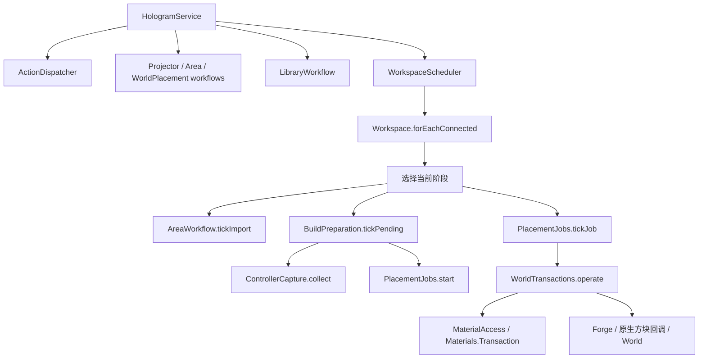

# GTMB 服务器引擎模块

本文描述 0.1.4 的内部职责和依赖。社区集成契约见 [API.md](API.md)。这里的包内类、字段和方法不是第三方兼容接口；客户端请求也不能携带这些对象。

## 入口、状态与生命周期

`HologramService` 是旧网络、物品和库接口的兼容 facade：保留原有外部方法签名，将请求交给实际负责的模块。它没有 Session 表、作者流水线、规划器、存档实现或世界事务，也没有供其他模块回调的一组私有 helper。

`HologramWorkspace` 独占会话创建、激活、查询和断线移除，维护每个玩家的区域上下文。`HologramSession` 保存同一服务端工作区的可变状态；`HologramEditState` 只记录可撤销的规划快照，不记录世界或背包。二者均为包内类型，没有继承一个 Service 基类，也不通过公共 API 返回。

Workspace 的 `forEachConnected` 负责连接生命周期，Scheduler 只为有效连接选择下一阶段。原先的 tick 主循环已拆为区域导入、采集续批和施工任务三个实际实现，调度器不内嵌这些业务。



## 职责表

以下类均位于 `com.miaokatze.gtmb.hologram`，省略共同的 `Hologram` 前缀。

| 模块 | 所有职责 | 边界 |
| --- | --- | --- |
| `Service` | 旧协议入口委托 | 保留外部签名，不实现引擎业务 |
| `Workspace` | Session 生命周期、区域上下文、出站端口组合 | 运行工作流通过 create/find/activate 操作会话，不能访问其私有 Session 表 |
| `Session` / `SessionKeys` | 包内工作区状态、状态复位、原存档键 | 不暴露给社区 API，不改变既有 NBT 键 |
| `WorkspaceScheduler` | 选择区域、采集或施工的 tick 阶段 | 不负责区域遍历、采集实现和材料付款 |
| `ActionDispatcher` | session/请求序列、限流、配置和操作分发 | NBT 是请求；授权仍由服务端身份、策略与事务重新验证 |
| `ProjectorWorkflow` | 打开、取消、设置与工作区 UI 意图 | 使用 Workspace 生命周期和各领域入口 |
| `AreaWorkflow` | 选区、导入、切换成员结构、同步区域编辑 | 导入续批在 tickImport 中执行，不进入施工事务 |
| `AreaDeclarations` | 区域成员声明视图及共享格归属 | 不依赖区域交互工作流，不执行世界修改 |
| `WorldPlacementWorkflow` | 虚拟蓝图移动、旋转、锁定与位置确认 | 只修改规划；已放置原生控制器的对齐由事务实现 |
| `BlueprintEditor` / `EditState` | 单元编辑、几何、剪贴板、撤销重做 | 更改作者数据，不支付材料、不修改实际世界 |
| `AuthoringWorkflow` | 作者选择、六阶段处理、来源切换与保存审阅 | 使用现有纯处理模块与库提交边界 |
| `AuthoringQueries` | 处理来源、AE 问题和 NBT 选择的投影 | 可维护工作区的延迟计算结果，不调度作者操作、不修改世界 |
| `BlueprintProjection` | 实际规划到独立蓝图的投影、虚拟蓝图载入 | 统一作者/预设所用的投影规则，保存原身份与 schema 校验 |
| `BlueprintData` | 深拷贝、来源描述、结构配置和成员值对象 | 不调用 UI 或世界事务 |
| `BuildPreparation` | 重新采集、校准、确认计划、网络分组准备、完成后开始任务 | 协调作者准备与 capture → job 转移，采集器和任务不反向启动上层流程 |
| `ControllerCapture` | 采集数据、预算、声明解释失效和校准数据 | 使用 HologramCapture/StructureSources，不调用上层 Workflow |
| `CellPolicy` | 目标、候选交集、原生 payload 投影、舱口与朝向 | 读取世界和声明，维护解释缓存，不运行逐格施工 |
| `PlanPolicy` | 差分分类、遮挡/归属/预期现场与整体施工前置 | 使用 CellPolicy 和会话作用域，不回调 Workflow |
| `ResourcePlanner` | 差分计划、资源/朝向分配、整机预设 | 只规划，不运行 Forge 施工事件或世界事务 |
| `MaterialAccess` / `MaterialSources` | 材料查询、库存快照与 StructureLib 物品源适配 | 保留原材料上下文和模拟规则；权威付款由事务流程持有 |
| `PlacementJobs` | 开始、推进、统计有界施工任务 | 每格调用 WorldTransactions；不回调作者或定位工作流 |
| `WorldTransactions` | 逐格世界修改、事件、原生 placement、材料支付/回滚、障碍清理 | 保留预期现场、权限、物理资源和回滚检查的单一实现 |
| `DraftPersistence` | 工具设置、world-owned draft 存取与兼容恢复 | 通过现有 DraftStorage/Presets 存储组件，不分发用户操作 |
| `PresetWorkflow` | 预设保存/选择/载入及编辑入口 | 投影交给 BlueprintProjection，审阅和库提交交给各自领域 |
| `LibraryWorkflow` | owner/session/revision 绑定的传输、接收与保存回执 | 继续使用 LibraryFacade/Service 与原子 artifact 写入协议 |
| `Snapshots` / `SnapshotSink` | 客户端快照构造和单向输送 | 读取明确的查询接口，不能用快照授予施工权限 |
| `Values` | 坐标键、材料相等和小型值变换 | 无会话注册、磁盘、网络或世界事务 |

## 依赖方向

引擎使用显式模块调用，禁止静态导入一个 Service helper 集合。主要底层链条如下：

```text
Values
  ↑ SessionPolicy / BlueprintData / MaterialAccess / Workspace
  ↑ AreaDeclarations / CellPolicy
  ↑ PlanPolicy / DraftPersistence
  ↑ ResourcePlanner / ControllerCapture / BlueprintProjection
  ↑ WorldTransactions / AuthoringQueries
  ↑ PlacementJobs / Snapshots
  ↑ BuildPreparation / 领域 Workflows / Dispatcher
  ↑ Service / Scheduler
```

这是职责依赖说明，不要求同层对象彼此完全隔离。事务在修改现场后可以重新计算差分；任务在一批结束后可以发送快照；上层作者、预设和库工作流可以通过明确的方法完成交接。规划、单元策略、材料访问、数据采集和逐格事务没有反向调用上层 Workflow 或 Dispatcher。

原有 `aeReady` 包含自动分组、去标识和规划更新等有副作用的准备步骤，因此归属上层 BuildPreparation，不作为纯查询放入 AuthoringQueries。实际作者数据更新由 AuthoringWorkflow.ensureNetworkGroups/deidentifyNetworkDraft 实现；这一协作发生在上层准备阶段，不从低层 job、planner 或 transaction 回调作者工作流。

输入与输出采用明确边界：

- 请求通过现有网络/物品 facade 进入 Dispatcher 或领域入口，Workspace 与 SessionPolicy 验证当前玩家、工具、会话、维度和位置。
- 结构来源通过 `StructureSources`，声明通过 `Declarations`，物理数据与材料通过现有原生适配器及 `HologramMaterials.Context/Transaction`，不引入第二套放置授权。
- Snapshot 构造与网络发送之间是 `HologramSnapshotSink`；Workspace 在组合处将其连接到原 `HologramNetwork.sendState`，快照模块不直接依赖网络实现。
- 文件持久化继续通过既有 DraftStorage、Presets、LibraryFacade/Service 和 BlueprintArtifact 原子写入契约；Session 类型不进入存档格式。

## 关键执行路径

**采集和续批。** BuildPreparation 请求 ControllerCapture.collect；HologramCapture 固定一次采集的 definition 图及 piece/trigger。续批只继续同一图。采集器更新声明、候选和规划数据；需要施工时，由 BuildPreparation 在完整采集后转入 PlacementJobs。改变来源或需要重取完整外观时重新扫描。

**编辑和作者处理。** Dispatcher 将编辑交给 BlueprintEditor，将处理选择交给 AuthoringWorkflow。BlueprintProjection 产生独立来源，现有 BlueprintProcessing 执行身份、量子、坐标、NBT 和提示规则，公共只读 processor 在完成后检查并产生报告。来源切换、保存审阅和最终库回执各有独立领域入口，原始作者数据不会因取消或拒绝而被改写。

**施工。** BuildPreparation 校验确认 revision 和现场，ResourcePlanner 计算资源与差分，PlacementJobs 按预算推进，WorldTransactions 对每格重新核验并执行原来的支付、事件、原生放置与补偿路径。原生 serializer、物理库存、恢复物品和量子网络规则仍使用原有专门模块。移动 facade 或方法位置不会让客户端 cell 成为世界写入授权。

**快照。** Snapshots 调用单元、规划、作者和持久化查询模块构造与旧协议兼容的 NBT，然后通过 Sink 单向发送。它没有任意执行世界操作的输出接口，公共 BlueprintSnapshots 也只收到独立数据。

## 兼容与验证

原外部 Service 方法、网络操作名、Session UUID/序列语义、工具标识、NBT 键、蓝图 schema 和存储/事务规则保持兼容。包内 Session/方法所属类属于实现细节；原生 smoke 和回归的私有反射已迁移到实际 owner。动态名称诊断只使用包内 EngineInspection，运行工作流不调用这一诊断工具，也没有为测试保留一批 Service 私有转发 stub。

验证应同时覆盖完整回归与实际引擎路径：本版 105 个回归用例、动态 definition 原生跨批、剪切双 JVM 持久化/恢复及原生蓝图/材料/放置 smoke。原生 GT/StructureLib 代表 fixture 不等于安装了 GTNL 原模组。每次结果必须绑定实际候选源码、class 字节、启动参数和日志；重构前的 PASS 不作为重构后候选的测试结果。

## 工作预算、增量与进度（0.1.5）

`WorkspaceScheduler` 在在线会话之间轮转，共用每 tick 10 ms 的协作预算；单次区域扫描、采集与施工切片至多申请 5 ms。`ServerTaskScheduler` 每 tick 最多执行 64 项或 5 ms，FIFO 余项留到下一 tick。原生单次回调、剪切事务、完整快照和编码不能被这些检查点强制抢占，不能据此承诺硬实时上限。

持续运行的施工由 `JobPublication` 发布单元索引与结果增量，不逐批重建全部 cells。客户端 `JobVisuals` 按会话、revision、审阅 nonce、批次和发布序列合并只读显示；它不能发行施工凭据。初始、终态和明确 UI 请求仍可获得完整快照。采集与导入使用轻量进度包，传输、解码、JSON/PNG 和本地提交进度由客户端实际阶段驱动。

普通动作、确认回执、剪切和库请求分别限制尚未完成请求的容量，处理结束后才释放名额，超量请求返回有界 busy 回执；它表示该请求没有入队，不能冒充旧操作的最终拒绝。私有保存遇到不确定回执时保留本地文件对，并通过原有取消/结果协议核实真实终态。网络 ingress 有界不等于所有第三方调用的通用任务队列都有硬容量上限。

库工作线程向主线程转交的五种回调另有每玩家 2 项、全局 16 项 pending 名额，执行结束才释放，避免前级队列已经出队而后级积压。生命周期清理使旧名额失效，旧回调不能释放新一轮的容量；拒绝保存回调只通过原有来源守卫终止未提交结果。

`HologramRuntimeMetrics` 默认关闭，提供独立 NBT 计数快照：GTMB codec 收发字节、快照构造/压缩耗时、队列与增量统计。字节不含 Forge/TCP 开销，耗时不是 TPS；详情及配置开启的独立测试设施见 [TESTLAB.md](TESTLAB.md)。这些 common-side 模块不导入客户端 GUI 或渲染类型。

## 客户端工作台的组合边界

`HologramScreen` 只适配 Minecraft 的 GuiScreen 生命周期、输入和父子界面返回，并保留既有包内 smoke 入口的薄转发。工作台通过组合装配 `HologramUi*` 模块；没有继承另一份大 Screen，也不静态导入 Screen 的内部状态。`HologramUiModules` 仅保存固定的模块引用，不承担原来的大量窗口布尔量、输入框和业务数据。

| 模块 | 所属状态与职责 |
| --- | --- |
| Session、Ticket | 当前快照、请求序号、等待状态及统一网络信封；Ticket 绑定 session，旧会话或较早 ACK 不能完成当前请求 |
| Router、InputChain | 原有绘制层次、模态输入优先级和生命周期协调；可见模态即使点击空白或禁用控件也消费输入 |
| Canvas | 缩放、局部坐标、控件命中、皮肤、物品图标与提示绘制 |
| Memory | 按会话恢复选区、标签页、草稿名称和引导记忆 |
| Preview | 摄像机、选区、框选、空格定位、轴拖动、背包拖放和编辑队列 |
| Configuration、Position、Shortcuts | 控制器参数、通道与候选仓室、等级预设、材料来源、坐标输入和快捷键设置 |
| Library | 本地/公共库、目录导航令牌、管理员设置、未保存切换、覆盖与删除确认、保存 ACK |
| Processing、NbtEditor、Deidentification | 作者处理流程与处理预设、分作用域 NBT 编辑、去标识选择及各自确认/ACK 状态 |
| BuildReview | 放置 revision、材料/资源与缓存报价审阅、施工范围及建造确认 |
| AeReview、NetworkBindings | AE 有界问题报告、跨结构导航、容器预览往返，以及量子分组绑定与真实 ACK 导航 |
| Annotations | 提示文字、悬浮标记、固定说明和版本面板 |
| Diagnostics | 保留原生 smoke 场景和断言，按真实 owner 定位已迁移的私有字段/方法；不是公共扩展接口 |

每个功能域保存自己的私有界面状态，并处理自己的控件动作、焦点、滚轮和 ACK。初始化输入框、游标更新、加工/NBT revision 参数、基础配置确认和选择请求记录也归对应领域。Router 保留原数字 ID 的分发顺序及原 Z 序，Session 的快照更新只按既定顺序协调领域 transition；不把原来的大 activate 或 updateState 原样隐藏在一个新协调类里。模块间的读取与动作接口限制在客户端包内，不将可变 `HologramState`、选区或控件对象加入公共 GTMB API。

原有服务端协议、session/UI sequence、确认 revision、图标坐标、按钮 ID 与窗口交互保持兼容。采集中的忙碌覆盖层、作者确认、NBT、AE 与量子绑定模态继续先于背景工作台处理输入；普通蓝图与专属剪切控制器仍是独立工作流。界面数据与显示快照不构成世界写入授权，实际修改继续由原服务端入口校验和执行。

## 客户端重构的验证边界

`HologramUiModuleRegression` 检查实际用于工作台的模态消费链，以及跨 session/旧序号/重置后的请求 Ticket。既有布局、选择、摄像机、快捷键、处理流程、记忆、放置上下文和引导回归仍须运行；这些模型断言不能替代 screen wiring 的原生验证。

原 `HologramClientSmoke` 的全部基础和扩展场景保留。PNG 捕获先在 ClientTick 请求，再等同一 Screen 的后续 `RenderTick.END`，要求 frame serial 和渲染 generation 均增加。客户端目录的 `hologram-render-frames.nbt` 逐帧记录 PNG 名称、SHA-256、字节数、尺寸、场景、缩放、请求/实际帧序号和 generation；最终写入 completed/passed。该账本明确标记 `actualNetty=false`、`sourceKind=server-snapshot-fixture`，只能证明实际原生绘制及 fixture 界面断言，不能冒称真实服务端交互通过。

真实网络交互仍由原 Interaction/AeInteraction 与 GuidanceNative 驱动验证，包括材料和施工确认、父子界面往返、框选忙碌层、来源切换和量子绑定 ACK。私有反射迁移到 Diagnostics 的真实 owner，不删除原断言，也不向运行时 Screen 增加一批私有转发桩。最终验收应绑定本轮候选重新运行完整回归、GUI END 截图和真实网络交互；各原始失败、运行日志与截图证据保留其实际归属。

## 本地预览与可信施工内容

`HologramLocalPlacement` 和蓝图库独立 browse display 只拥有显示数据，不替换服务端工作区、revision 或施工能力。源数据保持不变；24 种正交姿态、锚点、锁定与方向键微调在客户端维护。普通浏览只读取显示所需 JSON 或视觉 DTO，不打包、核验 PNG 配对、计算语义哈希或准备材料。首次显示沿用已有时间预算，去掉两遍 256 格/tick 的固定节流；完成的 state、cells 和 regions 按稳定文件身份或公库版本复用。显示缓存有界，超过常规额度的大图仅保留最近一个；文件实际变化、断线或更换玩家清退对应内容。原 Renderer 的分组、距离和视锥裁剪继续生效，完整下载沿独立原件路径进行。

原预览区域可以先显示异步解码的有界 PNG，占位延迟 200 ms，小图不强制等待占位。首批 state 使用独立的 cells/regions 容器，后续补齐不会修改已发布前缀；相机仅在实际更换来源时重置。普通浏览的原生 mesh 按自然帧时间预算渐进准备；只读蓝图库可见时暂停背后的 GTMB 世界 mesh 绘制，避免共用原生快照每帧切换而反复清空准备游标，离开后沿原路径恢复。数据完整后解除相关操作门禁，不等待全部 GL mesh，原 footer 继续展示绘制进度。读盘、解析、数据准备、绘制分别报告真实计数或未知总量及耗时，首批可见不冒充任务全部完成。作者差分和保存截图保持原完整渲染路径；单个原生材质提供者与最终投影排序仍可能超过单帧软预算。

库内点击原有放置按钮时才懒算并缓存 `HologramBlueprintContentHash`，先发送仅含内容身份和任务栅栏的 probe；原蓝图库 footer 显示准备、上传与校验进度，通过后进入世界预览。哈希忽略顶层名称、作者等描述字段，保留 NBT、保留选项和施工配置。服务端先查当前玩家的可信缓存，再查已发布库的内容索引；命中不构建 artifact、不计算传输摘要、不上传，双 miss 才读取完整配对、打包上传并执行 canonical admission。传输摘要仍单独检查实际收到的 artifact。内容哈希不是客户端提供的授权，也不能跳过新原文的首次审核。集成集合的原始内容身份与服务端规范模板按源代次绑定，避免默认字段差异或外部文件变化造成显示与实际内容错配。

`HologramTrustedBlueprintCache` 按连接、存档生命周期与策略版本隔离，保存独立模板副本。每玩家最多 10 条、100,000,000 字节紧凑 JSON，全服最多 32 条、512 MiB 展开内容计量配额；条目按 LRU 淘汰，权重是保守记账而非实际堆测量。本服保存的服务端原件在最终保存回执通过后直接成为可信条目。切维度保留内容，断线及运行重置清退；活动施工的锚点与确认能力另行约束。

`HologramBlueprintCompactCodec` 用方块描述字典和完整 NBT 内容池进行无损去重，逐格坐标引用字典；原始 JSON 蓝图继续可读，展开后的语义哈希一致。写入过程不先构建整份冗余 JSON；读取在复制前核对字典引用、行数和展开总量上限，避免小文件放大内存占用。公开蓝图库保留 64 MiB 磁盘总量限制，并另设 512 MiB 展开 DTO 计量上限。传输层原有分片与 GZIP 继续独立生效。

锁定后再次右键只请求原有 `openPlacementReview`，打开既有 `HologramMaterialConfirmationDialog`；不先核算一份客户端账单，也不自动执行建设。需求、库存、AE、抵用券、进度与最终确认沿用原 `ResourcePlanner`、`MaterialQuote`、`BuildReview` 和窗口，不另建材料 UI。最终姿态与位置经过服务器原有门禁；材料报价、当前放置者 UUID/名称、权限、区块与逐格事务继续使用服务端真实状态。显示缓存和哈希命中不授予扣款或世界写入能力，保存、导出及升级仍走既有存储和回执流程。

## 旧文件升级与单人传输

`HologramBlueprintFiles` 将稳定逻辑 ID、旧导入别名与可读文件名分开管理。独立 JSON/PNG 使用蓝图名与完整语义哈希命名；有界本地索引仅负责路径映射，不授予作者或施工权限。无索引的有效复制文件可以登记，原有 UUID 名称与分享别名继续可读。`HologramBlueprintCompactCodec.recompress` 直接转换原始 JSON，保留未知字段和 NBT 文本；升级不执行作者处理或游戏对象校验。

迁移先写入并回读新配对，再接入 `PairWrite` 与原子索引；逻辑提交成功后才清理旧文件。失败保留原件，已提交后的清理失败单列警告。集合重压缩与既有存储写入共用监视器并核对原文，避免覆盖较新的保存。批量升级按条目报告实际进度并检查取消；服务器公库升级仅限管理员，报告分页发送。

每个新的后台任务在取得 owner 时初始化活动时钟，读盘阶段与随后的内容准入各有自己的等待预算；重复进入同一任务和迟到回执不能续期。单人集成服开放私有内容分片与导入，继续核对当前玩家、投影仪、世界、session 和 revision；公库发布及管理仍受独立权限约束。
