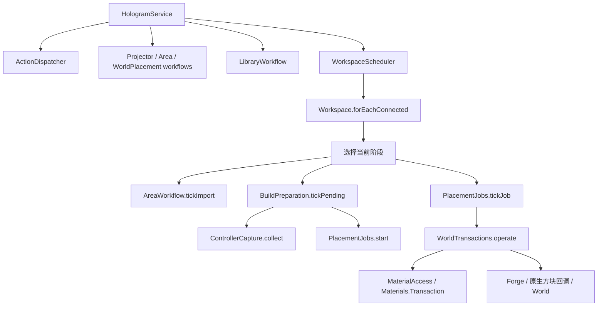

# 2026-10-29 预览生命周期和成品工作流候选

本轮基于已合并的83828a3，响应真人反馈：区域反复退役、旋转缩放时清空呈现、成品选择/保存/放置断链。下述为源码候选，**完整编译、check及游戏验收尚未执行**；当前云端缺少旧工具链缓存且官方下载受阻，不能套用历史PASS。

- Core0.1.27源码/API不变。GUI继续复用Core相机数学；世界切层与GUI区域缓存是不同owner。相机变换不再撤销已解析外观或重启准备FIFO，当前屏幕坐标仍重算，拾取绑定实际呈现帧。此CPU变换仍为O(保留顶点数)，不是FPS保证。
- model-only发布按真实输入坐标和稳定读者ID失效。同区无关READY/原生缓存/DATA续作保留；真正源/拓扑/未知读取仍保守处理。exact索引有界，容量不足采用持久coarse依赖，避免每批清图重学；查询工作耗尽保守保留，不能据此当成功READY。
- 原生描述行预算改为按最大堆自适应并可配置，见[预览内存](README/preview-memory.md)。临时输入树Core租约、最终驻留行、依赖索引和GL/TE并非同一本账。作者与完整预览单NBT对齐既有8MiB压缩/8MiB展开/16MiBtracker边界，保留完整预览64MiB累计上限和结构保护。
- 成品来源与恢复草稿分开；异步打开成功才提交选择，改稿后不能偷偷放旧文件。正式Save复用现有服务端处理/coverage/JSON+PNG回执；未改成品的相机PNG更新仍真实执行。源指纹、稳定工具ID、任务/会话、取消与ACK后本地变更独立核对，已提交后的本地异常进入终态，不能反复取消。
- 已保存审阅内容通过可撤销事务合并，不清空编辑历史；未知JSON扩展若现有typed正式保存不能无损承接，则上传/覆盖前明确拒绝，恢复稿和独立候选继续保真。该保护不是宣称正式服务器通道已具备任意未知扩展能力。
- 新候选清除历史coverage描述，正式保存由原服务端算法重算；库绶带不授权实际支付。旧实体券及世界材料/权限/事务规则不变。

两轮独立静态审查包含修正后回读；语法解析、标量预算测试的有限证据不代表编译或实际UI通过。普通蓝图与raw-cut的原生GL隔离仍有不同实现，本轮未盲目迁移整个渲染器。原始测试失败、预览成本、未知扩展拒绝与跨进程文件竞态边界应在新PR和测试清单中保留。

---

# 2026-10-29 静态实体材质与已呈现外壳

此轮针对精确395e6af6外部S3失败继续修复；旧本机30秒未完成结论保留，不用组件PASS覆盖。0.1.48之后的粗预览提前返回会保留内部格线框且只取普通getIcon，因此先恢复可证明的静态材质，再减少已呈现实体内部绘制。未取消分帧预算或原生/服务端校验。

- LightPreview只对既有精确vanilla普通立方体和审计过的GT BlockCasings5（coil）取完整静态材质。复用GT纹理层与tint遍历；任何未知层、缺失材质、pending/NBT/外部adapter均不能借用完整材质或新的GT遮挡证明。不能将它推广为所有IBlockWithTextures、机器或Chisel的完整静态替代；Chisel CTM原生路径保留。GT旧/新coil配置按既有场景/资源释放边界重新取样，不能宣称动态配置无条件即时刷新。
- 保留完整source/pick/outline记录和原细化/原生就绪计数，只改变实际提交的粗预览面与边。自身区域及跨边界邻区必须已经在当前相机完成提示投影，才采用已审计的不透明外壳mask；无关区域补算不再全局取消这个证明。未知/透明/部分形状保持保守，移动恢复完整表示，选中/关联项保留完整轮廓。边界缺失、切层、相机与补算后重新验证，不拿未呈现邻居遮挡本格。
- 区域批量移除由逐项ArrayList搬移改为稳定一次压缩；保留原顺序、unresolved/budget及deferred计数。
- 未新增GL缓存或扩大预算；修复不以减少逻辑源数据、伪造完成率或绕过点击就绪为代价。绘制负担降低的生产路径组件计数不等于真实FPS、完整UV/CTM或3–4秒达标。

诊断沿用releaseEpoch窗口，新增六个粗阶段：drawDemands、drawFacesAndHit、drawNativePlayback、drawLinked、drawOutlines、drawOverlay各自Nanos/Calls。它们是渲染线程墙钟，包含可能的驱动等待，不是GPU时间。drawFacesVisited、drawQuads、drawNativeCalls、drawLinkedDrawCalls为工作调用计数；drawOutlineLineVertices只统计体素线框，排除结构/提示框。drawLinkedCalls是阶段次数，不能与drawLinkedDrawCalls混用。drawSmokeActive/drawSmokeFrames记录实际光栅探针启用情况。读诊断只生成固定大小标量，不遍历蓝图。

新测试覆盖真实GT纹理容器的层/色、metadata及actual/target/protected/anchor边界、相机/视口/跨区已呈现证明、真实native repair接线、30³实体外壳计数、稳定压缩与计时窗口。测试纹理/相机存在控制夹具，未在云端启动真实游戏；实际截图与小图/大图加载对照由本机执行。最终精确commit/tree、命令、退出码与产物SHA以本轮PR回执为准。

---

# 2026年10月29日 S3 实测反馈后的持续推进修复

本轮承接 PR #67 的 `b2e22399`，保留用户加入的 governor 独立 JVM 测试。实机反馈属于其父提交 `2a5b0a82`：S3 为 48,003 格、41 区，30 秒仍缺 1 区、36 区未完成。下述机制修复与组件回归不能代替新候选的实机验收。

- 模型就绪不再把已经完成的 cheap 阶段重新放回优先队列。作者 model-only 补丁保留原始细化游标，以稳定槽位读取当前不可变 Cell，对已访问的受影响项去重补算。补算与首次细化轮换；源编辑、拓扑改变仍走保守失效。原生依赖仍按已有区域级证据保守处理，不凭无证据的逐格推断保留 GL 模型。
- 同一个原生访问对象的就绪通知按实际消费者修复。GUI 投影使用稳定源区域键调度，不把会随深度变化的呈现排序当工作顺序。同一相机下，每区以槽位 FIFO 和已投影集合保留未受影响的输出；补算只移除旧项并排到队尾。相机变化完整重投影。记录集合受当前输出/源格数约束，不新增 NBT 副本，但确有额外的槽位索引内存，不据此声称整包峰值下降。
- 原生 BlockAccess 仅在同一作者、直接后继、model-only、无拓扑变化且安全调用边界内保留未受影响的 DATA/READY 对象与续行。受影响区域及其传递 tile 读者仍清退，命中活动根/栈则取消该续行。源、网络、拓扑等其他切换保留原有完整退役；没有新增可重入发布或跨系统事务承诺。
- 每个投影单元只解析一次原生就绪与材质，并给轮廓和各面共享本次结果。负结果不跨重投影缓存；保留空格、实际侧、anchor/protected、部分形状及选择语义。
- 文字组件放置先检查当前呈现、相机和点击处的区域就绪，再处理 gizmo、邻格或空平面。阻塞不能被空平面兜底绕过；邻格选中最大深度的命中面，而非最后遍历的面。未完成但不覆盖点击处的区域不全局禁用放置。
- `previewWorkInspection` 新增 releaseEpoch 和累计发布、唤醒、cheap/detail 工作次数及游标丢弃计数。它们是工作事件，不是独立格数或原生成功数。只能在相同 releaseEpoch 内结合外部单调时钟比较阶段耗时与帧次数；快照身份变化本身不等于全局重置。

保留原 2ms 协作式准备期限、32MiB 行账本及其他准入限制。单个外部回调、区域过滤、全局列表聚合及实际绘制并非硬实时预算，仍需实测；不宣称 3–4 秒、复杂装饰或全视口正确已通过。

---

# 2026-10-29 PR #67：全区域准备与装饰数据准入

基线 `3e3e0e2` 的本地三样本完整区域验收为 FAIL：S3 / S4 / S5 在 90 秒终点分别缺少 29/41、15/107、48/231 个源区域。下列修改是对此基线的增量；旧组件 PASS、已缓存子集 pending=0 和宿主材质名单均不能证明完整原生视口正确。

- **事实与几何分离。** 精确匹配 block / ItemBlock / metadata、无 tile 与 item payload、无 TE 的静态来源直接生成独立 actual/target 栈事实，不再用 render type、normal-cube 或 adapter 支持与否决定是否需要解码。机器、未知物品/身份不匹配与任何非空编码 payload 仍沿原边界。事实就绪不新增几何能力、不覆盖外部 adapter，也不把未知形状认证为普通立方体。
- **按保留对象计费。** 原生行按最终 owned 行、共享 display / serialized stack 与两份独立 ItemStack tag、可变长度字段/成员等估算，替代原始输入统一乘四。可信 display/nativeTile 与 stack/tag 包装单独计入，不挤占合法源 NBT 的既有深度限额。32 MiB、codec 限制、已知成本在重解码前检查和有限驱逐保持不变。固定结构余量是估价，不是实测堆；临时解码、源文档、旧快照、原生 tile / GL 仍不属于此账本，不据此宣称 S4 全部能容纳。
- **全源廉价阶段优先。** 源区域的 cheap FIFO 与 detail 待办分开，选择为常数时间；期限或最多 1024 格后轮转，保留每区局部游标。全部 cheap 完成必须发布，未缓存区域仍属于分母；所有部分细化任务的 unresolved / budget 都计入进度。廉价覆盖不等于真实原生细节/相机投影完成。单个原生回调和最终投影发布仍不可抢占。
- **依赖按读取内容分类。** block / metadata / presence 读取与 tile 读取使用两个私有图，共享原 65,536 条边上限。纯模型发布不沿静态读取链传递，但仍保留紧邻遮挡 halo；真实源/拓扑变化沿两类依赖失效，溢出仍保守清退。RenderWorld.blockExists 对应的 presence 读取也登记静态依赖。精确选中的内置 Chisel 静态族不预先强求 27 邻居的 opaque 数据，任何实际 tile 读取和外部 adapter 仍保留 unknown / defer 保护，不能把未解 payload 当作已知空 tile。

新增组件回归覆盖密集 41 区、稀疏 4096 区、局部 dirty 风暴、owned 字节账本与 510/511/512 深度、远端 presence/source 编辑及溢出边界。GT 来源事实夹具使用实际 GT 类与物品，但部分 Block 是跳过完整初始化的类壳，不能当作真实 GT 生命周期或 GL 证据。旧细化夹具只调整 cheap-first 前置步骤，原游标/身份/精确计数断言保留；版本回归与基线已有 `RELEASE_VERSION=0.1.56` 对齐，没有改版本凑通过。

最终源码、构建命令、测试计数和普通 JAR SHA-256 以本轮 PR 回执为准。云端未运行游戏；本地先 S3、30 秒有界终点，失败即停止该候选长测，再按实际结果决定 S4/S5。需独立核对完整 source / camera-visible region、实际模型形状/UV/纹理、点击与相机变化；不宣称 3–4 秒目标、完整 UI 或无泄漏已验收。

---

# 2026-10-28 PR #66 本机反馈后的定向修复

反馈候选 `5cba71b` 的本机报告确认：未编辑名称的恢复保存会改成默认名；五样本来源/粗几何就绪为 0.714–1.238 秒，但完整原生视口和几何点选仍未验收。五次约 3 秒至 4 秒的未解数均减少 80，与 UI tick 每次最多 4 项的源码限流相符；这不是全部耗时的归因，也不是新候选的性能成绩。

- 本地名称元数据、保存输入、撤销/重做和 UI 记忆使用同一正式名称。空输入不隐式改名，明确改名才规范化；已有长名称与记忆中的长输入都不能被旧 240 字符框截断。旧服务端 UI 的长度规则不变。
- 模型准备取消固定 4 项上限，保留约 2ms 协作式准入期限与当前队列批次上限 512。单次原生回调、批次发布、区域/依赖失效不可抢占，不承诺整个 tick 或帧小于 2ms；发布还可能包含被驱逐的行及依赖区域。
- 本地完成的私有行转交既有 owned Cell 路径，避免重复复制原始行与显示 NBT。普通外部行构造仍防御复制；导出的 NBT、actual/target ItemStack、不同格与原始文档保持可变边界隔离。不共享位置相关的 TileEntity 或原生几何。
- 队列满而漏掉的邻域需求，通过本地可见读者的有界轮转重新检查：最多 16 个邻域，约 250µs 并受当前帧期限约束；一个邻域查询仍不可抢占。未知邻域不能作为已知空 tile 缓存。
- 预算占位仍是未完成数据。可见读者可重新提出隐藏层邻域需求，复用原 512 项队列；已知预算需要先检查容量再解码，失败继续保留，任何尝试都计入期限。自动预算恢复仍最多 8 项，并考虑可见依赖；依赖图溢出时，明确需求也不能永久失去恢复机会。未提高原 32MiB 计费预算。仅在已知单项需求不超过总预算且有可用容量时恢复；超过总预算的项保持显式预算占位，不承诺自动恢复。
- 材质去重索引保留既有字符串键的比较语义，以 LRU 限为 2048 项及 2MiB UTF-16 键字符计费；超大键不缓存。仍被活动格使用的材质不会因索引驱逐而失效。此上限不包括活动材质、键构造临时量、原生 tile 或 GL 内存。旧 NBT 字符串化并非完整 NBT 内容身份，未把新缓存包装成新的规范化协议。

新增定向回归覆盖名称/保存组件、截止时间/数量边界、私有行隔离、饱和及预算邻域恢复、材质索引计费与 owner 切换。名称夹具组合真实字段/命令、受控 worker 派发/完成和实际序列化/磁盘回读，不是实际异步 worker、FML/GL 界面或游戏重开验收。构建结果与最终源码/JAR 身份以 PR 当轮回执为准，不套用下方历史 PASS。

后续实机复测必须分别记录 source、coarse、完整固定视口原生完成、真实几何点选时间及帧间隔。普通窗口关闭按设计保留活动文档，判断旧文档泄漏需以替换/放弃和可比阶段作对照。旧报告整轮 RSS 约 8.58GiB 不能直接归因为 Java 活堆或泄漏。当前工作未宣称 3–4 秒目标通过。

# 2026-10-28 发布前复核的修正与后续边界

两轮独立审查后的实现补充：

- 附件任务的原生预检从构造前就进入执行边界；需要旧扩展时复用同一个附件引擎，在私有编辑器/owner续行中准备增量，客户端在原版本仍有效时一次提交。
- 旧Gson的strict开关不足以拒绝原始控制字符、非法转义及混合大小写字面量；作者入口加入常量状态的流式词法保护，不再解析第二份整稿，也不改变既有数字语义。
- 复制关系按原点/数值位移建索引，避免每个宿主线性扫描所有副本；跨维度的原生hub先判定外部关系，不查询无关本地副本。未知空间字段仍保守拒绝。
- 结构行复制复用容器复制与不可变标量；compact准入复用正则，计量Writer直接计数字符/字符串，保留Gson转义和原预算公式。
- 审核传输按实际大小及协商速率分阶段预算，保留2分钟计算和30分钟总上限；结果大小就绪后重新准入，轮询不是进度。不能保证未知后续带宽争用下必然完成。
- 历史公共库启动不再在IO线程调用旧原生扩展：内置路径仍是带粘性保护的IO快速路径，外部路径一次只保留一个待准入DTO，heartbeat按128工作量/约2ms协作推进原生验证与sanitation，纯数据和最终索引发布留给单IO worker。停止/重启/注册代次变化不会发布旧结果；原文件不因失败被删除。单次第三方回调、header验证及schema1完整验证仍不可抢占，不宣称硬实时。

仍值得后续独立优化：格式适配与编辑核心的依赖方向；registry不可变快照与安全适用性元数据；typed intent/configuration计划减少分散字符串派发；最终客户端大增量准备的协作处理；稀疏ID页的空间利用率；完整原生编译的分阶段数据复用。这些不是本轮已完成性能承诺，也不能以抽象化为由放松原始NBT、权限或事务边界。

---

# 2026-10-28 增量修复 外部回调与来源坐标

基线为已合并 PR #64（776159f），外测反馈 PR #65 是报告与复现工具，不是产品修复。本节描述后续增量；下方旧版本记录保留，旧 PASS 不自动适用于新提交。

- 作者文档现在持久保存真实采集 session 的维度与世界原点，独立于每格局部 payload origin；交接、草稿、历史及原生处理/旋转/编译使用同一来源框架。无法恢复来源的旧 raw 链接保留原稿并明确拒绝，不猜当前玩家位置。详见 AUTHOR_SOURCE_PROVENANCE.md。
- 作者来源采用一次严格流式 JSON 读取、受控 compact 展开和内部所有权转移；外部 JsonObject 接口仍防御性复制。重复字段不再在第一次 DOM 解析中悄悄丢失；数值语义与既有 Gson 兼容（不是逐字符 JSON 格式保真）。
- NativePlacement、ResourceContainers 和 StructureSources 的旧注册保持默认执行边界，客户端安全能力需要显式 opt-in；在 supports/decode/describe 前检查，不能探测后再判断或静默绕过第三方覆盖。公开同步调用接口不擅自改线程。
- 合成结构声明不触发真实 CAPTURE_COMPLETE；本地处理不借旧 AUTHORING_COMPLETE 生成服务端凭据。最终发布/私有激活刷新不可信报告，确认续接只复用服务端持有的精确已审核来源，避免重复回调。
- 显式兼容审核绑定原文档、版本、任务、哈希、连接、世界和工具；选中格查询只携带所需记录和引用结构。结构再生、选中配置及显式文字/图片附加对象回退复用原生引擎，在 owner tick 上分段推进并返回原子增量。普通文档编辑不恢复成远程作者 Session；不伪造 ACK、触碰世界或消费资产。
- 没有外部扩展时，原有库规范化仍留在 IO，最终回执清理不重复扫描全稿；注册变化由粘性边界阻止越线程调用。任意第三方单次回调不可抢占，显式完整处理/编译兼容路径也不是已证明的恒定 tick 延迟。
- 分段快照先扫描有界页头，保护本帧未来引用；空间不足的完整页采用当前帧私有所有权，不提高缓存容量。编码端超过热集的顺序扫描污染另列优化事项。

API.md 列出仍未镜像的第三方原生操作边界；新增协议与组件回归不代替实际整合包、UI、GL、材料及施工验收。MatterManipulator 的进一步借鉴方向是语义工作集缩小、稳定描述共享和意图通信，不是继续添加全量缓存或取消权威检查。

---

# 2026-10-28：客户端作者文档重构（当前分支）

## 大图片来源兼容补充（2026-10-28）

作者结构字符串上限采用既有原生 8 MiB NBT 压缩字节上限的最大 Base64 长度 **11,184,812 字符**，不再误用 compact 内容池的 2 MiB 单项限制去拒绝未入池的 `textBoxNbt`。64 MiB 文档总量、深度及原生 8 MiB 解压／压缩保护均未降低。新增真实 1024×1024 高熵像素图片定义回归：原生编码超过 2 MiB，作者导入／草稿重开保留原编码，原生再次解码、定义校验与逐像素比较通过。

修正后的 `check assemble reobfJar` 在 `27-compat-check.log` **PASS，1m50s**；179/179、12/12、Industrial、ownership、CLIENT／SERVER 隔离及静态 GUI ABI 9/9 均通过，1,994 个 main／mixin／test class 均为 major 52。实机游戏、GL 与完整业务 UI 仍待外部验收。下文 log25 和核心测量保留其各自快照身份，不将其自动套用为其他提交的运行证据。


> 本节说明 `refactor/client-author-document-20261028` 相对 `c249291` 的新作者路径。以下原版本章节全部保留作历史背景；其中“服务端作者会话／快照驱动作者编辑”的表述，不再代表已接入本地文档的新作者路径。服务器规划、真实施工、材料与物理 Cut 的权威边界没有随作者迁移而移交客户端。本文描述实现，不替代实机验收。

## 一份源文档、单向视图、明确跨界

```text
完整源 JSON / gtmb-author-draft / 一次性服务端源交接
  → AuthorDocumentIO（有界语法、结构与来源检查）
  → AuthorDocument + AuthorEditor（本地源真值、原子修改、历史）
  → HologramLocalAuthorRuntime（作者生命周期与既有业务 UI 适配）
  → HologramAuthorProjection → HologramState → 渲染 / 只读 UI

显式保存草稿 → 本地恢复文件（不是可施工证明）
显式处理 + 导出 → PortableCompiler → 原生 PNG + JSON → 未审核候选
显式放置 → 既有私有 contentOnly admission → 服务端核验 / 规划 / 材料 / 世界事务
```

`blueprint.editor` 中的 `AuthorDocument`、`AuthorEditor`、`AuthorDocumentIO`、`AuthorTree` 不依赖 Minecraft、注册表、服务器会话、网络 codec 或原生 NBT 解码器。源 JSON 是唯一可写真值；向调用方返回防御性副本。未修改的未知字段与编码 NBT 字符串保留，不从显示 DTO、快照或渲染缓存反向拼回源数据。结构准入不等于原生兼容、资产、所有权、材料或可移植性审查。

`AuthorDocument` 使用稳定文档／单元 ID、64 格写时复制页及持久位置／分组索引。编辑按事务发布一次或完全不发布；撤销重做恢复内容、选择及来源信息，但发布新的单调 revision，废弃分支的单元 ID 不复用。当前 runtime 使用最多 64 条历史，同时受保守保留源字节预算约束；这不是 JVM 总堆占用上限。普通选中格编辑不应通过完整快照往返；导入、保存、显式全源处理仍可能遍历全稿。

几何位置与原生 payload 的坐标基准不是一回事。文档记录每格 payload origin 和有序 pending obligations；移动／复制后可以先保留原始 payload，由显式原生编译边界兑现坐标、链接、附件与兼容性义务。保存、撤销、再打开不能自行清除这些义务。未知变换语义、歧义链接、不完整原生结构必须保留原稿并明确拒绝，不能以“预览有形状”冒充可安全施工。

## 模块职责与限制

| 模块 | 当前职责 | 不代表什么 |
| --- | --- | --- |
| `HologramLocalAuthorRuntime` | 持有编辑器、选区／剪贴板、处理报告版本、草稿保存状态及可丢弃投影；窗口关闭重开不把源所有权交给窗口 | 不是服务端 Session，也不能凭本地 revision 获得权限 |
| `HologramLocalAuthor*Actions` 与 common-side `HologramLocalAuthor*` | 连接现有注释、NBT、处理、配置、结构、AE、文字／图片等业务能力；需要原生事实的工作仍通过明确适配器执行 | 不是仅保留空壳预览的简化编辑器；也不表示所有业务控件已实机验证 |
| `HologramAuthorProjection` / `HologramDocumentIndex` | 稳定源 ID 与稠密渲染槽位分离，单向增量投影，可见格原生 payload 延迟解码与缓存回收 | 不持有源写权限；失败占位不删原 NBT，也不成为审核通过 |
| `HologramSourceTransfer` | 从实际服务端捕获／规划源，一次性、有界、owner-thread 交接完整作者源；检查玩家、连接、世界、session、revision、任务 token | 不可用显示快照补成“完整源”；不是持续远程作者写循环 |
| `HologramAuthorPortableCompiler` | 冻结源、兑现支持的原生空间义务、按明确策略重新处理、原生验证并产生独立候选 | 不修改活动草稿，不制造作者身份或服务端审核回执 |
| `HologramAuthorSubmission` | 版本／上下文栅栏、owner-thread 原生编译、原生渲染上下文 PNG、受限 IO 与 JSON/PNG 配对 | 当前同步原生编译不是已证明有 tick 预算的导出流水线 |
| `HologramClientLibrary` | 恢复草稿原子替换及回读、候选配对回读；区分本地草稿和审核库条目 | 不把候选自动列为已审核库，不以导出清除源 dirty 状态 |

投影当前常量：待解码队列 512、依赖边 65,536、原生驻留计费预算 32 MiB；每次推进使用约 2 ms 的协作 deadline，并以本次待解码队列长度（最多 512）限制尝试数；不再额外限制每个 UI tick 最多 4 格。延后预算恢复仍每次最多轮转 8 格。单个原生调用及批量发布不可据此宣称可抢占或硬实时，缓存计费也不等于整个客户端内存；确定性调度回归不等于真实整包的模型完成速度验收。源传递当前最多保留 2 个 lease、单份计费上限 64 MiB、每次最多 256 步并检查协作时间预算。整包总内存、FPS、TPS 与五个样本的游戏端到端表现仍须独立测量；已完成的两份真实输入核心测量及源交接回归见本节验证回执。

## 三种文件／准入状态不可混称

1. **恢复草稿**：`MiaoBlueprints/drafts/<UUID>.gtmb-draft.json`，格式 `gtmb-author-draft` v1。保留完整源、稳定身份、payload origin 和未兑现义务；无需 PNG、作者身份证明或服务器。未知草稿版本／字段拒绝而非丢弃。成功落盘与仍在保存、失败、过期版本必须区分。
2. **未审核候选**：显式处理并导出后，`MiaoBlueprints/candidates/unreviewed_<UUID>.json` 与 `.png`。配对哈希／回读一致性只证明文件配对；不证明服务器授权，也不应进入已审核库列表。导出失败或期间源变化，原草稿与义务保留。
3. **服务器 admission／施工**：显式放置将冻结候选交给既有私有 `contentOnly` 内容准入；之后仍由服务器校验内容、身份、世界／工具上下文、材料、权限、预期现场与真实事务。正式审核发布另有工作流。客户端不能制造 ACK 或跳过权威材料／Cut 资产检查。

## UI、传输及兼容边界

本地作者的常规编辑从 UI 进入本地 runtime／actions；`HologramUiSession.send` 在已有本地作者时留有安全栅栏，不为旧控件模拟线协议或服务器 ACK。未取得完整作者源时，界面应明确等待／失败，不能把空报告标成已完成，也不能允许显示快照成为作者真值。已有结构配置、来源选择、处理、NBT、AE、网络分组、注释、文字图片、库保存及世界施工能力都在验收范围，不能仅以主菜单启动通过宣称功能完整。

纯作者阶段的目标是 **零 GTMB 作者业务 RPC、零由这些编辑引起的服务器作者负载**，不是游戏连接上绝无 keepalive、移动或其他模组流量。源获取、远端库下载、真实终端／库存访问、正式提交与施工是单列的显式网络边界。新能力通过连接绑定的 `supportsAuthorDocuments` 协商；旧 peer、重连、任务取消、限额及过期传输应分别验证，不能把旧协议兼容说明扩展成所有混装版本均已实测。

schema-1 模板通过原有原生适配器尝试明确升级；升级失败保留可读原稿及恢复保存，不因缺失模组捏造兼容性。物理 Cut 与 `editCut`（作者规划排除／剪贴板）仍是不同功能。世界资源、剪切资产和持久恢复的历史安全规则继续适用。

## 本轮验证回执（不替代实机验收）

首次完整集成验证使用 `gtmb-build-support/logs/25-integrated-check-build.log`：`check assemble reobfJar` **PASS，2m18s**；服务端回归 **179/179**、独立 JVM 本地作者 **12/12**、Industrial 回归及 snapshot ownership 检查通过；实际 Forge `SideTransformer` 的 CLIENT／SERVER 隔离测试均通过。普通 GTMB＋MUI2 2.3.92 原始 class 的静态 GUI ABI 检查 **9/9**（2,822 个引用），不加载业务 GUI、不运行 FML／GL，不能当作实机界面通过。编译产物 main 1,522／mixin 7／test 465 个 class，全部 major 52。

格式器曾因只读 `~/.m2` 缓存写入失败；仅将外部 Equo/P2 缓存迁到可写工作区，未修改固定版本或关闭检查。原失败日志保留，后续 Spotless apply/check 与集成验证通过。五条原有 Mixin public-target 警告及 Netty direct-buffer fallback 警告保留；这是有边界的 PASS，不是零警告声明。

两份实际私有输入构造的服务端源图已通过有界交接回归：48,003 格／375 slices／owned 13,340,090 B；123,369 格／963 slices／owned 33,561,552 B。quota 保持 **67,108,864 B**，并非放宽限额换取通过。owned 是受控图的所有权计费估算，**不是实测堆占用，也不是活世界 capture 测量**；原始私有输入不随文档公开。

**最终无 overlay 核心实测已完成**：`implementation_measurements/after-integrated-results.md` 与 `48003~after-integrated.log`／`123369~after-integrated.log`。使用实际集成 `build/classes/java/main`、官方 Gson 2.2.4、JDK 8u512、`-Xms64m -Xmx768m -XX:+UseSerialGC`，每输入一次新 JVM，旧 editor/history 在 reopen 时仍存活；31/31 源码／class SHA-256 测前测后不变。

| 实际输入 | readExpanded before → 最终集成 | draft read/reopen（旧 editor 存活） | 进程最大 RSS |
| --- | --- | --- | --- |
| 48,003 格 | 2,348.153 → 981.971 ms | 1,495.639 ms，PASS | 637,852 KiB |
| 123,369 格 | 7,165.699 → 973.460 ms | before OOM → 3,858.441 ms，PASS | 950,852 KiB |

两输入全源 JSON（含未知字段）、编码 NBT、文档 ID／revision、全部稳定格 ID／payload origin 校验通过；指定 native NBT decoder 类加载审计匹配 0（不是对所有未知 decoder 的方法计数）。123,369 格 parse 1,553.399 ms＋readExpanded 973.460 ms 约 2.527 s，**只是纯数据两阶段，不是游戏端到端 3–4 秒达标**。该输入完整校验另用 15,313.512 ms，全进程 27.584 s；校验同时持有旧／新文档与 sourceCopy，其 RSS 不代表日常编辑峰值。单次结果无 p95／统计置信结论；采样 heap 不等于 peak/live set，heap 上限不等于 RSS。文件写入计时未包含 fsync，不能代替产品原子保存耗时。

测量绑定的 `AuthorDocumentIO.class` SHA-256：`524c53c1601f04aa5d5dbfe476e35a312c6001d22273a7b694bfc727484d10d0`；完整源码／class 指纹见 `after-integrated-snapshot.txt` 与 `after-integrated-postcheck.txt`。早期 frozen／overlay 数据和原 OOM 证据保留，但不冒充最终集成成绩；发布后按同核心 class hash 复核，核心变化须重跑。

---

v0.1.23 的 `HologramPictureBox` 在公共侧只处理有界 ARGB 样本、固定材质色板、滤镜、量化和边缘连通抠图，不引用客户端或 AWT。`HologramPictureFiles` 仅在客户端访问实例内 `MiaoBlueprintPicture`，在解码前核对文件和图像尺寸；原生 `HologramPictureEditorScreen` 使用有界单工作线程处理读取、预览和几何，过期回调按代数丢弃。图片定义嵌入既有 `textBoxNbt` 的 `picture` 分量，以 `gtmb_picture_` 区分整体身份；文字与图片共用 `HologramTextWorkflow` 的权限、版本、冲突与原子 staging。共享 `HologramMicroTiles` 按材质分别精确合并，混色整格不误折叠为单一普通方块。文字旧布局及旧序列化保留；复制、快照、世界姿态、撤销和删除均沿用既有附加链。

v0.1.22 使用共用 `HologramGizmo` / `HologramGizmoRenderer` 提供轴线与 XY/XZ/YZ 面平移。文字的 R/Alt+R 先经工作区权限/结构范围检查，再通过 `HologramTextWorkflow.rotateSelected` 重建整个对象并原子校验；有界立方体朝向替代无限追加旋转历史。`layoutVersion` 区分历史旋转式竖向与新逐字直立栅格；当前弧形、弯曲及扭转以横行或竖列中点为基准。微体素用 BitSet 去重后按 X/Z/Y 贪心合并精确长方体，填满整格且无额外染色的等价普通实心立方体在服务端落为无 TileEntity 的普通方块，仍保留文字定义与归属。`editDelete` 仅接纳无活动控制器结构的作者蓝图，复用几何 staging/单步撤销，控制器 `restoreCell` 原意保留。文字属性共用稳定草稿值，原生 MUI2 调色及只读背包采样子窗口不触发真实槽位搬运。加载材料时的 `HologramPlacementLoadingScreen` 属于快捷放置允许的过渡界面。

# GTMB 服务器引擎模块

v0.1.21 新增 `HologramTextBox`（无世界访问的有限文字栅格/形变/LittleTiles 打包）、`HologramTextWorkflow`（服务端位置与冲突校验后原子加入草稿）、`HologramVoucherEditor`（等级 4 的配置入口、版本冲突检查与权威回显）。文字定义保存在结构描述的 `textBoxNbt`，普通原生 tile NBT 不携带文本身份；原有结构归属、复制及撤销链维护整体选择。放置锁定的 schema-2 材料规划使用 `DeferredPlanRefresh`；`placementValidating` 阻止提前打开材料确认，完成后回到原核算流程。

本文描述 0.1.4 的内部职责和依赖。社区集成契约见 [API.md](API.md)。这里的包内类、字段和方法不是第三方兼容接口；客户端请求也不能携带这些对象。

## 入口、状态与生命周期

`HologramService` 是旧网络、物品和库接口的兼容 facade：保留原有外部方法签名，将请求交给实际负责的模块。它没有 Session 表、作者流水线、规划器、存档实现或世界事务，也没有供其他模块回调的一组私有 helper。

`HologramWorkspace` 独占会话创建、激活、查询和断线移除，维护每个玩家的区域上下文。`HologramSession` 保存同一服务端工作区的可变状态；`HologramEditState` 只记录可撤销的规划快照，不记录世界或背包。二者均为包内类型，没有继承一个 Service 基类，也不通过公共 API 返回。

Workspace 的 `forEachConnected` 负责连接生命周期，Scheduler 只为有效连接选择下一阶段。原先的 tick 主循环已拆为区域导入、采集续批和施工任务三个实际实现，调度器不内嵌这些业务。



## 职责表

以下类均位于 `com.miaokatze.gtmb.hologram`，省略共同的 `Hologram` 前缀。

| 模块 | 所有职责 | 边界 |
| --- | --- | --- |
| `Service` | 旧协议入口委托 | 保留外部签名，不实现引擎业务 |
| `Workspace` | Session 生命周期、区域上下文、出站端口组合 | 运行工作流通过 create/find/activate 操作会话，不能访问其私有 Session 表 |
| `Session` / `SessionKeys` | 包内工作区状态、状态复位、原存档键 | 不暴露给社区 API，不改变既有 NBT 键 |
| `WorkspaceScheduler` | 选择区域、采集或施工的 tick 阶段 | 不负责区域遍历、采集实现和材料付款 |
| `ActionDispatcher` | session/请求序列、限流、配置和操作分发 | NBT 是请求；授权仍由服务端身份、策略与事务重新验证 |
| `ProjectorWorkflow` | 打开、取消、设置与工作区 UI 意图 | 使用 Workspace 生命周期和各领域入口 |
| `AreaWorkflow` | 选区、导入、切换成员结构、同步区域编辑 | 导入续批在 tickImport 中执行，不进入施工事务 |
| `AreaDeclarations` | 区域成员声明视图及共享格归属 | 不依赖区域交互工作流，不执行世界修改 |
| `WorldPlacementWorkflow` | 虚拟蓝图移动、旋转、锁定与位置确认 | 只修改规划；已放置原生控制器的对齐由事务实现 |
| `BlueprintEditor` / `EditState` | 单元编辑、几何、剪贴板、撤销重做 | 更改作者数据，不支付材料、不修改实际世界 |
| `AuthoringWorkflow` | 作者选择、六阶段处理、来源切换与保存审阅 | 使用现有纯处理模块与库提交边界 |
| `AuthoringQueries` | 处理来源、AE 问题和 NBT 选择的投影 | 可维护工作区的延迟计算结果，不调度作者操作、不修改世界 |
| `BlueprintProjection` | 实际规划到独立蓝图的投影、虚拟蓝图载入 | 统一作者/预设所用的投影规则，保存原身份与 schema 校验 |
| `BlueprintData` | 深拷贝、来源描述、结构配置和成员值对象 | 不调用 UI 或世界事务 |
| `BuildPreparation` | 重新采集、校准、确认计划、网络分组准备、完成后开始任务 | 协调作者准备与 capture → job 转移，采集器和任务不反向启动上层流程 |
| `ControllerCapture` | 采集数据、预算、声明解释失效和校准数据 | 使用 HologramCapture/StructureSources，不调用上层 Workflow |
| `CellPolicy` | 目标、候选交集、原生 payload 投影、舱口与朝向 | 读取世界和声明，维护解释缓存，不运行逐格施工 |
| `PlanPolicy` | 差分分类、遮挡/归属/预期现场与整体施工前置 | 使用 CellPolicy 和会话作用域，不回调 Workflow |
| `ResourcePlanner` | 差分计划、资源/朝向分配、整机预设 | 只规划，不运行 Forge 施工事件或世界事务 |
| `MaterialAccess` / `MaterialSources` | 材料查询、库存快照与 StructureLib 物品源适配 | 保留原材料上下文和模拟规则；权威付款由事务流程持有 |
| `PlacementJobs` | 开始、推进、统计有界施工任务 | 每格调用 WorldTransactions；不回调作者或定位工作流 |
| `WorldTransactions` | 逐格世界修改、事件、原生 placement、材料支付/回滚、障碍清理 | 保留预期现场、权限、物理资源和回滚检查的单一实现 |
| `DraftPersistence` | 工具设置、world-owned draft 存取与兼容恢复 | 通过现有 DraftStorage/Presets 存储组件，不分发用户操作 |
| `PresetWorkflow` | 预设保存/选择/载入及编辑入口 | 投影交给 BlueprintProjection，审阅和库提交交给各自领域 |
| `LibraryWorkflow` | owner/session/revision 绑定的传输、接收与保存回执 | 继续使用 LibraryFacade/Service 与原子 artifact 写入协议 |
| `Snapshots` / `SnapshotSink` | 客户端快照构造和单向输送 | 读取明确的查询接口，不能用快照授予施工权限 |
| `Values` | 坐标键、材料相等和小型值变换 | 无会话注册、磁盘、网络或世界事务 |

## 依赖方向

引擎使用显式模块调用，禁止静态导入一个 Service helper 集合。主要底层链条如下：

```text
Values
  ↑ SessionPolicy / BlueprintData / MaterialAccess / Workspace
  ↑ AreaDeclarations / CellPolicy
  ↑ PlanPolicy / DraftPersistence
  ↑ ResourcePlanner / ControllerCapture / BlueprintProjection
  ↑ WorldTransactions / AuthoringQueries
  ↑ PlacementJobs / Snapshots
  ↑ BuildPreparation / 领域 Workflows / Dispatcher
  ↑ Service / Scheduler
```

这是职责依赖说明，不要求同层对象彼此完全隔离。事务在修改现场后可以重新计算差分；任务在一批结束后可以发送快照；上层作者、预设和库工作流可以通过明确的方法完成交接。规划、单元策略、材料访问、数据采集和逐格事务没有反向调用上层 Workflow 或 Dispatcher。

原有 `aeReady` 包含自动分组、去标识和规划更新等有副作用的准备步骤，因此归属上层 BuildPreparation，不作为纯查询放入 AuthoringQueries。实际作者数据更新由 AuthoringWorkflow.ensureNetworkGroups/deidentifyNetworkDraft 实现；这一协作发生在上层准备阶段，不从低层 job、planner 或 transaction 回调作者工作流。

输入与输出采用明确边界：

- 请求通过现有网络/物品 facade 进入 Dispatcher 或领域入口，Workspace 与 SessionPolicy 验证当前玩家、工具、会话、维度和位置。
- 结构来源通过 `StructureSources`，声明通过 `Declarations`，物理数据与材料通过现有原生适配器及 `HologramMaterials.Context/Transaction`，不引入第二套放置授权。
- Snapshot 构造与网络发送之间是 `HologramSnapshotSink`；Workspace 在组合处将其连接到原 `HologramNetwork.sendState`，快照模块不直接依赖网络实现。
- 文件持久化继续通过既有 DraftStorage、Presets、LibraryFacade/Service 和 BlueprintArtifact 原子写入契约；Session 类型不进入存档格式。

## 关键执行路径

**采集和续批。** BuildPreparation 请求 ControllerCapture.collect；HologramCapture 固定一次采集的 definition 图及 piece/trigger。续批只继续同一图。采集器更新声明、候选和规划数据；需要施工时，由 BuildPreparation 在完整采集后转入 PlacementJobs。改变来源或需要重取完整外观时重新扫描。

**编辑和作者处理。** Dispatcher 将编辑交给 BlueprintEditor，将处理选择交给 AuthoringWorkflow。BlueprintProjection 产生独立来源，现有 BlueprintProcessing 执行身份、量子、坐标、NBT 和提示规则，公共只读 processor 在完成后检查并产生报告。来源切换、保存审阅和最终库回执各有独立领域入口，原始作者数据不会因取消或拒绝而被改写。

**施工。** BuildPreparation 校验确认 revision 和现场，ResourcePlanner 计算资源与差分，PlacementJobs 按预算推进，WorldTransactions 对每格重新核验并执行原来的支付、事件、原生放置与补偿路径。原生 serializer、物理库存、恢复物品和量子网络规则仍使用原有专门模块。移动 facade 或方法位置不会让客户端 cell 成为世界写入授权。

**快照。** Snapshots 调用单元、规划、作者和持久化查询模块构造与旧协议兼容的 NBT，然后通过 Sink 单向发送。它没有任意执行世界操作的输出接口，公共 BlueprintSnapshots 也只收到独立数据。

## 兼容与验证

原外部 Service 方法、网络操作名、Session UUID/序列语义、工具标识、NBT 键、蓝图 schema 和存储/事务规则保持兼容。包内 Session/方法所属类属于实现细节；原生 smoke 和回归的私有反射已迁移到实际 owner。动态名称诊断只使用包内 EngineInspection，运行工作流不调用这一诊断工具，也没有为测试保留一批 Service 私有转发 stub。

验证应同时覆盖完整回归与实际引擎路径：本版 105 个回归用例、动态 definition 原生跨批、剪切双 JVM 持久化/恢复及原生蓝图/材料/放置 smoke。原生 GT/StructureLib 代表 fixture 不等于安装了 GTNL 原模组。每次结果必须绑定实际候选源码、class 字节、启动参数和日志；重构前的 PASS 不作为重构后候选的测试结果。

## 工作预算、增量与进度（0.1.5）

`WorkspaceScheduler` 在在线会话之间轮转，共用每 tick 10 ms 的协作预算；单次区域扫描、采集与施工切片至多申请 5 ms。`ServerTaskScheduler` 每 tick 最多执行 64 项或 5 ms，FIFO 余项留到下一 tick。原生单次回调、剪切事务、完整快照和编码不能被这些检查点强制抢占，不能据此承诺硬实时上限。

持续运行的施工由 `JobPublication` 发布单元索引与结果增量，不逐批重建全部 cells。客户端 `JobVisuals` 按会话、revision、审阅 nonce、批次和发布序列合并只读显示；它不能发行施工凭据。初始、终态和明确 UI 请求仍可获得完整快照。采集与导入使用轻量进度包，传输、解码、JSON/PNG 和本地提交进度由客户端实际阶段驱动。

普通动作、确认回执、剪切和库请求分别限制尚未完成请求的容量，处理结束后才释放名额，超量请求返回有界 busy 回执；它表示该请求没有入队，不能冒充旧操作的最终拒绝。私有保存遇到不确定回执时保留本地文件对，并通过原有取消/结果协议核实真实终态。网络 ingress 有界不等于所有第三方调用的通用任务队列都有硬容量上限。

库工作线程向主线程转交的五种回调另有每玩家 2 项、全局 16 项 pending 名额，执行结束才释放，避免前级队列已经出队而后级积压。生命周期清理使旧名额失效，旧回调不能释放新一轮的容量；拒绝保存回调只通过原有来源守卫终止未提交结果。

`HologramRuntimeMetrics` 默认关闭，提供独立 NBT 计数快照：GTMB codec 收发字节、快照构造/压缩耗时、队列与增量统计。字节不含 Forge/TCP 开销，耗时不是 TPS；详情及配置开启的独立测试设施见 [TESTLAB.md](TESTLAB.md)。这些 common-side 模块不导入客户端 GUI 或渲染类型。

## 客户端工作台的组合边界

`HologramScreen` 只适配 Minecraft 的 GuiScreen 生命周期、输入和父子界面返回，并保留既有包内 smoke 入口的薄转发。工作台通过组合装配 `HologramUi*` 模块；没有继承另一份大 Screen，也不静态导入 Screen 的内部状态。`HologramUiModules` 仅保存固定的模块引用，不承担原来的大量窗口布尔量、输入框和业务数据。

| 模块 | 所属状态与职责 |
| --- | --- |
| Session、Ticket | 当前快照、请求序号、等待状态及统一网络信封；Ticket 绑定 session，旧会话或较早 ACK 不能完成当前请求 |
| Router、InputChain | 原有绘制层次、模态输入优先级和生命周期协调；可见模态即使点击空白或禁用控件也消费输入 |
| Canvas | 缩放、局部坐标、控件命中、皮肤、物品图标与提示绘制 |
| Memory | 按会话恢复选区、标签页、草稿名称和引导记忆 |
| Preview | 摄像机、选区、框选、空格定位、轴拖动、背包拖放和编辑队列 |
| Configuration、Position、Shortcuts | 控制器参数、通道与候选仓室、等级预设、材料来源、坐标输入和快捷键设置 |
| Library | 本地/公共库、目录导航令牌、管理员设置、未保存切换、覆盖与删除确认、保存 ACK |
| Processing、NbtEditor、Deidentification | 作者处理流程与处理预设、分作用域 NBT 编辑、去标识选择及各自确认/ACK 状态 |
| BuildReview | 放置 revision、材料/资源与缓存报价审阅、施工范围及建造确认 |
| AeReview、NetworkBindings | AE 有界问题报告、跨结构导航、容器预览往返，以及量子分组绑定与真实 ACK 导航 |
| Annotations | 提示文字、悬浮标记、固定说明和版本面板 |
| Diagnostics | 保留原生 smoke 场景和断言，按真实 owner 定位已迁移的私有字段/方法；不是公共扩展接口 |

每个功能域保存自己的私有界面状态，并处理自己的控件动作、焦点、滚轮和 ACK。初始化输入框、游标更新、加工/NBT revision 参数、基础配置确认和选择请求记录也归对应领域。Router 保留原数字 ID 的分发顺序及原 Z 序，Session 的快照更新只按既定顺序协调领域 transition；不把原来的大 activate 或 updateState 原样隐藏在一个新协调类里。模块间的读取与动作接口限制在客户端包内，不将可变 `HologramState`、选区或控件对象加入公共 GTMB API。

原有服务端协议、session/UI sequence、确认 revision、图标坐标、按钮 ID 与窗口交互保持兼容。采集中的忙碌覆盖层、作者确认、NBT、AE 与量子绑定模态继续先于背景工作台处理输入；普通蓝图与专属剪切控制器仍是独立工作流。界面数据与显示快照不构成世界写入授权，实际修改继续由原服务端入口校验和执行。

## 客户端重构的验证边界

`HologramUiModuleRegression` 检查实际用于工作台的模态消费链，以及跨 session/旧序号/重置后的请求 Ticket。既有布局、选择、摄像机、快捷键、处理流程、记忆、放置上下文和引导回归仍须运行；这些模型断言不能替代 screen wiring 的原生验证。

原 `HologramClientSmoke` 的全部基础和扩展场景保留。PNG 捕获先在 ClientTick 请求，再等同一 Screen 的后续 `RenderTick.END`，要求 frame serial 和渲染 generation 均增加。客户端目录的 `hologram-render-frames.nbt` 逐帧记录 PNG 名称、SHA-256、字节数、尺寸、场景、缩放、请求/实际帧序号和 generation；最终写入 completed/passed。该账本明确标记 `actualNetty=false`、`sourceKind=server-snapshot-fixture`，只能证明实际原生绘制及 fixture 界面断言，不能冒称真实服务端交互通过。

真实网络交互仍由原 Interaction/AeInteraction 与 GuidanceNative 驱动验证，包括材料和施工确认、父子界面往返、框选忙碌层、来源切换和量子绑定 ACK。私有反射迁移到 Diagnostics 的真实 owner，不删除原断言，也不向运行时 Screen 增加一批私有转发桩。最终验收应绑定本轮候选重新运行完整回归、GUI END 截图和真实网络交互；各原始失败、运行日志与截图证据保留其实际归属。

## 本地预览与可信施工内容

`HologramLocalPlacement` 和蓝图库独立 browse display 只拥有显示数据，不替换服务端工作区、revision 或施工能力。源数据保持不变；24 种正交姿态、锚点、锁定与方向键微调在客户端维护。普通浏览只读取显示所需 JSON 或视觉 DTO，不打包、核验 PNG 配对、计算语义哈希或准备材料。首次显示沿用已有时间预算，去掉两遍 256 格/tick 的固定节流；完成的 state、cells 和 regions 按稳定文件身份或公库版本复用。显示缓存有界，超过常规额度的大图仅保留最近一个；文件实际变化、断线或更换玩家清退对应内容。原 Renderer 的分组、距离和视锥裁剪继续生效，完整下载沿独立原件路径进行。

原预览区域可以先显示异步解码的有界 PNG，占位延迟 200 ms，小图不强制等待占位。首批 state 使用独立的 cells/regions 容器，后续补齐不会修改已发布前缀；相机仅在实际更换来源时重置。普通浏览的原生 mesh 按自然帧时间预算渐进准备；只读蓝图库可见时暂停背后的 GTMB 世界 mesh 绘制，避免共用原生快照每帧切换而反复清空准备游标，离开后沿原路径恢复。数据完整后解除相关操作门禁，不等待全部 GL mesh，原 footer 继续展示绘制进度。读盘、解析、数据准备、绘制分别报告真实计数或未知总量及耗时，首批可见不冒充任务全部完成。作者差分和保存截图保持原完整渲染路径；单个原生材质提供者与最终投影排序仍可能超过单帧软预算。

库内点击原有放置按钮时才懒算并缓存 `HologramBlueprintContentHash`，先发送仅含内容身份和任务栅栏的 probe；原蓝图库 footer 显示准备、上传与校验进度，通过后进入世界预览。哈希忽略顶层名称、作者等描述字段，保留 NBT、保留选项和施工配置。服务端先查当前玩家的可信缓存，再查已发布库的内容索引；命中不构建 artifact、不计算传输摘要、不上传，双 miss 才读取完整配对、打包上传并执行 canonical admission。传输摘要仍单独检查实际收到的 artifact。内容哈希不是客户端提供的授权，也不能跳过新原文的首次审核。集成集合的原始内容身份与服务端规范模板按源代次绑定，避免默认字段差异或外部文件变化造成显示与实际内容错配。

`HologramTrustedBlueprintCache` 按连接、存档生命周期与策略版本隔离，保存独立模板副本。每玩家最多 10 条、100,000,000 字节紧凑 JSON，全服最多 32 条、512 MiB 展开内容计量配额；条目按 LRU 淘汰，权重是保守记账而非实际堆测量。本服保存的服务端原件在最终保存回执通过后直接成为可信条目。切维度保留内容，断线及运行重置清退；活动施工的锚点与确认能力另行约束。

`HologramBlueprintCompactCodec` 用方块描述字典和完整 NBT 内容池进行无损去重，逐格坐标引用字典；原始 JSON 蓝图继续可读，展开后的语义哈希一致。写入过程不先构建整份冗余 JSON；读取在复制前核对字典引用、行数和展开总量上限，避免小文件放大内存占用。公开蓝图库保留 64 MiB 磁盘总量限制，并另设 512 MiB 展开 DTO 计量上限。传输层原有分片与 GZIP 继续独立生效。

锁定后再次右键只请求原有 `openPlacementReview`，打开既有 `HologramMaterialConfirmationDialog`；不先核算一份客户端账单，也不自动执行建设。需求、库存、AE、抵用券、进度与最终确认沿用原 `ResourcePlanner`、`MaterialQuote`、`BuildReview` 和窗口，不另建材料 UI。最终姿态与位置经过服务器原有门禁；材料报价、当前放置者 UUID/名称、权限、区块与逐格事务继续使用服务端真实状态。显示缓存和哈希命中不授予扣款或世界写入能力，保存、导出及升级仍走既有存储和回执流程。

## 旧文件升级与单人传输

`HologramBlueprintFiles` 将稳定逻辑 ID、旧导入别名与可读文件名分开管理。独立 JSON/PNG 使用蓝图名与完整语义哈希命名；有界本地索引仅负责路径映射，不授予作者或施工权限。无索引的有效复制文件可以登记，原有 UUID 名称与分享别名继续可读。`HologramBlueprintCompactCodec.recompress` 直接转换原始 JSON，保留未知字段和 NBT 文本；升级不执行作者处理或游戏对象校验。

迁移先写入并回读新配对，再接入 `PairWrite` 与原子索引；逻辑提交成功后才清理旧文件。失败保留原件，已提交后的清理失败单列警告。集合重压缩与既有存储写入共用监视器并核对原文，避免覆盖较新的保存。批量升级按条目报告实际进度并检查取消；服务器公库升级仅限管理员，报告分页发送。

每个新的后台任务在取得 owner 时初始化活动时钟，读盘阶段与随后的内容准入各有自己的等待预算；重复进入同一任务和迟到回执不能续期。单人集成服开放私有内容分片与导入，继续核对当前玩家、投影仪、世界、session 和 revision；公库发布及管理仍受独立权限约束。

### 显式兼容审核的有界时限

`HologramAuthorReviewDeadline` 集中管理双方协商的速率/大小预算：上传和结果下载分别采用两倍最多两个审核槽位的公平份额传输时间，加 30 秒固定余量；本地准备/握手各有两分钟上限，上传完成后的服务端解码、原生处理与结果编码共用两分钟窗口。30 分钟硬保留上限独立于实际进度；轮询、等待回复、重复阶段通知不能续期。实际结果大小仅在编码后已知，因此先检查剩余硬上限才发布结果。无法满足该保守预算的上传在 Ready/上传前拒绝，结果在首个结果字节前拒绝，并报告大小、速率与阶段。共享库的其他未来流量仍可能触发真实进度超时；该策略不声称所有持续推进的原生任务或任意竞争都能完成。配置在处理中变化会明确中止并要求按新预算重试，不会静默沿用不可能满足的旧预算。

## PR67 细化发布与原生缓存续审（2026-10-29）

`36980a62fa2694da3d97ffed8b9289126d251e8a` 的本地 S3 实测不是验收通过：48,003 格 cheap 已覆盖 41 个源区域，但 30.221 秒仍有 35 个区域未完成细化、detail visited=5,144。该事实与旧 `3e3e0e2` 的报告分别保留；visited、cheap、native faces 与完整几何不得混为一个完成率。

后续实现维持以下边界：

- 完成一个 detail 区域即产生可合并的发布事件，不等待 cheap+detail 的几何倍增阈值。cheap 的倍增发布与最后一批强制发布仍保留。
- 区域可见性在每个时间片内复用，下一时间片重新计算。只有当前 owner/相机 key 完全追平、没有投影待办时，细化才使用原 2 ms 共享预算中暂不需要的投影一半；其他情况仍为原一半。原生回调和至少一个投影单元可越过合作式截止线，这不是硬实时保证或增加资源限额。
- model-only 的 shell/面遮挡仍失效紧邻 halo；native list 仅退休真实变更区域和 tile 依赖闭包。来源变化仍遍历静态与 tile 两类依赖，溢出仍保守退休整个 owner。世界 list 先于它引用的 native list 退休，不共享或移植 detached TileEntity 缓存。
- 缓存 tile 在其他模型的调用中完成 hydration/topology 时，嵌套读取同时属于 active model 与各 tile owner。pending/budget 读取污染所有 active tile scope；未完整构造的 tile 连同 loaded/topology/failure 标记被清退，后续重试重新发起需求，不能因缓存命中把未知邻居变成已知空值。scope 在正常、早退和异常路径均归还。
- 本地空间索引按触及 region 做一次 identity 过滤，保留 survivor 与 changed 的原顺序、未触及 region 共享、旧快照、重复坐标拒绝及边界。不是全量重建，也不扩大缓存。
- 原生顶点检查每完整 quad 只算一次退化判定，以原始 xyz 整数位去重，保持负零/NaN、UV 缺失判断和 smoke 有序证据；不改变原注册 renderer、真实顶点、render pass 或 GL 状态恢复。
- cheap 隐藏面仅在精确静态不透明证明及当前完整投影后少发绘制顶点。所有 pick Face、outline、source/visible 计数仍保留；未知/native/带 payload/外部 adapter 不自动套用该证明，任何 moveOffset 都禁用该裁剪。不能把 cheap 图形当作最终几何。
- 无显式完整 hintTint 的 iconOnly 材质键包含实际语义颜色，避免状态不同的占位共用错误颜色。普通材质与明确 tint 的既有共享规则不变。

`previewWorkInspection()` 是 render-thread 标量观察入口，返回 release 以来的 frames、preparationNanos、projectionNanos、drawNanos 副本。应同窗口取差并另外测探针开销；draw 包含需求重试和 GUI 绘制。这些 elapsed 值不包含前置 view/bounds/camera setup、其他 tick 的作者发布，也不是 GPU 时间或总帧时间。关闭/释放后重开观察窗口，不能跨 owner 切换拼接。

新增组件回归覆盖区域发布、实际可见普通 cube 的 detail/CPU 投影、相机时间片、缓存 tile 真实扩展读取与重试、批量索引、顶点旧算法差分、cheap 绘制证书和材质颜色键。预置材质、伪时钟和无 GL list fixture 不代表真实纹理、UV、复杂 native shape 或 S3 的 3–4 秒目标通过。

### 保留的兼容缺口

另有一个已确认的既存边界未在本轮扩大重构：外部 adapter 的 `loadTile` 若读取“payload 已就绪、但本 access 尚未 hydrate”的另一个 native tile，`loadingTile` 的非递归保护仍可能返回缓存空值；仅补依赖边不能追溯这次读取。它不同于本轮修复的 pending/budget 输入，也尚未证实是 S3 的触发原因。彻底处理需要有界 detached-tile 准备顺序、循环依赖和终结失败策略，不能通过递归展开、无限重试或擅自收紧公共扩展契约解决。本轮不声称所有外部 hydration 组合兼容。

新候选继续由本地按 S3 的完整 source 与独立 viewport 分母在 3/4/15/30 秒验收，30 秒失败即停，再决定 S4/S5 与真实点击、形状、UV 测试。代码检查通过不覆盖这些实机阶段。

## 蓝图、结构与剪切联合续审（2026-10-29）

本节是对前述 PR67 阶段记录的续篇。此前记录的 ready-but-unhydrated 邻居缺口已在本候选引入显式准备生命周期；历史失败与历史未执行状态不改写为新候选通过。

### 数据、任务与服务器权限

- AuthorEditor 使用有界源树的精确 JSON 值比较，避免 Gson 把不同的大整数/小数折叠为一次无操作；对象无序、数组有序，普通等值数字仍可无操作。无法精确表示的极端数字不退回 double/long 相等。原 payload origin、稳定 ID、COW、撤销和义务保持。
- 恢复目录的流式摘要区分 bare/wrapped 源，不将外层未知同名字段误作蓝图字段；可恢复的 null 数组和描述性元数据不被目录额外拒绝。严格重开与服务端准入仍独立执行。
- 原始 JSON 候选编码单独保留显式 null；typed DTO/delta 的既有 Gson 约定不改。离线导出、服务端处理返回和选中上下文不能静默抹掉未改动的未知 null 字段。
- 真正的 Capture 完成回调、仅生成结构声明的 server-owner 路径和 client-safe 声明路径彼此独立。继续同一采集不能取消它自己的 DTO 完成 Future；显式取消/替换仍退休旧任务。公开区域选择取消入口复用完整 import owner 清理，不只改 importing 标记。
- 未指定显式全局姿态覆盖时，重建成员保留原生加载的 roll/flip；所选 front 及原 fallback 仍决定方向，既有 DetachedController 调用默认语义不变。共享成员重建收窄建议候选及两份持久源的 allowedTargets，不覆盖选中源/NBT或外部成员；空交集保持显式不完整，既有 exact-source replay 语义不作为非源候选兜底。
- Cut 的 world-write request 从排队、分步准备到最终结果始终拥有精确 player/connection/request 身份。仍可执行的任务只能返回非终结 request_pending，不能凭尚无 durable tombstone 宣称未执行。重复 live ID 合并；旧死亡/重生 actor、连接替换、拷贝/入队异常都退休旧能力。原 durable world transaction、磁盘回读、资源及重放屏障不变。
- identity Cut 仍做必要关系搬移和输出隔离，但不预先深拷贝永远不会使用的 LittleTiles 旋转图。

### 入站与内存所有权

库/display 帧在组装前、异步解码和消费发布时均保留原连接及 epoch 约束。库分片空闲超时主动退还占用与 credit；新 origin receiver 与 legacy owned receiver 均协商两帧背压。延迟结果仅保留不含 payload 的 context supplier，不能在退还 credit 后通过闭包继续持有 Complete.bytes。

附件的原 ticket/压缩预算持有到解码及 owner 回调结束，展开 NBT 使用既有 owned bounded decode；取消的在途 worker 在退出前保留必要所有权，已排队回调仅持 ticket。限额、严格解码和最终会话/权限检查未放宽。这些账本不是整个 JVM、长期文档或所有原生 tile 的堆上限。

### 有界原生准备及捕获

每个 detached access 只有一条迭代准备 lane；不递归运行 native callbacks，也没有第二个无界根请求队列。状态明确区分已知缺席、等待、数据可用、完整就绪和终结失败。最多 512 个依赖 frame、每 frame 512 次尝试；每个调用者已有时间片共享最多 32 次准备回调/阶段尝试。新限额描述的是准备工作元数据/次数，不提高原 appearance queue、依赖图或 decoded-row 配额，也不承诺能抢占单个卡住的外部回调。

待输入/预算不等于空 tile，半成品不缓存；终结依赖失败优先于同时出现的未知读取，普通 callback 在未知输入后的异常仍可重试。AE 的已审查拓扑读取有私有 DATA 视图，不能把该权限带进外部 loadTile。真实 LOAD 循环和超限明确失败，不能无限等待或制造默认空邻居。**这是可观察的兼容边界变化：任意循环 LOAD 回调，包括读取后忽略未知值的回调，不再保证旧的“空邻居即成功”行为。**已审查的 AE DATA/拓扑循环与这种 LOAD 循环不同，实机兼容仍须验证。

同一 access 的准备进展会精确唤醒受影响区域/世界分组，不依赖额外 source publication，不清空无关游标。world list 开始前冻结实际所用材质，list/tessellator 活跃期间只查询缓存，不能触发 tile、adapter 或纹理准备。defer/ready/诊断查询统一 effective actual/target 选择，原始逐侧重试位仍独立。

截图 Request 留在容量四的队头直到终结；状态准备与 native 预准备共用既有 END 时间片。请求私有 access 跨帧保持，最后在正常旧 list 退休后交接完整同一 owner；取消/重载仅在拥有线程回调退出后清理，真正有工作推进才刷新进度。最终 one-shot GL 渲染仍沿用原行为，并未被这些 CPU 准备限额变成硬实时。渲染的 mode2/anchor/protected 有效侧和保留的 target 验证政策都检查真实 native 模型/缺失纹理，不能接受诊断立方体 PNG。

### 验证与未证明事项

两轮分块调查、交叉审查和纠正后的独立复核覆盖数据、结构、Cut、通信和 native/capture。无游戏的整合回归覆盖 183 个主套件项、35 个本地作者项；精确提交的完整 clean/字节码/产物回执由交付记录单列，不能从本节文字推断任意后续提交通过。

真实 AE 注册、复杂原生模型/UV、世界 list 渲染、截图/重载交互、大蓝图 3–4 秒及峰值内存由外部实机验收。保留持续传输与固定总超时的策略问题、重复 DTO/NBT miss 路径及可见网格批处理等优化方向；未在缺乏实测成本分解时一并改写。MatterManipulator 的 descriptor/job 分离和 mutable stack copy-on-output 值得复用，但其提示立方体、浅 clone 或新旧版本的世界通知策略不替代本项目的真实 native 和 durable Cut 契约。
