

  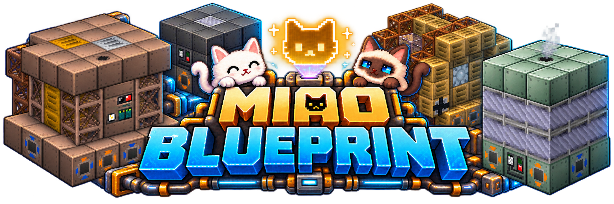

<h1 align="center">GT-Miao-Blueprint</h1>

<strong>猫猫蓝图 · GTNH 结构预览、蓝图编辑与材料施工</strong> <strong>Miao Blueprint · Preview, edit and build with your materials</strong>

  
  
  
  
  

  <a href="https://github.com/MIAOKATZE/GT-Miao-Blueprint/releases">下载 / Download</a> ·
  <a href="https://miaokatze.com/wiki?mod=gtmb">使用指南 / Guide</a> ·
  <a href="https://miaokatze.com/blueprints">蓝图站 / Blueprint Library</a> ·
  <a href="https://miaokatze.com/">主页 / Homepage</a>

从一台多方块机器到整片工厂：用投影仪查看结构，导入区域、识别结构并编辑蓝图，再用真实材料施工。搬家时，使用当前存档中每位玩家独立保存的**剪切暂存队列**，通过原生数据快照保留方块、机器数据与库存。

From one multiblock to a factory: preview structures, import regions, identify structures and edit blueprints, then **construct them with your materials**. Move existing builds with a persistent **Cut queue**, stored separately for each player in the current save and carrying block, machine and inventory data through native snapshots.

  <a href="README/screenshots/projector-preview.png">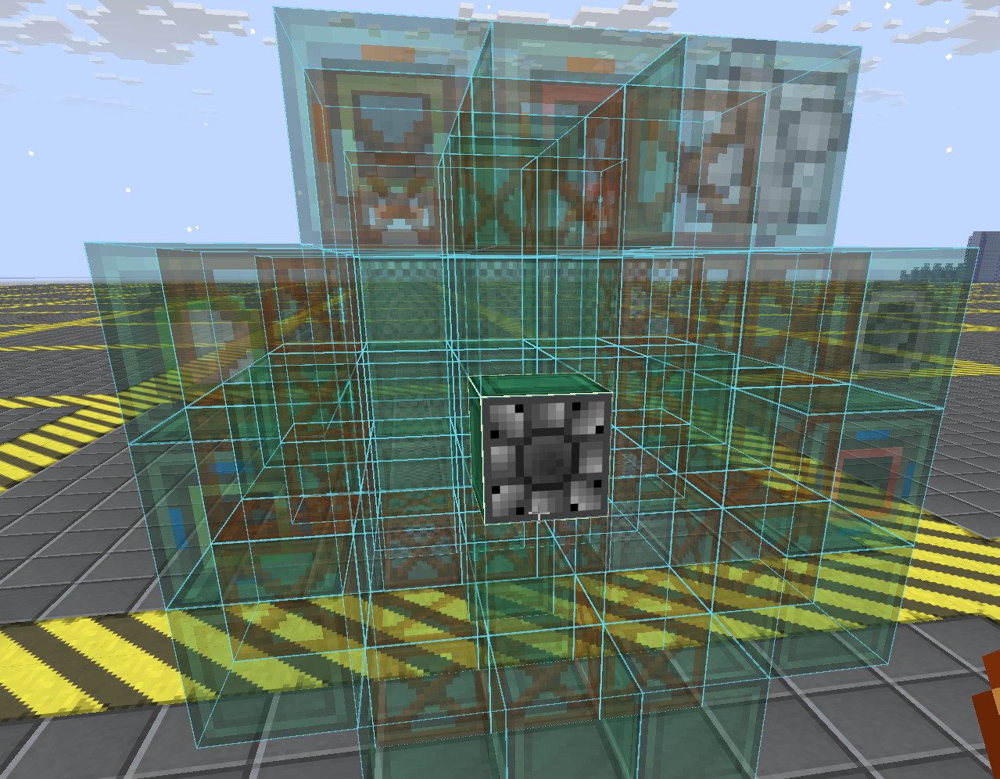</a> 
  <em>先看清结构，再准备材料施工。 / See the structure before committing your materials.</em>

## Features / 主要功能

| 功能 / Feature | 用途 / What it does |
| --- | --- |
| **结构投影 / Structure projector** | 对准真实控制器导入结构，预览并进入建造、替换或拆除流程。 / Import a structure from its real controller, preview it and use build, replace or dismantle workflows. |
| **区域与编辑 / Regions & editing** | 框选大区域，识别其中结构，调整方块与蓝图设置，按需进行量子分组。 / Capture large regions, identify structures, adjust blocks and blueprint settings, and optionally group quantum nodes. |
| **蓝图库 / Blueprint library** | 三维预览、分层查看、私用或分享处理；在客户端与服务器蓝图库间上传、下载。 / Inspect 3D and layer previews, process blueprints for private use or sharing, and transfer them between client and server libraries. |
| **剪切队列 / Cut queue** | 连续剪切、独立预览、定位粘贴；暂存归当前存档与玩家所有，独立于蓝图库与分享流程。 / Queue cuts, preview each entry and position it for paste; storage belongs to the current save and player, separate from blueprint sharing. |
| **世界定位 / World placement** | 贴面或悬空预览，锁定位置、旋转与镜像，核对材料后确认施工。 / Preview on a surface or in the air, lock the position, rotate or mirror, then review materials and confirm construction. |

<table>
  <tr>
    <td width="50%"><a href="README/screenshots/large-region-recognition.png">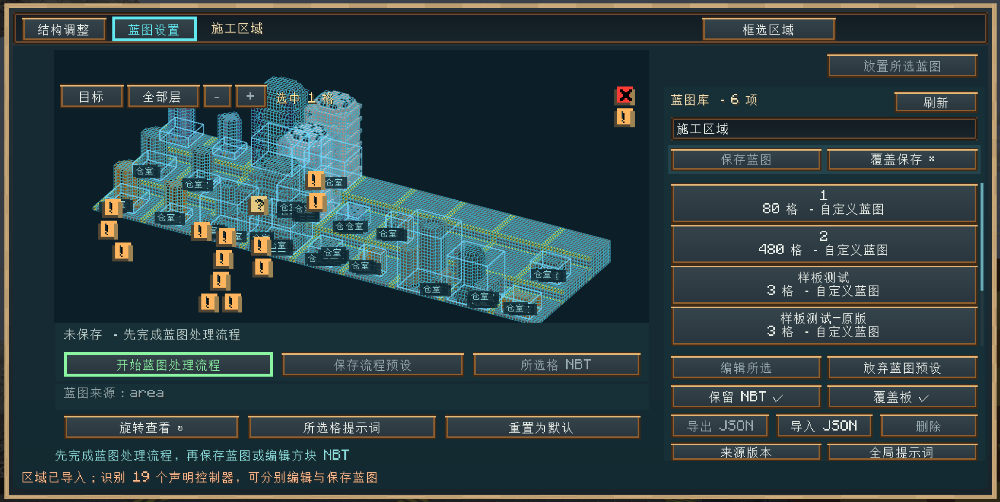</a></td>
    <td width="50%"><a href="README/screenshots/blueprint-library.png">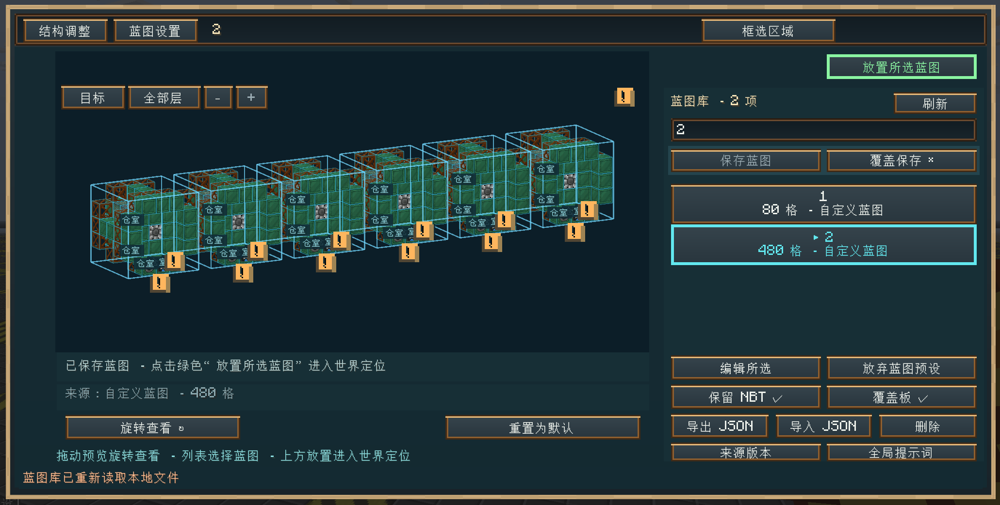</a></td>
  </tr>
  <tr>
    <td align="center">从区域大图识别结构 <em>Recognize structures in a large region</em></td>
    <td align="center">在蓝图库中预览与选择 <em>Preview and select from the library</em></td>
  </tr>
</table>

## Downloads & Requirements / 下载与依赖

目标 / Target: **GTNH 2.9.0 RC-2 · Minecraft 1.7.10 · Forge 10.13.4.1614**。

**客户端与服务端均需安装 / Install on both client and server.** 成品下载 / Packaged jars: [GitHub Releases](https://github.com/MIAOKATZE/GT-Miao-Blueprint/releases).

必需依赖 / Required: GregTech、StructureLib、Applied Energistics 2、GTNHLib、ModularUI、ModularUI2 **2.3.92-1.7.10**。目标 GTNH 整包已提供这些依赖 / These dependencies are included in the target GTNH pack. **GTIT 为可选模组 / GTIT is optional.**

**获取投影仪 / Get the projector:** 无序配方为 **1 个 StructureLib 多方块结构全息投影仪 → 1 个猫猫蓝图全息投影仪**。同装兼容版本 GTIT 时，也可在猫猫机用 **1 枚普通猫猫币**兑换。

Shapeless recipe: **1 StructureLib Hologram Projector → 1 Neko Blueprint Hologram Projector**. With compatible GTIT, the Neko Vending Machine also exchanges **1 ordinary Neko Coin** for one projector.

**装饰抵用券 / Decoration voucher：**无序合成 **2 个原生 StructureLib 全息投影仪 → 1 张券**。材料确认中主动选用后，主背包中的一张券可抵扣**本次施工**允许的建筑 Mod 材料；GT、AE、工业部件、库存、流体和能量仍按实际需求支付。未成功放置抵扣材料不会消耗券。服务器可在 `config/gtmb-decoration-voucher.cfg` 的 `decorationVoucher.enabled` 与 `allowedModIds` 中调整启用状态和建筑 Mod，修改后重启生效。
Shapeless recipe: **2 native StructureLib Hologram Projectors → 1 Decoration Voucher**. Explicitly select it in material review to waive eligible decoration costs for **one construction job**, using one voucher from the main inventory. Industrial parts, inventories, fluids and energy remain payable. The voucher is consumed only when covered material is successfully placed. Server configuration controls availability and allowed decoration mod IDs.

## Quick Start / 快速使用

| 步骤 / Step | 操作 / Controls |
| --- | --- |
| **1 · 导入 / Import** | 手持投影仪右键打开工作台；对准真实控制器可导入结构，或使用「框选区域」导入世界区域。 / Right-click with the projector to open the workspace; target a real controller to import its structure, or select a world region. |
| **2 · 编辑与保存 / Edit & save** | 用「结构调整」编辑结构，用「蓝图设置」完成私用／分享处理，再命名保存；从蓝图库选择蓝图并查看三维预览。 / Adjust the structure, complete private-use or sharing processing in Blueprint Settings, then name and save it; select entries in the library for a 3D preview. |
| **3 · 定位与施工 / Position & build** | 点「放置所选蓝图」进入世界预览，右键立即固定位置并将绿色边框切为青色；位置核对完成后，再右键核对材料并确认，Esc 取消。 / Click Place to enter the world preview. Right-click immediately freezes the position and turns the outline cyan; after the position check, right-click again to review materials and confirm. Esc cancels. |
| **4 · 调整位置 / Adjust position** | 框选取命中方块，放置预览贴合命中表面；无命中时悬空，Alt 强制悬空，**Alt+滚轮调距 0–64 格**（0 为脚下）。**普通滚轮保持原版快捷栏切换**。 / Selection uses the hit block and placement attaches to its face; without a hit it floats. Alt forces floating; **Alt+wheel adjusts 0–64 blocks** (0 = your feet). **The plain wheel keeps vanilla hotbar switching.** |
| **5 · 切换剪切 / Switch to Cut** | 蓝图模式下 Shift+右键打开模式切换器，按住 Shift 继续右键切换，松开 Shift 进入；空闲时 Ctrl+Shift+右键可重开。选择「剪切」即开始框选。 / In Blueprint mode, Shift+right-click opens the mode selector; keep Shift held and right-click to cycle, then release Shift to enter. Ctrl+Shift+right-click reopens it while idle. Choosing Cut starts selection. |

结构调整中，**G 切换移动轴开／关**，按钮显示「移动轴(G) ✓／×」。空闲 2 秒后显示操作帮助，任何动作都会收起帮助并继续响应输入。

In Structure Adjustment, **G toggles the movement axes**; the button shows its on/off state. Help appears after 2 idle seconds and dismisses on any action while letting that input take effect.

蓝图内的成员结构仍可调整主信号、等级与高度等子信道；修改参数会重新生成所选结构，保留其他成员及其编辑。旧蓝图也可在这里重新设置参数；旧结构归属不完整时，先按保存内容恢复可确认的范围，无法可靠确定时保留原图并提示重新导入。请核对预览中的实际尺寸。

Member structures remain adjustable: change the main signal or named channels such as tier and height to regenerate the selected member while retaining other members and their edits. Existing blueprints can use the same controls. Incomplete legacy membership is recovered from verified saved content; if its extent cannot be established reliably, the original is retained with a request to import it again. Check the resulting dimensions in the preview.

普通蓝图放置时，空气空位不参与现场校验、材料核算或施工，也不会清空现场方块；实际检查与放置只针对非空气目标。空位仍保留在结构声明中，可继续调整结构或手动指定方块。忠实剪切粘贴和拆除沿用各自的处理方式。

Ordinary blueprint placement skips empty air positions during site checks, material accounting and construction, leaving existing blocks in those gaps intact. Checks and placement apply to non-air targets. Air remains in the structure declaration for editing or assigning a block. Faithful cut-and-paste and dismantling retain their own behavior.

资源复核中，可解析的库存数据可选择「完全保留」，施工时匹配完整物品数据并扣除对应材料。确实无法解析的信息会指出具体路径，需要移除后才能保存。倾向自用时可尽量保留原配置；与坐标或去标识选项冲突时，界面会要求先解决冲突。

In resource review, choose **Keep unchanged** for inventory data whose complete material cost can be decoded. Construction matches the full item data and consumes those materials. Unreadable data identifies the path to remove before saving. Private-use processing can retain the original configuration; resolve any conflicting coordinate or identity-processing choices first.

施工前使用独立的 **MUI2 材料确认窗口**：按图标、精确物品 / NBT 与单位逐项查看**需求 / 已有 / 缺失**，同名材料不会合并成一项，创造模式也显示完整需求。打开清单、切换抵用券复用已核定的材料数据；主动「刷新材料」只核对清单中的库存，确认施工前再核对现场和材料。没有可处理内容的按钮禁用，悬停可查看原因；普通按钮使用默认猫猫材质，仅强调需要处理的操作和确认。ME 缺料可明确提交独立的真实 AE 合成订单；关闭窗口后继续，重新打开可看总进度与结果。按实际产物交付确认完成，材料进入 ME 网络后，**刷新材料再确认施工**；取消只取消本次订单，已接管未交付的产物在退出或运行时重置时进入玩家回收暂存。退出游戏不表示订单继续。
The separate **MUI2 material confirmation window** shows icons and exact **required / available / missing** quantities, preserving distinct item and NBT identities and showing full demand in creative mode. Opening the list and toggling a voucher reuse reviewed material data. Explicit refresh checks stock for those rows; construction checks the site and materials before starting. Controls without applicable content are disabled with a tooltip. Ordinary controls use the default cat theme, with emphasis reserved for relevant actions and confirmation. Explicitly submit missing materials through an independent AE crafting request; closing the window keeps it running with progress and terminal notifications. Actual outputs are delivered to ME storage; **refresh the quote and confirm construction** afterward. Undelivered outputs already received are preserved in player recovery storage when leaving or resetting runtime. Leaving the game ends the active order.

EU 不足时才标红。创造模式持有抵用券时，也可切换抵扣方案核对范围；创造施工不消耗抵用券。
EU requirements turn red only when available energy is insufficient. Carry a voucher in creative mode to inspect its coverage; creative construction does not consume it.

到 [**蓝图站 · 浏览、下载与分享**](https://miaokatze.com/blueprints) 寻找机器与建筑设计，或分享自己保存的蓝图。游戏内蓝图库和保存／分享引导也提供入口。
Visit the [**Blueprint site · Browse, download and share**](https://miaokatze.com/blueprints) to find machine and building designs or share your saved blueprints. Links are also available in the in-game library and save/share guidance.

<strong>剪切、选区与旋转 / Cut, selection and rotation controls</strong>

| 操作 / Action | 用途 / Result |
| --- | --- |
| 选区 / Selection | 左右键设置或调整两角；Alt+右键按悬空光标标第二点。Shift+Alt+右键开始下一框，同时按 Ctrl 减选；Delete 删除当前框，方向键平移，Alt+上下调高低，Ctrl+Z 逐次撤销。蓝图与剪切均适用。 / Left- and right-click set or adjust corners; Alt+right-click marks point 2 at the floating cursor. Shift+Alt+right-click starts another box; add Ctrl for subtraction. Delete removes the current box, arrows move it, Alt+up/down changes height, and Ctrl+Z undoes individual selection actions. Applies to Blueprint and Cut. |
| 保存剪切 / Store a cut | 完整选区时 Shift+右键进入剪切确认；保存至当前玩家／存档队列后继续框选，聊天提示可用 Shift+右键打开列表。尚无完整框时，该操作直接打开暂存列表并保留已有角点。 / Shift+right-click confirms a complete selection. Saving stores it in this player/save queue and starts another selection; chat points to Shift+right-click for the list. Without a complete box, that shortcut opens the list and retains partial corners. |
| 暂存列表 / Stored cuts | 选择条目查看独立 3D 预览，点「放置」进入世界预览。Alt+A/D 切换条目，非框选时 Alt+右键撤销；仅成功粘贴或撤销后消费条目。 / Select an entry for its independent 3D preview and click Place for the world preview. Alt+A/D switches entries; Alt+right-click outside selection undoes a cut. Only successful paste or undo consumes an entry. |
| 姿态 / Pose | 确认前用 R 绕 Y 轴旋转，Ctrl+R 绕 X 轴旋转，Alt+R 打开旋转、镜像和朝向面板。 / Before confirming, use R to rotate around Y, Ctrl+R around X, or Alt+R for rotation, mirror and facing controls. |
| 剪切放置 / Cut placement | 右键锁定预览，再右键确认；可选「确认且以后不提醒」。该偏好按当前存档与玩家保存，与剪切命名独立，只跳过放置确认框；确认框显示位置与姿态，姿态须提前调整。 / Right-click to lock the preview, then again to confirm; optionally choose Confirm and don't ask again. This player/save preference is separate from cut naming and skips only the placement prompt. The prompt shows position and pose; adjust pose beforehand. |
| 退出剪切 / Exit Cut | **Esc 完整退出剪切模式，保留全部暂存。**剪切放置使用带方块边框的半透明原生模型预览。 / **Esc exits Cut mode and retains every stored entry.** Cut placement uses translucent native models with block outlines. |

## Gallery / 更多界面

<strong>展开 7 张操作界面 / Show 7 more workflow screenshots</strong>

**控制器结构工作台：建造、替换与拆除 / Controller structure workspace: build, replace and dismantle**

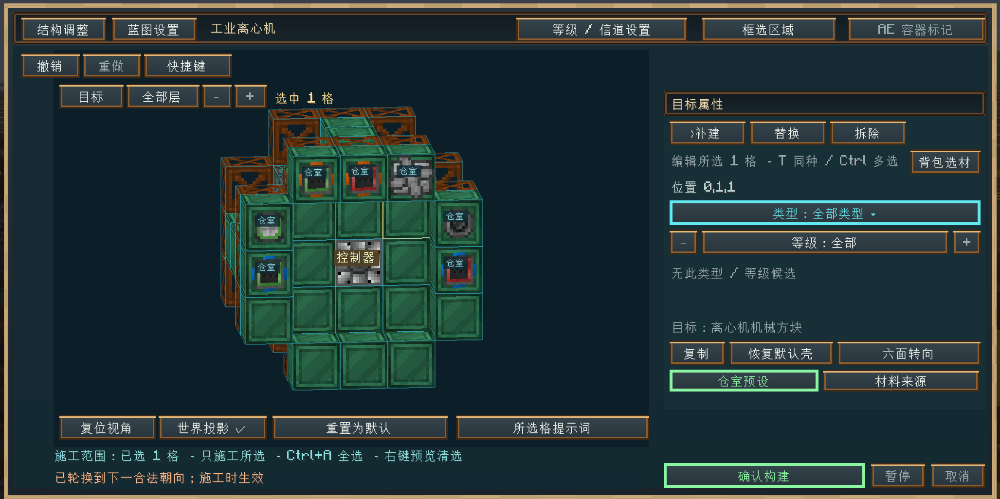

**导入后的结构调整与蓝图编辑 / Structure adjustment and blueprint editing after import**

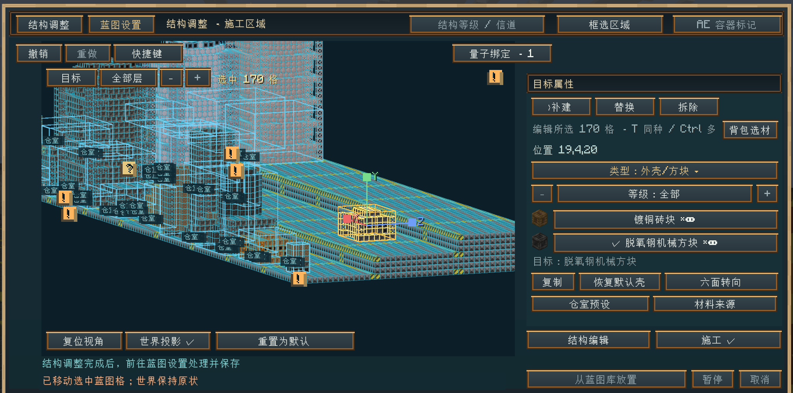

**按私用或分享需求确认蓝图标识处理 / Confirm blueprint identity processing for private use or sharing**

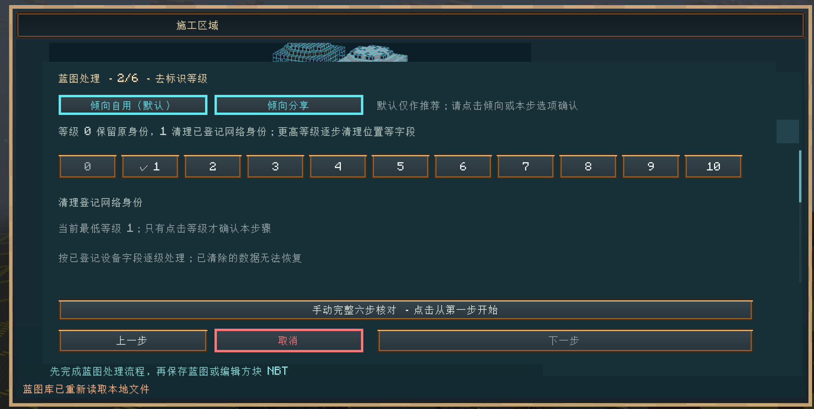

**在世界中预览与定位蓝图 / Preview and position a blueprint in the world**

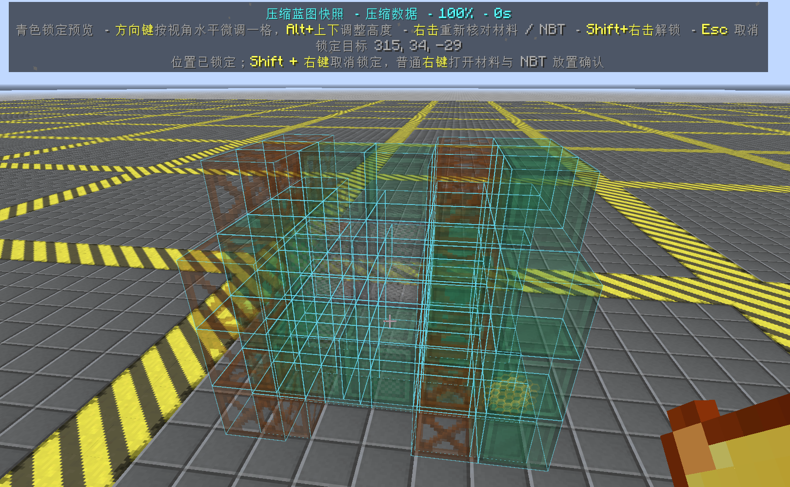

**蓝图与剪切模式切换 / Blueprint and Cut mode switcher**

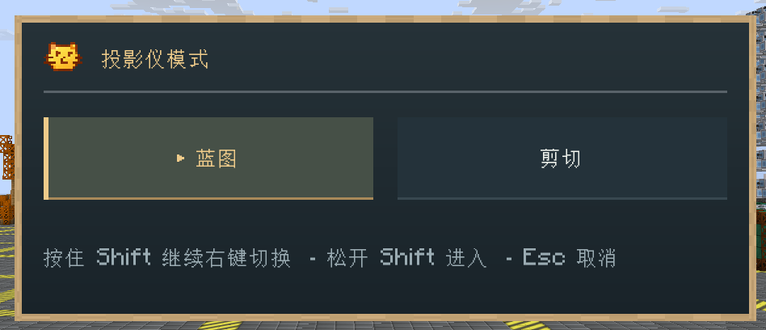

**剪切暂存队列与独立三维预览 / Stored Cut queue and independent 3D preview**

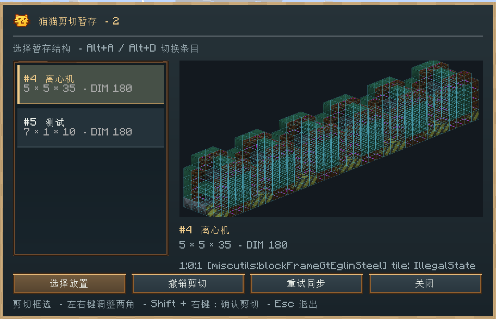

**区域导入与准备蓝图快照的任务进度 / Region import and blueprint snapshot preparation progress**

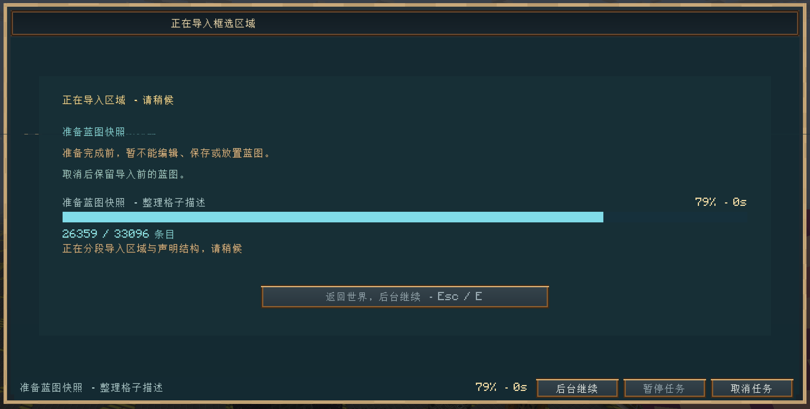

导入任务显示进度，返回世界后也可继续。 / Import progress stays visible, and the task can continue in the background.

感谢玩家提供功能展示截图。 / Thanks to the player who contributed these screenshots. [素材清单 / Image credits](README/screenshots/manifest.json)。

## Sharing & Further Reading / 分享与更多说明

手动分享时，将**同名 JSON + PNG 双文件**一起放入对方游戏目录的 `MiaoBlueprints/`；公库上传、下载使用蓝图库「客户端／服务器」切换。剪切暂存独立保存，不参与分享。

To share manually, copy the **same-basename JSON + PNG pair** into the recipient's game-directory `MiaoBlueprints/`. Use the library's Client/Server switch for uploads and downloads. Stored cuts remain separate from sharing.

<strong>传输、后台任务与开发者说明 / Transfers, background tasks and developer notes</strong>

新安装默认全服聚合上传限速 **1024 KiB/s（1 MiB/s）**、下载限速 **128 KiB/s**。管理员可在服务器蓝图库设置中调整；已有配置值保留。客户端与服务端均更新后，上传连续发送分片并合并回执；连接旧服务端时保留原单片传输。

New servers default to shared upload/download limits of **1024 KiB/s (1 MiB/s)** and **128 KiB/s**. Operators can adjust both in server library settings; existing configuration values are preserved. Updated clients and servers pipeline uploads; older servers retain compatible single-chunk transfer.

等待界面在总量已知时显示实际进度与百分比，未知时显示动态等待与耗时。长任务关闭界面后继续，再次打开恢复原业务页面、选区与视角。保存成功的引导说明蓝图设置与结构调整的区别，并支持不再显示。

Waiting views show measured progress and percentages when totals are known, or activity and elapsed time otherwise. Long tasks continue after closing the workspace; reopening restores the business page, selection and view. Save guidance explains Blueprint Settings and Structure Adjustment and can be dismissed persistently.

已确认的蓝图施工可在大图范围内继续，走离预览锚点不会单独终止任务；仍须保持原工具槽中的同一把投影仪、当前世界与维度，实际区块、现场权限和放置事件继续检查。停止、部分完成与全部成功分别显示，进度走完不代表机器成型。保存准备按实际快照与序列化工作显示进度，匹配本次任务的有效活动会延长等待；传输结束后仍须等待原生预览、配对文件与最终保存确认。
An admitted blueprint construction job can continue while you inspect a large build, including beyond the preview anchor's admission range. Keep the same projector in its original slot and remain in the same world and dimension; chunk, permission and placement checks still apply. Stopped, partial and successful outcomes remain distinct. Save preparation reports actual snapshot and serialization work, and correlated activity extends the wait; transfer completion still requires preview validation, paired files and final save confirmation.

管理员可用 **`/gtmb restart`（权限等级 4，支持 Tab 补全）**重置 GTMB 运行任务与会话、清除旧回调与传输，并独立取消 AE 订单；已施工方块、回收暂存与剪切记录保留，随后重新打开投影仪。命令须由服务器线程正常执行；已进入不可中断的原生原子写盘可能完成原提交，不能借此强制解除卡死磁盘或被阻塞的 tick 线程。
Administrators can use **`/gtmb restart` (permission level 4, with Tab completion)** to reset GTMB runtime tasks, sessions, stale callbacks and transfers, and cancel its independent AE orders. Placed blocks, recovery storage and persistent cuts remain available. The server thread must be able to execute the command; an atomic disk operation already in progress may still finish. This runtime reset cannot forcibly unblock a stuck disk or server tick thread.

稳定几何上的蓝图编辑按脏格更新，保留未改动的 16³ 预览分区。共享材料规划与大图首次快照分阶段执行；世界修改与材料结果由服务端决定。几何增删和专门审核在需要时使用完整刷新。

Edits to stable blueprint geometry update dirty cells and retain unchanged 16³ preview regions. Shared material planning and initial large snapshots run in stages; world changes and material authority remain on the server. Geometry changes and specialized audits retain complete refreshes where required.

校验通过有界任务缓存复用相同完整 NBT；不同机器、覆盖板和 AE 配置分别处理。`gradlew runBlueprintValidationBenchmark` 对照生产校验路径启用与禁用缓存的结果；该组件基准不包含实际世界采集、网络和渲染。

Validation reuses identical complete NBT within a bounded task cache, keeping different machine, cover and AE configurations separate. `gradlew runBlueprintValidationBenchmark` compares production validation with caching enabled and disabled; this component benchmark excludes live-world capture, networking and rendering.

- 完整操作、私用／分享处理与资源规则 / Controls, private/shared processing and resource rules: [GTMB Guide](https://miaokatze.com/wiki?mod=gtmb).
- 查找与分享蓝图 / Find and share blueprints: [Blueprint Library](https://miaokatze.com/blueprints).
- 社区扩展与模块契约 / Community integrations and module contracts: [Public API](API.md).
- 默认关闭的存档内 agent 测试区：通过 `config/gtmb-testlab.cfg` 开启；`/gtmbtestlab`、隔离设施、压力测试与报告边界见 [TESTLAB.md](TESTLAB.md)。 / The save-local agent laboratory is disabled by default; enable it in `config/gtmb-testlab.cfg`. See TESTLAB.md for commands, fixture isolation, stress tests and report boundaries. Ordinary players do not need to enter its dimension.

## License & Origins / 许可与来源

[AGPL-3.0](LICENSE) · 源自 / Origin: GT-Interesting-Thing · 现独立维护为 / Independently maintained as GTMB · 开发记录 / Development notes: [GT-Miao-Blueprint-plan](https://github.com/MIAOKATZE/GT-Miao-Blueprint-plan).
