

  

<h1 align="center">GT-Miao-Blueprint</h1>

<strong>猫猫蓝图 · GTNH 结构预览、蓝图编辑与材料施工</strong> <strong>Miao Blueprint · Preview, edit and build with your materials</strong>

  
  
  
  
  

**必需前置：客户端与服务端均需 [MIAOKATZE Core 0.2.0 ~ +](https://github.com/MIAOKATZE/MIAOKATZE-Core)**（最低版本 0.2.0，不设版本上限）。FalsePatternLib 可在缺失时补下载；已有旧版请手动更新。

### v0.1.44 框选与镜头交互 / Selection and camera controls

蓝图画布及蓝图等距框选使用中键拖动平移、右键拖动旋转。世界等距选点仍需按住 Ctrl；投影与剪切保留各自的镜头操作。顶部世界提示采用与 GTSWN 相同的字号适配规则。

Z / Alt+Z 只加选或减选下一个框，青色表示加选、红色表示减选；完成后自动恢复角点编辑。按 B 开始自由多边形会继承已启用的减选。轮廓支持水平与两种轴对齐竖直平面：点击紫色首点闭合，其他顶点为深绿色；未闭合就确认时，首点闪动。闭合后点击仅锁定法向厚度，粗线标明锁定点，再次点击可重设。

有已选内容时，取消框选会先询问是否放弃；「否」或弹框中的 Esc 保留选区，「是并且不再提醒」会保存偏好。Delete 仍可单独撤回最近选区。

当前可编辑框的两个角点用紫色粗框和放大的「左键 / 右键」标注，外露表面以淡斜线网显示。开始下一个选区会隐藏旧框角点标注；Delete 或 Ctrl+Z 回到旧框时随状态恢复。

移动、复制和删除现在刷新受影响区域的渲染，保留其他分区；完整蓝图检查延至后续处理、保存及材料或施工准入。修复区域导入与保存后的状态收尾，使同一连接中可以再次 Shift+右键开始新蓝图。蓝图右键短按释放仍可打开工具菜单，拖动则旋转镜头。

*Blueprint camera: middle-drag to pan, right-drag to rotate. Add/subtract applies to one new box. Free polygons support horizontal and axis-aligned vertical planes with an explicit purple closing vertex and a separately locked extrusion depth. Cancelling a nonempty selection asks before discarding it. Editable corners use purple markers, and exposed surfaces use a faint diagonal hatch.*

原生观察图展示当前框角标及 Esc 放弃确认，来源见 [manifest](README/native-v0144/manifest.json)。小型实机流程已核对删除、处理、保存后的再次框选；不代表专服、施工或全部多边形场景验收。

*Native captures show editable corners and the discard dialog. The bounded run checks deletion, processing, saving and capture reentry; it does not establish dedicated-server, construction or exhaustive polygon coverage.*

<table>
  <tr>
    <td width="50%"><a href="README/native-v0144/selection-corners.png">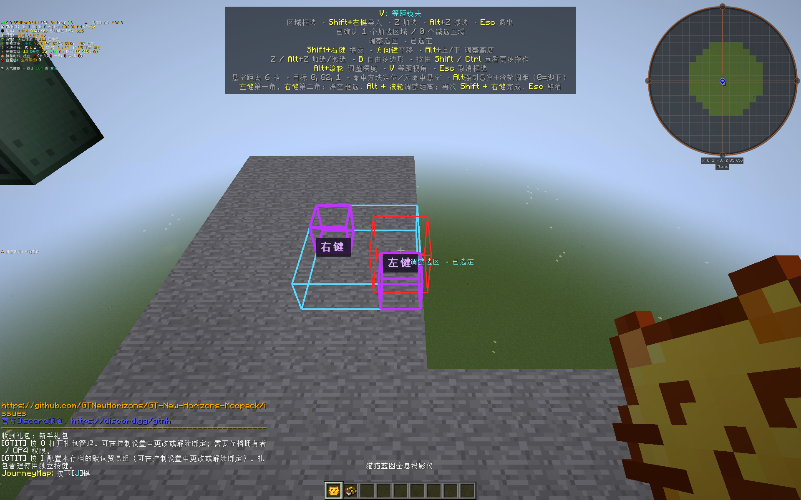</a></td>
    <td width="50%"><a href="README/native-v0144/discard-confirmation.png">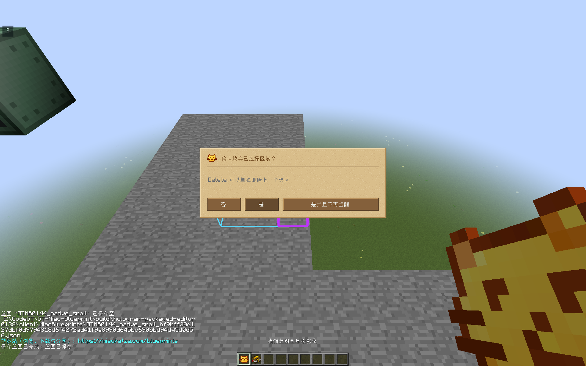</a></td>
  </tr>
</table>

### v0.1.43 内部附加编辑与并列进度 / Attachment windows & task progress

文字和图片编辑现在使用工作台内部悬浮窗，保持当前蓝图和视角；标题可拖动，材质、滤镜与预设等完整功能继续保留，窗口在小屏下按比例适配。Esc 先退出文本焦点，再逐层收起子窗和编辑窗；输入框中的 E 继续用于输入。

顶部「教程」新增「文字附加」和「图片附加」独立课程，演示实际输入、生成、选位、确认和整体移动。图片课只读取自动生成的 8×8 示例图，结束清理自身文件并恢复原工作区。

任务进度与文档标题位于同一固定高度顶栏，多条任务横向并列。任务开始、增加或结束都不挤动模式栏与画布；悬停可查看完整阶段、数量与耗时。

*Text and image editors now float inside the workbench. Two new lessons demonstrate the complete attachment workflow. Concurrent task bars share the existing header without moving the workspace.*

以下原图展示内部图文浮窗及并列进度布局，来源和有限验证范围见 [manifest](README/native-v0143/manifest.json)。进度图使用受控示例任务核对布局，不代表实际扫描或施工完成。

<table>
  <tr>
    <td width="50%"><a href="README/native-v0143/text-window.png">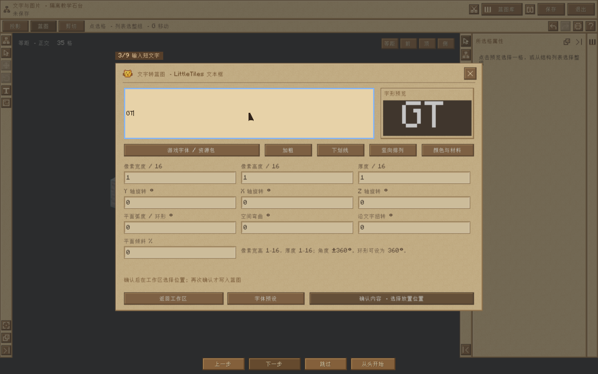</a></td>
    <td width="50%"><a href="README/native-v0143/picture-window.png">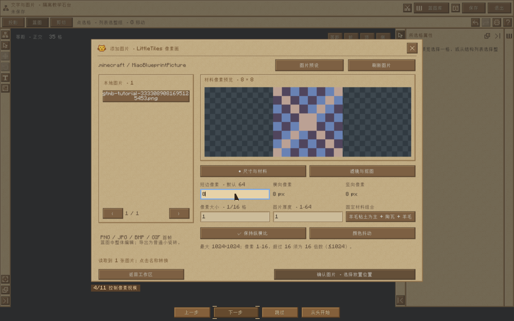</a></td>
  </tr>
  <tr><td colspan="2"><a href="README/native-v0143/parallel-progress.png">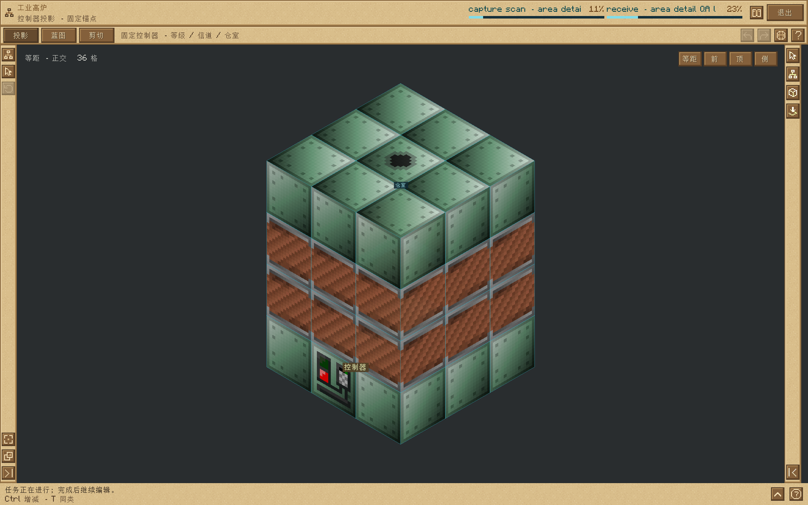</a></td></tr>
</table>

v0.1.42 历史教程布局与选区操作 / Previous tutorial layout & selection

### v0.1.42 教程布局与选区操作 / Tutorial layout & selection

蓝图课从空白工作区打开两台高炉规划，先演示沿轴移动、取消与确认换行，再用平面移动放到预留位置，最后复制成三台。左后方平台保留一台，地面两台之间留出空间；原生手柄位移、无碰撞与底面承托共同核对。

工具栏默认仅显示图标，可用底部箭头展开名称，悬停查看说明。教程按操作收纳侧栏：看库时收属性，改参数时收库，移动和复制时留出画布。

等距多边形按住 **Ctrl+左键** 落点、闭合或调整高度；松开 Ctrl 操作镜头。**Delete** 先撤回正在绘制的最后顶点或半成框，否则移除最近完成的整个选区；多边形按一次完整选择处理。它不删除世界方块，可用 Ctrl+Z 撤销。

*The lesson loads two furnaces, demonstrates movement and copies a third into a clear supported position. Tool labels start collapsed and lesson sidebars follow the current operation. Isometric polygon clicks require Ctrl; Delete removes pending input or the latest complete selection.*

下图为本轮原生候选包的实际画面，来源与有限观察范围见 [manifest](README/native-v0142/manifest.json)。本轮仅对修改后的摆放段补做实机观察；世界 Ctrl/Delete 另以回归验证，未作为真实世界输入验收。版本为用户测试包，未创建 Release 或草稿。

<table>
  <tr>
    <td width="50%"><a href="README/native-v0142/blueprint-two.png">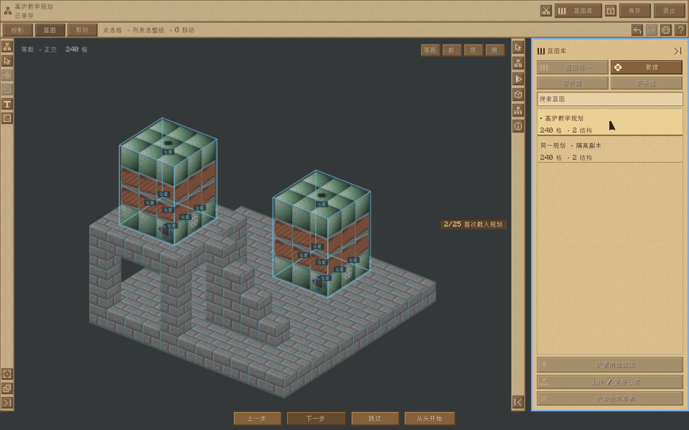</a></td>
    <td width="50%"><a href="README/native-v0142/blueprint-move.png">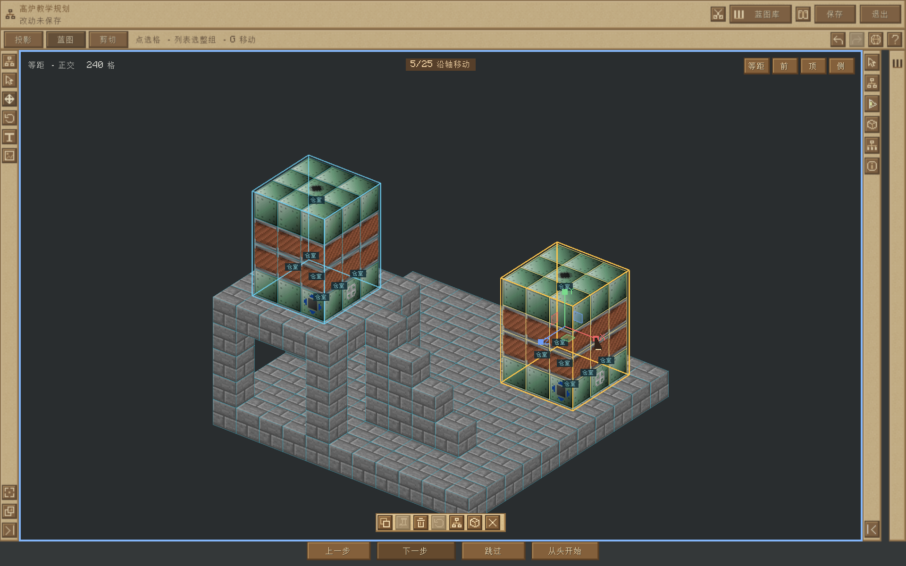</a></td>
  </tr>
  <tr>
    <td><a href="README/native-v0142/blueprint-plane.png">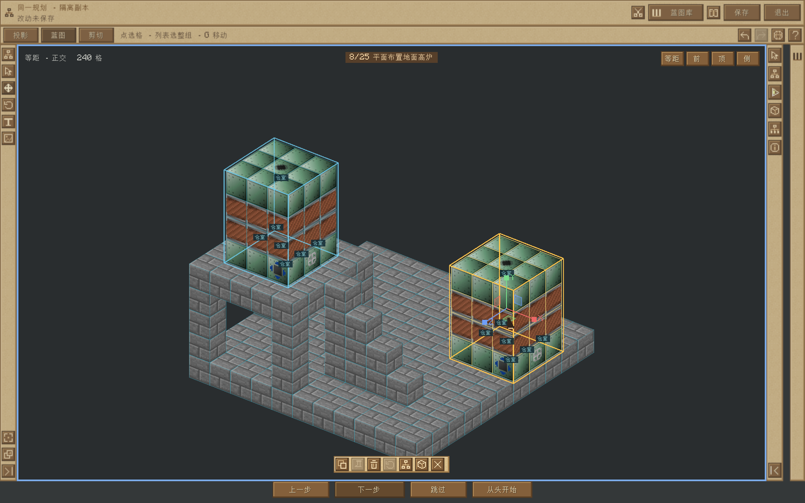</a></td>
    <td><a href="README/native-v0142/blueprint-three.png">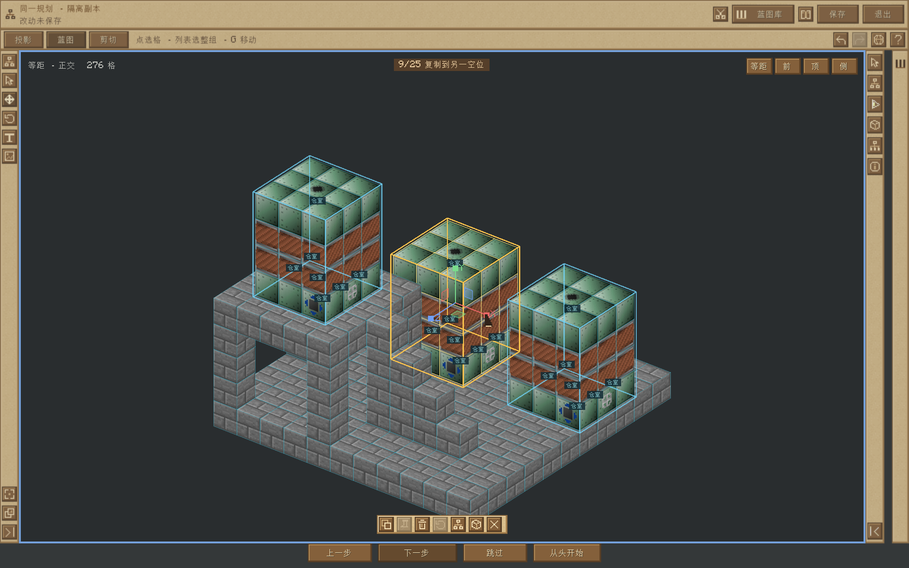</a></td>
  </tr>
</table>

v0.1.41 历史教程流程与原生观察 / Historical tutorial observations

### v0.1.41 教程流程修正 / Tutorial flow fixes

蓝图教程从**空白工作区**开始，点击侧边蓝图库的记录后才载入三台电力高炉：两台在地面，一台在平台上。编辑后的库记录切换会按实际界面展示丢弃提示，教程分别演示取消与确认；每步等待实际操作完成后再推进。

八套教程分别覆盖投影、蓝图、结构、剪切列表，以及普通与等距视角的框选和剪切。剪切课使用与实际界面共用的命名、列表和粘贴确认控件。上一步回到该步动画开头，从头开始恢复课程初态，结束或跳过后返回原工作区。教学内容只在隔离内存中变化，不扣材料、不移动真实世界方块、不读写玩家剪切目录。

*Blueprint lessons begin with an empty workspace. Library clicks load the teaching scene; edited-content switches explicitly demonstrate cancellation and confirmation. All eight courses wait for actual operation results. Teaching uses isolated state and preserves the original workspace.*

本版本为用户测试包，未发布 GitHub Release 或草稿。最低 Core 依赖为 0.1.22，配套 Core 运行包随用户测试包提供。

下图为本轮候选包的原生教程画面。八课共 77 步分别核对实际动作结果与原图；蓝图补测和其他七课的来源分开记录，不将早期失败改写为通过。框选及剪切示例保存完整 **6×4×5** 选区，包括空气格与原有方块 NBT。画面来源与审查范围见 [manifest](README/native-v0141/manifest.json)；它们不是专服施工或用户验收证明。

*Original native tutorial captures: empty workspace, library loading, explicit discard confirmation, material review and the complete 6×4×5 Cut volume. Provenance distinguishes the Blueprint follow-up from the other seven courses.*

<table>
  <tr>
    <td width="50%"><a href="README/native-v0141/blueprint-empty.png">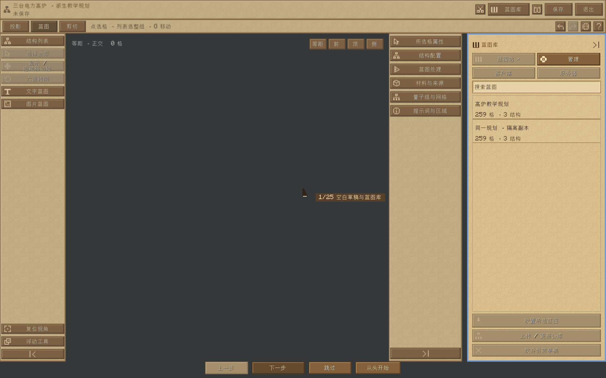</a></td>
    <td width="50%"><a href="README/native-v0141/blueprint-loaded.png">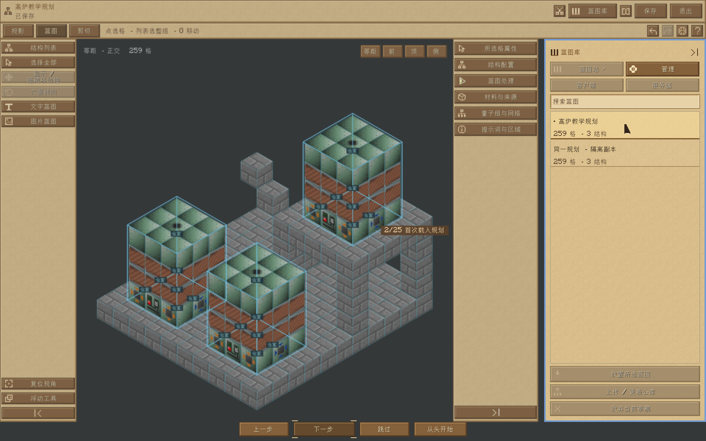</a></td>
  </tr>
  <tr><td align="center">空白起步 / Empty start</td><td align="center">单击载入 / Click to load</td></tr>
  <tr>
    <td><a href="README/native-v0141/discard-confirmation.png">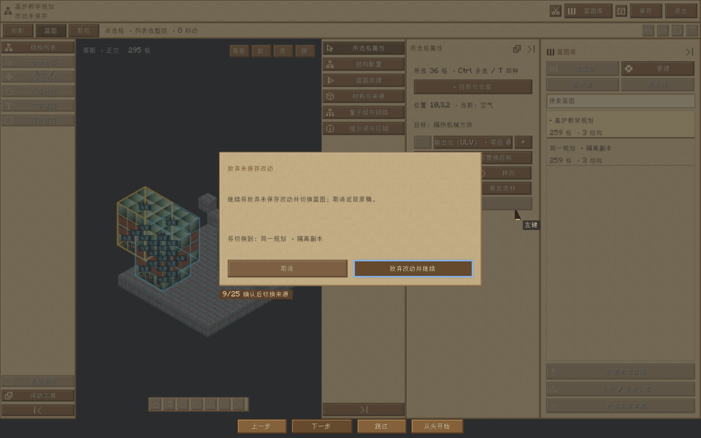</a></td>
    <td><a href="README/native-v0141/material-review.png">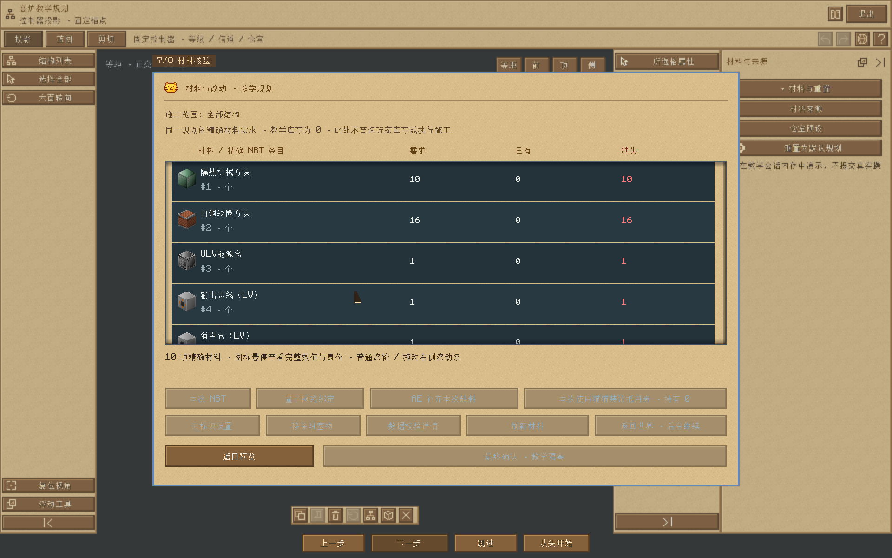</a></td>
  </tr>
  <tr><td align="center">丢弃确认 / Discard confirmation</td><td align="center">材料核验 / Material review</td></tr>
  <tr>
    <td><a href="README/native-v0141/cut-list.png">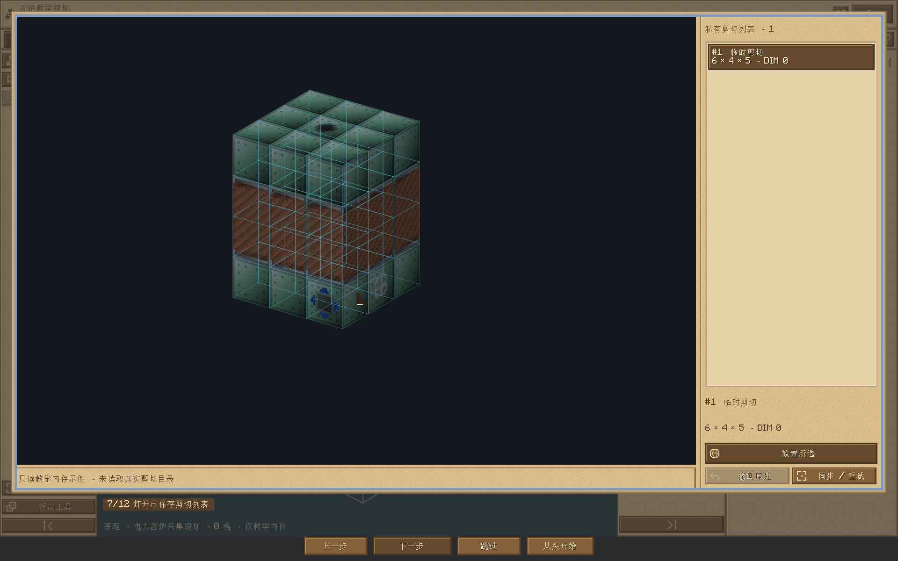</a></td>
    <td><a href="README/native-v0141/cut-confirmation.png">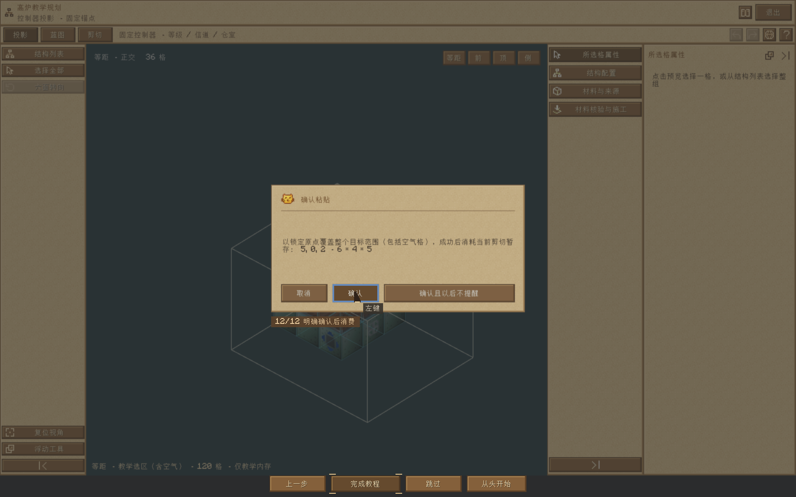</a></td>
  </tr>
  <tr><td align="center">剪切列表 / Cut list</td><td align="center">粘贴确认 / Placement confirmation</td></tr>
</table>

v0.1.40 历史界面与有限观察 / Historical interface observations

### v0.1.40 编辑器与教程 / Editor & tutorial

**v0.1.40 用户测试构建，未发布 Release。 / v0.1.40 is a user-testing build; no Release has been published.** 本轮仅接受所列有限视觉范围，不代表用户验收或完整八课。 / The reviewed screenshots cover a bounded visual scope, not user acceptance or all eight lessons.

投影只记住最近一次状态。从有内容的投影进入蓝图时会询问是否丢弃；取消保留投影记忆，确认后清除。空投影可切入投影页：顶部模式栏仍可用，正文置灰，中央提示“右击控制器开启投影模式”。

*Projection remembers only its most recent state. Entering Blueprint from a non-empty projection asks whether to discard it: cancel keeps the remembered projection, while confirm clears it. An empty projection can open the Projection page; the mode bar remains usable, the body is dimmed, and the center says “Right-click the controller to enable projection mode.”*

左右工具栏默认展开，顶部显示进度；Ctrl+Shift+Delete 快捷清空，Esc / E 每次退回一级。等距放置使用 Ctrl。教程使用 portable 注册名和真实材料窗口，样例包括 3 台高炉（2 台在地面、1 台在平台上）及 151 格建筑材料；初始蓝图不含文字或图片附件。

*Both tool rails start expanded, with progress at the top. Ctrl+Shift+Delete clears quickly; Esc / E goes back one level at a time. Hold Ctrl for isometric placement. Lessons use portable registry names and the real materials window, with 3 blast furnaces—2 on the ground and 1 on a platform—and 151 building-material cells. The initial blueprint has no text or picture attachments.*

下列为本轮已复核的有限原生观察画面。root 查看了 00–05 与 progress 共七张原图，并接受此处所列的限定视觉范围；这不代表用户验收或完整八课。顶部进度见 05 图，00 投影图中没有进度条。蓝图库使用两份合法的 8 格 QA 原生 JSON/PNG 夹具，不是真实玩家存档；截图不代表真实库存施工或专服用户验收。原图与范围说明见[本轮截图 manifest](README/native-v0140/manifest.json)。v0.1.39 gallery 文件保留归档，不作为本版证据。

*The gallery below shows selected native observations reviewed by root: seven original images covering views 00–05 and progress. Root accepted this bounded visual scope; it is not user acceptance or evidence for all eight lessons. Progress appears in image 05, not projection image 00. The library uses two valid eight-slot QA JSON/PNG fixtures, not a real player's save. These images do not represent construction from real inventory or dedicated-server user acceptance. The v0.1.39 gallery remains archived and is not current evidence.*

<table>
  <tr>
    <td width="50%"><a href="README/native-v0140/projection-properties.png">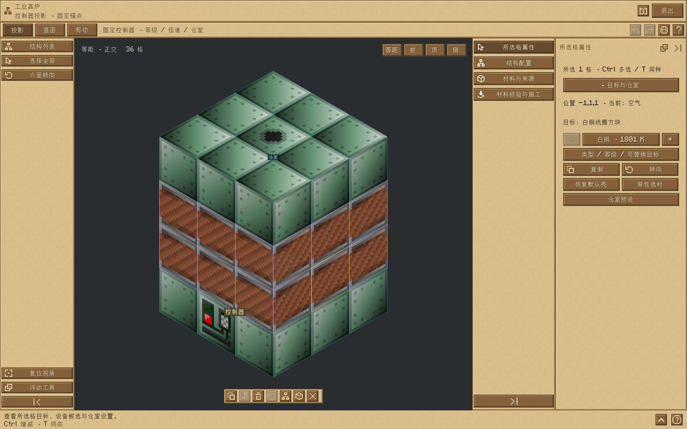</a></td>
    <td width="50%"><a href="README/native-v0140/blueprint-library.png">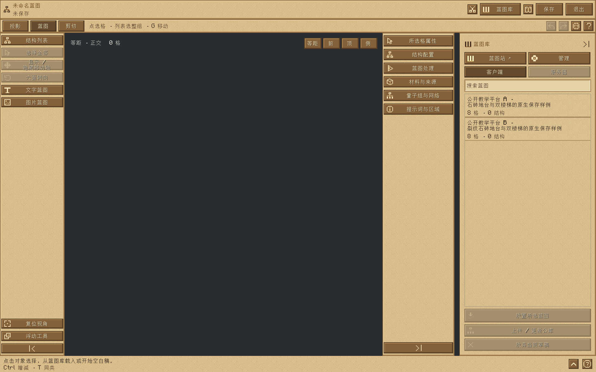</a></td>
  </tr>
  <tr><td align="center">投影与属性 / Projection & properties</td><td align="center">双侧栏与满高 QA 库 / Tool rails & full-height QA library</td></tr>
  <tr>
    <td><a href="README/native-v0140/tutorial-blueprint.png">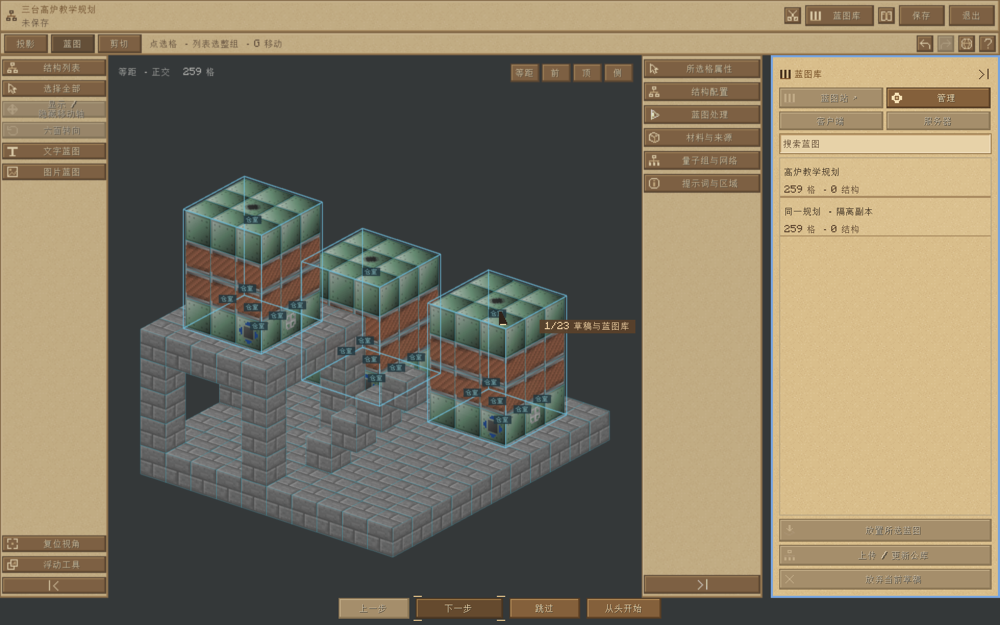</a></td>
    <td></td>
  </tr>
  <tr><td align="center">蓝图教程 / Blueprint lesson</td><td align="center">材料复核 / Material review</td></tr>
  <tr>
    <td><a href="README/native-v0140/projection-empty.png">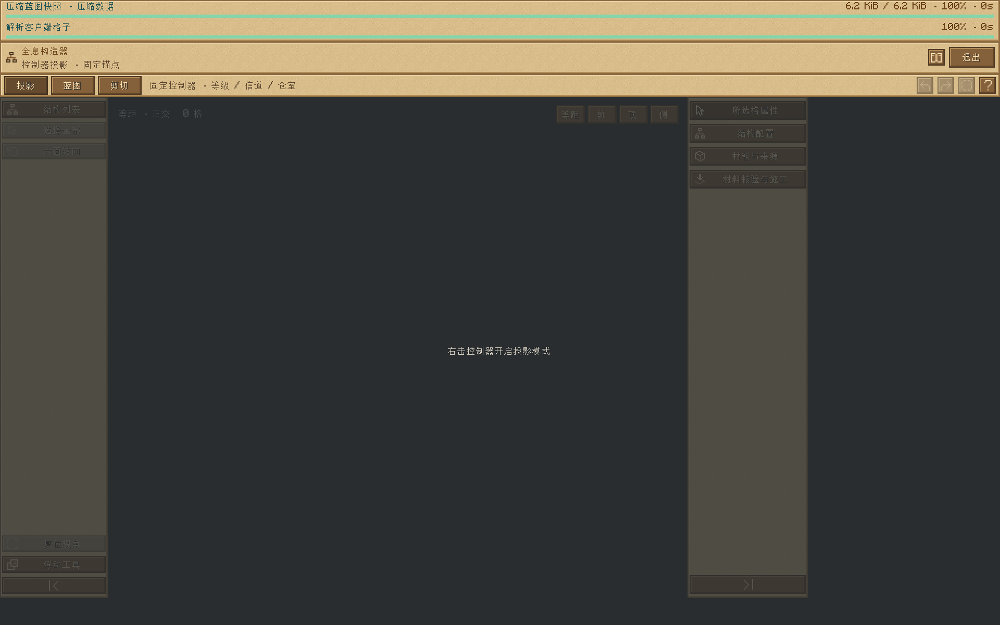</a></td>
    <td></td>
  </tr>
  <tr><td align="center">确认丢弃后的空投影页（05）/ Empty Projection after discard (05)</td><td></td></tr>
</table>

其余内嵌配图保留为此前版本的流程参考，原图与[旧截图 manifest](README/screenshots/manifest.json)不变；它们不作为 v0.1.40 原生验收证据。

世界蓝图操作支持可选等距视角：手持投影仪，在蓝图/剪切框选或蓝图放置中默认按 V 切入等距视角（可在控制设置中重新绑定），V 或 Esc 返回普通视角。未按 Ctrl 时不显示红色选点框；按住 Ctrl 后，左键固定点1、右键固定点2，选完一角只提示另一角；松开 Ctrl 后 Shift+左键提交。默认 B 开始自由框选，短按左键添加顶点，再按 B 闭合并确认当前预览区域；外框沿实际方块边界显示，保留凹角。普通左拖旋转镜头，拖动不会添加顶点；右拖平移，滚轮缩放（适配 lwjgl3ify 的滚轮单位，每格缩放上限约 1.5 倍）。Alt+滚轮以直接命中方块为参考，沿视线作 -64 至 +64 格的深度偏移。X 切换 X 光，选点无需等待网格重建完成；左侧竖条可拖动高度、切换隐藏上方/下方并显示 Y 值，切片默认渐变 1 格。相机移动不会移动玩家或扩大服务端施工权限；此模式直接调用 Core 引擎，无需安装 Outpost。

  <a href="https://github.com/MIAOKATZE/GT-Miao-Blueprint/releases">下载 / Download</a> ·
  <a href="https://miaokatze.com/wiki?mod=gtmb">使用指南 / Guide</a> ·
  <a href="https://miaokatze.com/blueprints">蓝图站 / Blueprint Library</a> ·
  <a href="https://miaokatze.com/">主页 / Homepage</a>

从一台多方块机器到整片工厂，**先看清结构，再编辑蓝图，最后用自己的材料施工。** 猫猫蓝图把结构投影、区域导入、三维编辑、精确材料核对与剪切搬家放进同一把投影仪：既可以设计下一条产线，也可以把已经建好的机器排队搬走。

*Preview a multiblock or a factory, edit its blueprint, then build with your own materials—or move existing builds with a persistent Cut queue.*

v0.1.30 开发版本将新建文字与图片的默认材质调整为 Chisel 羊毛粘土；图片优先使用羊毛粘土，并以陶瓦、羊毛补色。羊毛、陶瓦、混凝土、羊毛粘土、AE2 石英/聚能石英玻璃、Ender IO 的六种石英/纯净玻璃变种及 OpenBlocks 普通/旋转电梯的全部 16 色均纳入抵用券默认规则，管理员保存后自动更新材料核算。已有蓝图与预设的材质保留。有可抵扣方块即高亮，材料或券未备齐也能勾选预览；选券后优先抵扣并保留已有装饰库存；保存或升级时生成「完全抵用」标记，游戏与蓝图站显示沿用原券猫头、倾斜 45° 的像素风金色斜条幅，角部留空、两侧保留金黄色间距，悬浮可查看纯装饰蓝图的抵用说明；游戏条幅与蓝图条目的提示互斥显示。

v0.1.25 支持 [LittleTiles 添加图片与像素画](README/picture-blueprints.md)：从 `.minecraft/MiaoBlueprintPicture` 读取图片，默认短边 64 像素，支持比例锁定、固定羊毛/黏土/混凝土组合、滤镜与边缘同色抠图。图片沿用 [文字附加](README/text-blueprints.md) 的整体编辑、旋转、轴面位移和冲突校验，随蓝图保存后可脱离原文件再次编辑。图片分辨率上限为 1024×1024，支持像素大小与厚度；文字和图片均支持处理预设、后台生成与分块上传。下载请见 [Releases](https://github.com/MIAOKATZE/GT-Miao-Blueprint/releases)。

   
  <strong>把结构直接投到现场：外壳、仓室、控制器与内部空间一眼看清。</strong> 
  <em>See the structure in place before committing your materials.</em>

  <a href="#preview">结构投影 / Projector</a> ·
  <a href="#regions">区域大图 / Regions</a> ·
  <a href="#editing">蓝图编辑 / Editor</a> ·
  <a href="#materials">材料与补料 / Materials</a> ·
  <a href="#cut">剪切搬家 / Cut</a> ·
  <a href="#install">安装与上手 / Install</a>

## 想完成什么？ / Choose your workflow

| 你的目标 / Your goal | 从这里开始 / Start here |
| --- | --- |
| **建一台机器 / Build a multiblock** | [对准真实控制器导入结构](#preview)，查看仓室、调整目标，再核对材料施工。 / Import from its real controller, adjust targets and review materials. |
| **规划整片工厂 / Plan a factory** | [框选区域并识别成员结构](#regions)，在三维预览中编辑方块与结构参数。 / Capture a region, recognize its structures and edit the plan. |
| **保存自己的设计 / Save a design** | [进入蓝图工作区](#editing)，用属性侧栏调整结构，在蓝图设置中处理，再到蓝图库命名保存。 / Edit with the Properties sidebar, process in Blueprint Settings, then save in the library. |
| **搬走已经建好的东西 / Move a build** | [切换剪切模式](#cut)，连续暂存多份结构，分别预览、转向与粘贴。 / Queue cuts, preview each entry and place it elsewhere. |
| **准备施工物资 / Prepare supplies** | [查看精确材料与 NBT 需求](#materials)，按需提交 ME 补料订单或使用装饰抵用券。 / Inspect exact costs, request AE crafting or select a decoration voucher. |
| **交流与复用设计 / Share and reuse** | [打开蓝图站](#sharing)浏览、下载与分享，或转交同名 JSON + PNG 文件对。 / Browse the blueprint site or share a JSON + PNG pair. |

## 01 · 从控制器开始，看清后再施工 / Project & inspect

手持投影仪右键打开工作台；**对准真实控制器可导入它的结构**。在三维预览里旋转、分层查看，选中方块后调整外壳、仓室或朝向，再选择建造、替换或拆除。预览让你先检查结构和目标，材料与现场条件则在施工确认中核对。

*Import a structure from its real controller, inspect the 3D and layer views, then choose build, replace or dismantle.*

   
  <strong>右击控制器导入结构，调整仓室与目标，按需建造、替换或拆除。</strong> 
  <em>Inspect structure targets and construction controls together.</em>

**操作要点：**选中模型后用「属性」侧栏修改规划；可通过选区限定施工范围，确认前核对界面显示的范围。手持投影仪空闲时，屏幕顶部 HUD 也会列出当前可执行操作，包括打开工作台、框选区域，以及可用时快速放置上次蓝图或查看剪切暂存。

*Use the Properties sidebar for planning changes. Check the displayed construction scope; the idle top HUD shows available actions and shortcuts.*

## 02 · 从一台机器到整片区域 / Capture a larger plan

使用「框选区域」把世界中的一片建设区域导入工作台，**识别其中的成员结构，再在同一张蓝图内查看与编辑**。机器之间的布局、建筑外壳与公共空间可以放在一起规划；识别结果和待处理问题也会在预览中给出提示。

*Capture a world region, recognize its member structures and work on the surrounding layout in one blueprint.*

   
  <strong>框选整片区域，识别成员结构，在同一张蓝图内继续编辑与保存。</strong> 
  <em>Review the whole layout and its recognized structures.</em>

大图的导入、快照准备与传输按阶段显示状态：总量已知时显示实际进度与百分比，未知时显示动态等待与耗时。**关闭工作台后长任务仍可继续**，再次打开恢复原业务页面、选区与视角。稳定几何上的局部编辑会保留未改动的 16³ 预览分区；几何增删与专门审核在需要时完整刷新。

读取、区域采集与编辑的上限为 **999,999 个实际记录格**；包围盒中的空白位置不计入上限。

*Progress follows the actual task stages. Long tasks can continue after closing the workspace; reopening restores the page, selection and view. Local edits retain unchanged preview regions where applicable.*

*Reading, region capture and editing are limited to **999,999 recorded cells**; empty positions inside the bounding box do not count toward the limit.*

   
  <strong>分阶段显示区域导入与蓝图快照准备进度，返回世界后任务继续。</strong> 
  <em>See the current preparation stage and continue in the background.</em>

保存准备会跟随实际快照与序列化工作更新进度；传输结束后仍须等待原生预览、JSON + PNG 配对文件和最终保存确认。图中是 **79% 的准备中状态**，不代表保存已经完成。

*Transfer completion is followed by preview validation, paired files and final save confirmation. The screenshot shows preparation in progress.*

## 03 · 在蓝图库直接切换，在蓝图工作区调整与保存 / Switch designs, edit & save

**库行直接切换当前蓝图并更新中央预览。** 有未保存修改时，在切换前只提示一次是否放弃；取消会保留当前草稿。外层工作区分为投影、蓝图与剪切。右侧「属性」用于编辑方块、结构参数与仓室，「蓝图设置」用于处理身份、坐标和资源，「蓝图库」用于文件管理与保存；三页共用中央画布。规划修改不会立刻改动世界。

*Select a blueprint directly in the library. Projection, Blueprint and Cut have separate entries; Properties, Blueprint Settings and Library share the central editing canvas.*

<table>
  <tr>
    <td width="50%"></td>
    <td width="50%"></td>
  </tr>
  <tr>
    <td align="center"><strong>蓝图库：按条目选择，三维旋转与分层检查，再进入世界放置。</strong> <em>Choose a design, inspect its layers, then place it.</em></td>
    <td align="center"><strong>结构编辑：多选、移动与调整方块，让规划先在预览里完成。</strong> <em>Select, move and adjust blocks before construction.</em></td>
  </tr>
</table>

**结构参数也能继续调整。** 蓝图成员的主信号、等级、高度等子信道可重新设置，重新生成所选成员时保留其他成员及其编辑；请核对预览中的实际尺寸。旧蓝图归属不完整时先恢复可确认的范围，无法可靠确定时保留原图并提示重新导入。

蓝图编辑中默认 **G 显示或隐藏移动轴**；拖动彩色轴可实时单轴移动，拖动 XY、XZ、YZ 平面可同时移动两轴。底部指引按当前选择与操作更新，按 ^ 收起后会记住状态；F1 可查看与改绑编辑器快捷键。

与机器等级关联的线圈、分级外壳、框架和玻璃可单独选中；相关外壳显示紫色框及持续的「全选 T」提示，按 **T** 才扩选同一结构的相关外壳，已设置的仓室保持独立。

*Tier-related casings can be selected individually. Purple outlines and the T hint identify related cells in the same structure; press T to select them together while keeping configured hatches independent.*

*Adjust supported member signals and channels while retaining other members. Uncertain legacy boundaries require reimport; check the resulting dimensions. G toggles axis and plane handles; F1 opens editor key bindings.*

### 让文字与图片成为蓝图的一部分 / Add text & picture art

在空白工作区或蓝图编辑中，从左侧工具栏选择文字或图片工具（默认 F7 / F8），用 **LittleTiles 小瓷砖**制作标牌、立体字与像素画。文字可调整字体、颜色、材料和三维形态；图片从 `.minecraft/MiaoBlueprintPicture` 读取，支持固定材料组合、滤镜与边缘背景抠除。文字和图片都能保存处理预设，并按同色实体体积合并瓷砖及完整方块。

*Create signs, 3D lettering and pixel art with LittleTiles. Choose text fonts and materials, or convert local pictures with fixed palettes, filters and background removal; reuse processing presets and merge solid geometry.*

  <a href="README/screenshots/text-picture-showcase.png">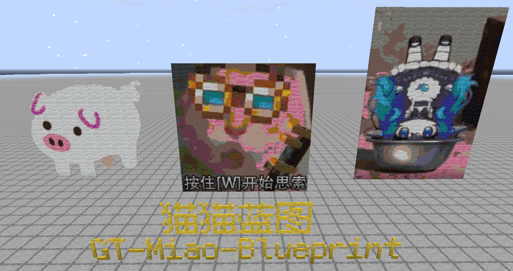</a> 
  <strong>把标牌、文字和图片放进设计，让蓝图也能表达你的想法。</strong> 
  <em>Bring lettering and picture art into your designs.</em>

<table>
  <tr>
    <td width="50%"><a href="README/screenshots/text-attachment-editor.png">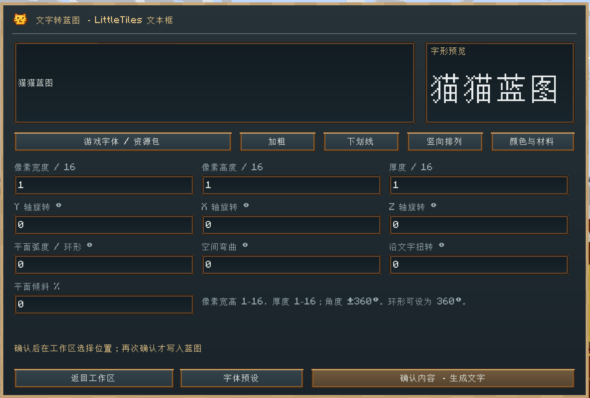</a></td>
    <td width="50%"><a href="README/screenshots/picture-attachment-editor.png">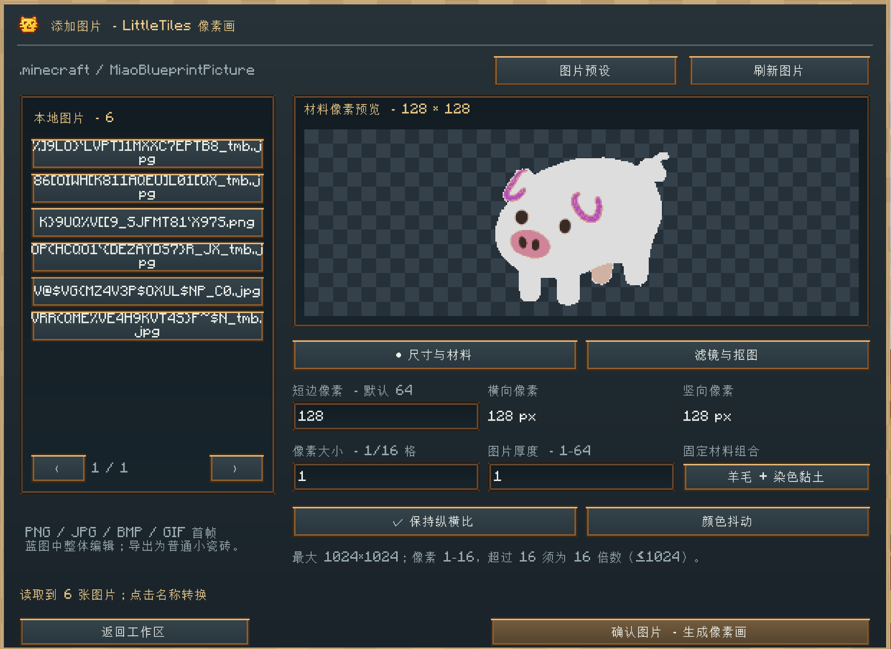</a></td>
  </tr>
  <tr>
    <td align="center"><strong>文字：字体、颜色、厚度、竖排与居中弧形。</strong> <em>Fonts, colors, thickness, upright columns and centered curves.</em></td>
    <td align="center"><strong>图片：比例、像素大小、厚度、滤镜与抠图。</strong> <em>Aspect ratio, pixel size, thickness, filters and background removal.</em></td>
  </tr>
</table>

确认内容后，在已有蓝图中点击选位，再用 **R / Alt+R、方向键或共用的轴线与平面手柄**整体调整；空工作区会直接创建新蓝图。点击高亮「确认放置」后校验冲突，失败保留预览供移动重试。附加对象随蓝图保存，整体选中后可再次编辑；实际建造仍按材料体积核算。详见[文字操作](README/text-blueprints.md)与[图片操作](README/picture-blueprints.md)。

*Pick a position and move or rotate the whole attachment before confirming. Saved attachments remain editable; construction still charges their actual material volume. An empty workspace creates a new blueprint directly.*

### 私用还是分享，由你逐步确认 / Review for private use or sharing

在「蓝图设置」中按「倾向自用」或「倾向分享」核对身份、坐标、网络和资源等处理选项，完成后到「蓝图库」命名保存。倾向自用时可尽量保留原配置；与坐标或去标识选择冲突时，先解决冲突。保存成功后的引导说明处理、保存与属性编辑的入口，也支持不再显示。

自动提示词在私用和分享倾向下均默认轻度。木匠方块的来源所有者不会阻塞蓝图，新放置方块按原生规则归当前放置者，无需为此去标识；形状、饰面、染色与其他配置保留，施工仍需支付相应装饰材料。原版立式、壁挂告示牌按一个告示牌物品计料并保留文字。

*Automatic annotations default to Light for both private and shared designs. Copied Carpenter blocks belong to their installer without requiring deidentification; shape, skins and other settings remain intact and their materials are still charged. Vanilla standing and wall signs consume one sign and retain their text.*

保存时不保留木匠方块的原主人信息；旧版蓝图仍可读取，方块形态与饰面保持。

*Saved blueprints do not retain the original owner information for Carpenter blocks. Older blueprints remain readable with their shapes and skins intact.*

*Blueprint Settings handles processing and saving. Review identity, coordinate, network and resource choices for private use or sharing, resolve conflicts, then save.*

   
  <strong>按用途核对处理选项，再保存自己的蓝图。</strong> 
  <em>Review processing choices for the way you intend to use the blueprint.</em>

## 04 · 把蓝图带回世界，锁定后再确认 / Position in the world

从蓝图库点击「放置所选蓝图」，在真实环境中检查占地与高度。预览可贴合命中表面，也可悬空；**普通视角下右键立即固定当前位置，边框由绿色切为青色；等距视角改用左键**。调整位置与姿态后，普通视角再右键打开材料确认，等距视角用左键；Esc 取消。

蓝图库浏览使用独立的客户端显示数据。预览区域中的大图可先显示 PNG 或首批方块，再逐步补齐；现有页脚按阶段显示进度，依赖数据的操作在数据就绪后开放，小图不强制等待 PNG。点击「放置所选蓝图」后，先只按内容哈希查找玩家可信缓存和服务器蓝图库；命中时直接复用，不打包或上传整份蓝图。未命中时才打包，并在蓝图库界面底部显示上传与校验进度，完成后进入世界预览。移动、旋转与微调只更新本地预览，不上传蓝图或发起服务器校验，锁定后仍可旋转。服务器蓝图的显示副本按版本缓存在本次连接中；完整下载才取得原件。

*Browsing uses independent client display data. Large previews may first show a PNG or an initial batch of blocks and fill in progressively; the existing footer shows stage progress and data-dependent controls become available when ready, while small previews need not wait for a PNG. Place selected blueprint first probes the player's trusted cache and server library by content hash alone; a hit reuses the content without building or uploading the full bundle. Only a miss builds the bundle and shows upload and validation progress in the library footer before entering the world preview. Moving, turning and nudging update the local preview without upload or server validation; rotation also works while locked. Server-library previews are cached by revision for the current connection; a full download retrieves the original.*

*Place a selected blueprint into the world preview and align it with the site. In ordinary view, right-click to lock the position and right-click again to review materials; in isometric view, use the left mouse button for these actions.*

   
  <strong>在世界里看位置、看朝向，确认后再投入材料。</strong> 
  <em>Check position and orientation at the actual site.</em>

| 定位操作 / Placement | 用途 / Result |
| --- | --- |
| **Alt + 滚轮 / Alt + wheel** | 普通视角调整悬空距离 **0–64 格**，0 为脚下；Alt 强制悬空。等距视角相对直接命中方块沿视线偏移 **-64 至 +64 格**，正值朝向相机、负值进入后方。普通视角滚轮保留快捷栏切换，等距视角滚轮缩放镜头。 / In ordinary view, adjust floating distance. Isometric offsets follow the viewing ray from the directly hit block: positive toward the camera, negative behind it (-64 to +64). Plain wheel switches the hotbar in ordinary view and zooms the isometric camera. |
| **R · Ctrl + R · Alt + R** | 普通视角下分别绕 Y 轴、X 轴旋转，或打开旋转／镜像／朝向面板；等距视角中 R 保留为镜头控制。 / In ordinary view, rotate around Y or X, or open pose controls; in isometric view, R remains a camera control. |
| **锁定后方向键 / Arrows after locking** | 水平微调位置，Alt + 上下调高度；Shift + 右键解锁。 / Nudge horizontally, adjust height with Alt + up/down, or unlock with Shift + right-click. |

普通蓝图的**空气空位不参与现场校验、材料核算与施工，也不会清空现场方块**；实际检查与放置针对非空气目标。空位仍保留在结构声明中，可继续调整结构或手动指定方块。忠实剪切粘贴与拆除沿用各自规则。

已确认的施工可在大图范围内继续，走离预览锚点不会单独终止任务；须保持**原工具槽中的同一把投影仪、当前世界与维度**，区块、权限与放置事件仍会检查。停止、部分完成和全部成功分别显示，进度走完不代表机器已经成型。

*Ordinary blueprint placement preserves existing blocks in air gaps. Admitted jobs can continue beyond the preview anchor's range with the same projector in its original slot, world and dimension; site checks still apply. Completion status does not certify multiblock formation.*

## 05 · 看清每一笔材料，再开工 / Review exact costs

锁定世界预览后，再次右键打开**材料确认窗口**，按窗口内的核算进度与**需求 / 已有 / 缺失**清单，核对放置位置、NBT 保留选项和当前库存，再确认施工。AE 缺料下单、刷新材料与装饰抵用券也在这个窗口操作；服务器按当前放置者核对真实材料、权限与现场条件。

*After locking the world preview, right-click again to open the material confirmation dialog. Follow its calculation progress and review required, available and missing quantities, placement, retained NBT and current stock before confirming construction. AE ordering, stock refresh and decoration vouchers use this dialog; the server checks actual materials, permissions and site conditions for the current placing player.*

蓝图使用无损字典压缩，重复方块描述与 NBT 内容只保存一份，旧格式仍可读取。服务端为每位玩家缓存最多 **10 份、合计 100 MB** 的可信内容，并可直接复用服务器蓝图库中相同哈希的原件；压缩不改变材料、配置与归属信息，实际施工仍绑定当前放置者。

*Lossless dictionaries store repeated block descriptions and NBT once while retaining legacy-file support. Each player can cache up to 10 admitted blueprints totaling 100 MB; matching server-library originals can also be reused. Construction still binds the current placing player.*

施工前打开独立的 **MUI2 材料确认窗口**，逐项查看**需求 / 已有 / 缺失**。每行对应图标、精确物品／NBT 与单位，同名材料不会混成一项；创造模式也显示完整需求。材料整行左右留白一致，表头与各列对齐；没有可处理内容的按钮禁用，悬停可查看原因。

*Review exact required, available and missing quantities by item and NBT identity, including full demand in creative mode.*

  <a href="README/screenshots/blueprint-material-review.png">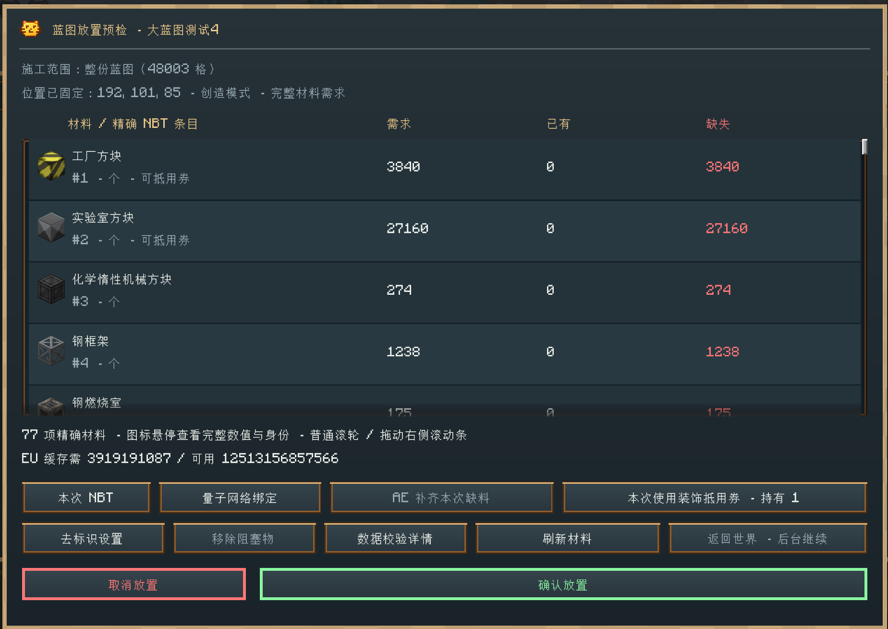</a> 
  <strong>施工范围、材料缺口、EU 与本次选项集中核对。</strong> 
  <em>Review scope, shortages, energy and construction choices together.</em>

**同一材料方案只需确认一次。** 报价或施工条件变化时仍须重新核对；打开清单、切换抵用券复用已核定的材料数据，主动「刷新材料」核对清单中的库存，实际施工前再检查现场与材料。普通按钮使用默认猫猫材质，需要处理的操作与确认才作强调；EU 只有不足时标红。

*Confirm the same material plan once; quote or construction-condition changes require another review. Refresh updates listed stock, and construction checks the site and materials again. EU turns red only when insufficient.*

### 库存与 AE 样板，保留配置也核对成本 / Inventory & pattern configuration

可完整解析材料成本的库存数据可选择「完全保留」，施工时匹配完整物品数据并扣除对应材料。可解析的 AE 编码样板保留配方，并将所需空白样板计入材料；样板输入总成等设备与配置材料分别列出。确实无法解析的信息会指出具体路径，移除后才能保存。

*Keep inventory data whose complete cost can be decoded, paying with matching item data. Supported encoded patterns retain their recipes and account for physical blank patterns; unreadable paths must be removed before saving.*

  <a href="README/screenshots/pattern-configuration.png">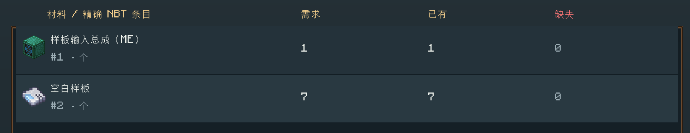</a> 
  <strong>样板配方随蓝图保留；设备与空白样板分项计数，配置所需物资也看得见。</strong> 
  <em>The hatch and blank patterns appear as separate material costs.</em>

### 缺料时主动下单，等待时回到世界 / Request missing materials

ME 缺料可明确提交**独立的真实 AE 合成订单**；关闭窗口后继续，重新打开可查看总进度和结果。按实际产物交付确认完成，材料进入 ME 网络后，**刷新材料，再确认施工**。取消只取消本次订单；已接管未交付的产物在退出或运行时重置时进入玩家回收暂存。退出游戏结束活动订单。

*Submit missing materials through an independent AE crafting request. Closing the window keeps it running; after delivery to ME storage, refresh and confirm construction. Leaving the game ends the active order, with received but undelivered outputs retained for recovery.*

### 建筑装饰可选抵用券 / Optional Decoration Voucher

无序合成 **2 个原生 StructureLib 全息投影仪 → 1 张装饰抵用券**。在材料确认中主动选用，主背包中的一张券可抵扣**本次施工**允许的建筑 Mod 材料；**GT、AE、工业部件、库存、流体与能量仍按实际需求支付**。有可抵扣方块时即可勾选查看方案，不要求其他材料或券已备齐；生存施工仍须主背包备券，只有成功放置抵扣材料后才消耗券。创造模式无需持券即可核对覆盖范围，施工不消耗券。

*Craft a voucher from two native StructureLib projectors and select it for one construction job. It covers eligible decoration only, is consumed when covered material is placed, and is not consumed in creative mode.*

服务器可在 `config/gtmb-decoration-voucher.cfg` 的 `decorationVoucher.enabled` 与 `allowedModIds` 调整启用状态和建筑 Mod，修改后重启生效。

*Server configuration controls availability and allowed decoration mod IDs; restart after changes.*

抵用券覆盖范围按当前服务端配置计算；列入范围不代表该次施工免支付。

*Voucher coverage follows the current server configuration; inclusion does not promise a payment-free build.*

## 06 · 连续剪切，排队搬家 / Queue cuts & move builds

想移动已经建好的机器或建筑，切换到**剪切模式**。它使用当前存档中每位玩家独立的暂存队列，通过原生快照携带方块、机器数据与库存，**与蓝图库、私用／分享处理独立**。先连续剪切需要搬走的内容，再逐项预览并决定放在哪里。

*Cut stores existing builds in a persistent queue for each player and save, carrying native block, machine and inventory data separately from blueprint sharing.*

   
  <strong>设计新蓝图，或搬走已有结构：从模式选择开始。</strong> 
  <em>Choose Blueprint for designs or Cut for moving existing builds.</em>

**进入与暂存：**蓝图模式下 Shift + 右键打开模式切换器，按住 Shift 继续右键切换，松开 Shift 进入；非框选时 Ctrl + Shift + 右键直接打开剪切列表。选择「剪切」开始框选：普通视角用左、右键设置两角；等距视角用 Ctrl+左键固定点1、Ctrl+右键固定点2，并用 Shift + 左键确认。保存条目后可继续框选；Ctrl + Shift + 右键打开暂存列表。

*Hold Shift and right-click to cycle modes, then release Shift to enter. Outside selection, Ctrl+Shift+right-click opens stored cuts. In ordinary view, set the two cut corners with left- and right-click and confirm with Shift+right-click; in isometric view, Ctrl+left-click fixes corner 1, Ctrl+right-click fixes corner 2, and Shift+left-click submits the selection. Save a cut and continue selecting.*

   
  <strong>连续剪切多份机器与建筑，暂存队列逐条预览，再旋转、镜像与定位粘贴。</strong> 
  <em>Choose and preview each queued build before placing it.</em>

**放置与撤销：**在列表中选择条目，点「放置」进入带方块边框的半透明原生模型预览；Alt + A/D 切换条目。普通视角下可旋转、镜像与调整模型朝向，等距视角中的 R 用于镜头操作。普通视角右键锁定、再右键确认；等距视角改用左键。非框选时 Alt + 右键可撤销剪切。只有成功粘贴或撤销后才消费条目，**Esc 完整退出剪切模式，保留全部暂存**。

可选「确认且以后不提醒」：偏好按当前存档与玩家保存，与剪切命名独立，只跳过放置确认框。确认框展示位置与姿态，姿态须提前调整。

*Preview each entry before confirming. In ordinary view, rotate or mirror the model pose; in isometric view, R controls the camera. Use right-click to lock and confirm in ordinary view, or left-click in isometric view. Only a successful paste or undo consumes an entry; Esc exits Cut mode while retaining every entry. The optional player/save preference skips only the placement prompt.*

## 07 · 保存之后，让设计继续流转 / Save & share

到 [**蓝图站 · 浏览、下载与分享**](https://miaokatze.com/blueprints) 寻找机器与建筑设计，或分享自己的蓝图。游戏内蓝图库入口常态为**橙色**，选中有效的已保存蓝图时显示**渐变流彩**；保存成功后，引导会强调浏览与分享入口，聊天中也提供**青色可点击链接**。

*Browse, download and share on the blueprint site. The in-game entry is orange by default, becomes an animated gradient for a valid saved selection, and is linked from successful-save guidance and chat.*

| 分享方式 / Share through | 操作 / How |
| --- | --- |
| **蓝图站 / Blueprint site** | 在 [miaokatze.com/blueprints](https://miaokatze.com/blueprints) 浏览、下载或分享设计。 / Browse, download or share designs on the site. |
| **游戏内公库 / In-game server library** | 蓝图库「客户端／服务器」切换，完成上传与下载。 / Switch Client/Server for library transfers. |
| **直接转交文件 / Manual transfer** | 将**同名 JSON + PNG 双文件**一起放入对方游戏目录的 `MiaoBlueprints/`。单人档打开或刷新蓝图库也会发现联机保存的独立双文件，无须转交集合清单；保留原文件、作者和版本。 / Copy the same-basename JSON + PNG pair into the recipient's game-directory `MiaoBlueprints/`. |

独立蓝图现在以 **蓝图名＋完整内容哈希** 命名，JSON 与 PNG 使用同一个文件名主体。蓝图库中的「升级旧蓝图」会一键重新无损压缩、校准配对文件名，并保留最近蓝图与上传关联；旧文件仍可读取。缺图、配对不明确或写入失败的条目会保留原件并报告原因。服务器公库升级由管理员执行。

*Individual blueprints use their name plus the full content hash, with matching JSON/PNG basenames. Upgrade old blueprints recompresses and renames existing pairs while retaining recent and upload associations. Unreadable or ambiguous pairs remain intact and are reported; server-library upgrades require an administrator.*

普通保存或覆盖保存会重新采集当前蓝图，并生成与 JSON 内容绑定的 PNG 预览。配对校验或写入失败时，原有 JSON 与 PNG 一并保留。旧本地文件读取不会静默升级；上传旧蓝图至蓝图站前请重新保存。站点三个预览位的任一位置都可使用同名配对 PNG，文字与图片附加展示规则不变。

*Every normal save or overwrite recaptures the current blueprint and creates a PNG preview bound to its JSON content. If pair validation or writing fails, both existing files are kept. Reading an older local file does not silently upgrade it; resave it before uploading to the site. Any of the site's three preview slots can use a same-basename paired PNG; text and picture attachment display rules remain unchanged.*

剪切暂存归当前存档与玩家，不参与蓝图分享。保存后的配置、资源与网络选择请按实际用途核对；完整处理规则见 [使用指南](https://miaokatze.com/wiki?mod=gtmb)。

*Stored cuts remain separate from sharing. Review configuration, resource and network choices for the intended use.*

## 安装、获取与快速上手 / Install & start

| 项目 / Requirement | 版本或说明 / Version or notes |
| --- | --- |
| **目标整包 / Target pack** | **GTNH2.9.0 正式版**；模组版本范围 **0.3.0 ~ +**（当前 0.3.0 为待发布草稿 / Draft） |
| **游戏与加载器 / Game & loader** | Minecraft **1.7.10** · Forge **10.13.4.1614** |
| **安装位置 / Install on** | **客户端与服务端均需安装 / Both client and server** |
| **必需依赖 / Required mods** | GregTech、StructureLib、Applied Energistics 2、GTNHLib、ModularUI、ModularUI2 **2.3.94-1.7.10**；目标 GTNH 整包已提供。 / Included in the target GTNH pack. |
| **可选模组 / Optional mod** | **GTIT**；兼容版本可提供猫猫机兑换。 / Compatible versions add the vending-machine exchange. |
| **下载 / Download** | [GitHub Releases](https://github.com/MIAOKATZE/GT-Miao-Blueprint/releases) |

**获取投影仪：**无序合成 **1 个 StructureLib 多方块结构全息投影仪 → 1 个猫猫蓝图全息投影仪**。同装兼容版本 GTIT 时，也可在猫猫机用 **1 枚普通猫猫币**兑换。

*Shapeless recipe: one StructureLib Hologram Projector → one Neko Blueprint Hologram Projector. Compatible GTIT also offers one projector for one ordinary Neko Coin.*

| 第一次使用 / First use | 操作 / Action |
| --- | --- |
| **1 · 导入 / Import** | 手持投影仪右键打开工作台，对准控制器导入结构，或框选区域。 / Open the workspace and import a controller structure or region. |
| **2 · 编辑 / Edit** | 在「属性」修改结构，「蓝图设置」核对自用／分享处理，再从「蓝图库」保存。 / Adjust properties, review processing and save in the library. |
| **3 · 定位 / Position** | 从蓝图库选择蓝图并放置预览，调整朝向；普通视角右键锁定位置，等距视角用左键。 / Select a blueprint, preview it in the world and adjust its pose; right-click to lock in ordinary view, or left-click in isometric view. |
| **4 · 施工 / Build** | 普通视角再右键核对材料，等距视角用左键；处理缺料或绑定要求后确认，Esc 取消。 / In ordinary view, right-click again to review materials; use left-click in isometric view. Resolve missing materials or binding requirements, then confirm; Esc cancels. |

感谢玩家提供全部 **12 张功能展示截图**；点击图片可查看原尺寸。[素材清单 / Image credits](README/screenshots/manifest.json)。

## 快捷键与更多说明 / Controls & further reading

<strong>剪切、选区与旋转 / Cut, selection and rotation controls</strong>

| 操作 / Action | 用途 / Result |
| --- | --- |
| 选区 / Selection | 普通视角用左、右键设置两角；Alt+右键可按悬空光标标记第二点。等距视角用 Ctrl+左键固定点1、Ctrl+右键固定点2，Shift+左键确认。首次完成选区后，Z 开关加选，Alt+Z 开关减选；重复按对应键关闭。Shift+Z 合并、扣负并去重。可在控制设置绑定 C 使用连续多边形：左键逐点绘制，点击首点闭合，再点方块调整高度，按 V 完成；Shift+C 减选。绘制时再按 C 清除点并重画。Ctrl+Z/Y 逐步撤销/重做；Delete 删除当前框，方向键平移，Alt+上下调高低。蓝图与剪切均适用。 / In ordinary view, set two corners with left- and right-click; Alt+right-click can mark the second point at the floating cursor. In isometric view, Ctrl+left-click fixes corner 1, Ctrl+right-click fixes corner 2, and Shift+left-click submits the selection. After the first complete selection, Z toggles add mode and Alt+Z toggles subtract mode; press the same key again to turn it off. Shift+Z merges, subtracts negatives and deduplicates. Bind C in Controls for continuous polygon selection: place points with left-click, click the first point to close, click a block to adjust height, then press V to finish; Shift+C subtracts the selection. Press C while drawing to clear the points and start over. Ctrl+Z/Y undo and redo each step; Delete removes the current box, arrows move it and Alt+up/down changes height. Applies to Blueprint and Cut. |
| 保存剪切 / Store a cut | 普通视角完整选区时 Shift+右键进入剪切确认；等距视角用 Shift+左键确认。保存至当前玩家／存档队列后可继续框选；非框选时 Ctrl+Shift+右键打开暂存列表。 / In ordinary view, Shift+right-click confirms a complete selection; in isometric view, use Shift+left-click. Saving stores it in this player/save queue and allows another selection; outside selection, Ctrl+Shift+right-click opens the stored cuts list. |
| 暂存列表 / Stored cuts | 选择条目查看独立 3D 预览，点「放置」进入世界预览。Alt+A/D 切换条目，非框选时 Alt+右键撤销；仅成功粘贴或撤销后消费条目。 / Select an entry for its independent 3D preview and click Place for the world preview. Alt+A/D switches entries; Alt+right-click outside selection undoes a cut. Only successful paste or undo consumes an entry. |
| 姿态 / Pose | 普通视角下确认前用 R 绕 Y 轴旋转，Ctrl+R 绕 X 轴旋转，Alt+R 打开旋转、镜像和朝向面板；等距视角中 R 用于镜头操作。 / In ordinary view, use R to rotate around Y, Ctrl+R around X, or Alt+R for pose controls; in isometric view, R controls the camera. |
| 剪切放置 / Cut placement | 普通视角右键锁定预览，再右键确认；等距视角改用左键。可选「确认且以后不提醒」。该偏好按当前存档与玩家保存，与剪切命名独立，只跳过放置确认框；确认框显示位置与姿态，姿态须提前调整。 / In ordinary view, right-click to lock the preview and right-click again to confirm; in isometric view, use the left mouse button. Optionally choose Confirm and don't ask again. This player/save preference is separate from cut naming and skips only the placement prompt. The prompt shows position and pose; adjust pose beforehand. |
| 退出剪切 / Exit Cut | **Esc 完整退出剪切模式，保留全部暂存。**剪切放置使用带方块边框的半透明原生模型预览。 / **Esc exits Cut mode and retains every stored entry.** Cut placement uses translucent native models with block outlines. |

### 传输、维护与开发者 / Transfers, administration & development

<strong>传输、后台任务与开发者说明 / Transfers, background tasks and developer notes</strong>

新安装默认全服聚合上传限速 **128 KiB/s**、下载限速 **512 KiB/s**。管理员可在服务器蓝图库设置中调整；旧版未标记的上下行 16/16 配置首次升级为上述默认值，其他自定义值保留，之后明确设置的 16/16 不会重复迁移。客户端与服务端均更新后，上传连续发送分片并合并回执；连接旧服务端时保留原单片传输。

New servers default to shared upload/download limits of **128 KiB/s** and **512 KiB/s**. Operators can adjust both in server library settings. Unversioned legacy 16/16 limits migrate once to these defaults; other custom values and later explicit 16/16 choices are preserved. Updated clients and servers pipeline uploads; older servers retain compatible single-chunk transfer.

等待界面在总量已知时显示实际进度与百分比，未知时显示动态等待与耗时。长任务关闭界面后继续，再次打开恢复原业务页面、选区与视角。保存成功的引导说明蓝图设置、蓝图库与属性编辑的入口，并支持不再显示。

Waiting views show measured progress and percentages when totals are known, or activity and elapsed time otherwise. Long tasks continue after closing the workspace; reopening restores the business page, selection and view. Save guidance explains Blueprint Settings and the Properties sidebar and can be dismissed persistently.

已确认的蓝图施工可在大图范围内继续，走离预览锚点不会单独终止任务；仍须保持原工具槽中的同一把投影仪、当前世界与维度，实际区块、现场权限和放置事件继续检查。停止、部分完成与全部成功分别显示，进度走完不代表机器成型。保存准备按实际快照与序列化工作显示进度，匹配本次任务的有效活动会延长等待；传输结束后仍须等待原生预览、配对文件与最终保存确认。
An admitted blueprint construction job can continue while you inspect a large build, including beyond the preview anchor's admission range. Keep the same projector in its original slot and remain in the same world and dimension; chunk, permission and placement checks still apply. Stopped, partial and successful outcomes remain distinct. Save preparation reports actual snapshot and serialization work, and correlated activity extends the wait; transfer completion still requires preview validation, paired files and final save confirmation.

管理员可用 **`/gtmb restart`（权限等级 4，支持 Tab 补全）**重置 GTMB 运行任务与会话、清除旧回调与传输，并独立取消 AE 订单；已施工方块、回收暂存与剪切记录保留，随后重新打开投影仪。命令须由服务器线程正常执行；已进入不可中断的原生原子写盘可能完成原提交，不能借此强制解除卡死磁盘或被阻塞的 tick 线程。
Administrators can use **`/gtmb restart` (permission level 4, with Tab completion)** to reset GTMB runtime tasks, sessions, stale callbacks and transfers, and cancel its independent AE orders. Placed blocks, recovery storage and persistent cuts remain available. The server thread must be able to execute the command; an atomic disk operation already in progress may still finish. This runtime reset cannot forcibly unblock a stuck disk or server tick thread.

稳定几何上的蓝图编辑按脏格更新，保留未改动的 16³ 预览分区。共享材料规划与大图首次快照分阶段执行；世界修改与材料结果由服务端决定。几何增删和专门审核在需要时使用完整刷新。

Edits to stable blueprint geometry update dirty cells and retain unchanged 16³ preview regions. Shared material planning and initial large snapshots run in stages; world changes and material authority remain on the server. Geometry changes and specialized audits retain complete refreshes where required.

校验通过有界任务缓存复用相同完整 NBT；不同机器、覆盖板和 AE 配置分别处理。`gradlew runBlueprintValidationBenchmark` 对照生产校验路径启用与禁用缓存的结果；该组件基准不包含实际世界采集、网络和渲染。

Validation reuses identical complete NBT within a bounded task cache, keeping different machine, cover and AE configurations separate. `gradlew runBlueprintValidationBenchmark` compares production validation with caching enabled and disabled; this component benchmark excludes live-world capture, networking and rendering.

- 完整操作、私用／分享处理与资源规则 / Controls, private/shared processing and resource rules: [GTMB Guide](https://miaokatze.com/wiki?mod=gtmb).
- 查找与分享蓝图 / Find and share blueprints: [Blueprint Library](https://miaokatze.com/blueprints).
- 社区扩展与模块契约 / Community integrations and module contracts: [Public API](API.md).
- 默认关闭的存档内 agent 测试区：通过 `config/gtmb-testlab.cfg` 开启；`/gtmbtestlab`、隔离设施、压力测试与报告边界见 [TESTLAB.md](TESTLAB.md)。 / The save-local agent laboratory is disabled by default; enable it in `config/gtmb-testlab.cfg`. See TESTLAB.md for commands, fixture isolation, stress tests and report boundaries. Ordinary players do not need to enter its dimension.

## License & Origins / 许可与来源

[AGPL-3.0](LICENSE) · 源自 / Origin: GT-Interesting-Thing · 现独立维护为 / Independently maintained as GTMB · 开发记录 / Development notes: [GT-Miao-Blueprint-plan](https://github.com/MIAOKATZE/GT-Miao-Blueprint-plan).

兼容平台：GTNH2.9.0 正式版。
