

<h1 align="center">GT-Miao-Blueprint</h1>

<strong>猫猫蓝图 · 规划结构、编辑蓝图，用自己的材料建造</strong> <strong>Miao Blueprint · Plan structures, edit blueprints and build with your materials</strong>

  
  
  
  
  

**本轮准备版本：GTMB 0.1.55。正式发布与下载请看 [Releases](https://github.com/MIAOKATZE/GT-Miao-Blueprint/releases)。必需前置：[MIAOKATZE Core 0.1.27 或更新版本](https://github.com/MIAOKATZE/MIAOKATZE-Core)，客户端与服务端均须安装。** FalsePatternLib 缺失时可补下载；已有旧版请手动更新。

*Prepared version: GTMB 0.1.55. See Releases for published downloads. MIAOKATZE Core 0.1.27 or newer is required on both client and server. Missing FalsePatternLib can be downloaded automatically; update an existing older copy manually.*

GTMB 是面向 **GTNH 2.9.0 RC** 的结构规划、蓝图编辑与材料施工工具。手持猫猫蓝图全息投影仪，查看控制器结构、采集机器和建筑、编辑布局与图文，再预览、核对材料并施工。搬家时，可把现有结构逐份剪切暂存，再放回世界。

*GTMB brings structure planning, blueprint editing and material-backed construction to GTNH 2.9.0 RC. Inspect controllers, capture existing builds, edit layouts and artwork, then preview and review costs before construction. A separate Cut queue moves existing builds.*

  <a href="README/screenshots/20261025/blueprint-workspace.png">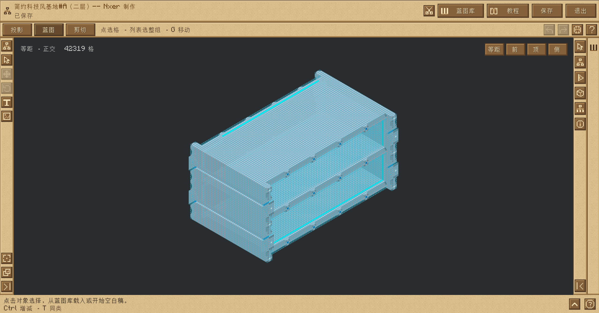</a> 
  蓝图画布、三种工作区、可收纳工具栏与保存入口。 <em>A shared canvas with workspace tabs, collapsible tools and saving.</em>

[安装与上手 / Start](#install) · [三种模式 / Workspaces](#workspaces) · [框选 / Capture](#import) · [编辑与图文 / Edit](#editing) · [处理与保存 / Save](#saving) · [材料施工 / Build](#materials) · [剪切搬家 / Cut](#cut) · [分享 / Share](#sharing)

## 安装与第一次使用 / Install & get started

| 项目 / Requirement | 说明 / Details |
| --- | --- |
| 目标环境 / Target | **GTNH 2.9.0 RC** · Minecraft **1.7.10** · Forge **10.13.4.1614** |
| 安装位置 / Installation | 客户端与服务端均安装 GTMB 和 **Core ≥ 0.1.27**。 / Install both on the client and server. |
| 整包依赖 / Pack dependencies | GregTech、StructureLib、Applied Energistics 2、GTNHLib、ModularUI、ModularUI2 **2.3.92-1.7.10**；由目标整包提供。 / Provided by the target pack. |
| 图文附加 / Artwork | 文字与图片生成需要 **LittleTiles**。 / Text and picture generation requires LittleTiles. |
| 获取 / Download | [GitHub Releases](https://github.com/MIAOKATZE/GT-Miao-Blueprint/releases) · [Core](https://github.com/MIAOKATZE/MIAOKATZE-Core) |

无序合成 **1 个 StructureLib 多方块结构全息投影仪 → 1 个猫猫蓝图全息投影仪**。安装兼容版本 GTIT 时，也可在猫猫机用 **1 枚普通猫猫币**兑换。

*Shapeless recipe: one StructureLib Hologram Projector → one Neko Blueprint Hologram Projector. Compatible GTIT versions also offer it for one ordinary Neko Coin.*

1. **导入：**右键控制器查看结构投影，或使用区域框选采集机器与建筑；也可从蓝图库载入设计。
2. **编辑：**在蓝图工作区调整结构与布局，加入文字或图片。
3. **保存：**在「蓝图设置」核对自用／分享处理方案，完成后保存；已载入的私人蓝图可用 **Ctrl+S** 快捷保存。
4. **施工：**从蓝图库点「放置所选蓝图」，调整位置与朝向，锁定后核对材料、EU 和网络要求，再确认施工。

*Import a controller structure, capture a region or load a blueprint. Edit the layout and artwork, review processing choices, then save. Choose Place from the library, position the preview and review materials, energy and network requirements before building.*

## 三种工作区，各有用途 / Three workspaces

| 工作区 / Workspace | 用途 / Purpose |
| --- | --- |
| **投影 / Projection** | 以真实控制器为固定锚点，调整等级、信道与仓室，核对现场差异并建造、升级或拆除。 / Plan around a real controller, configure tiers, channels and hatches, then build, upgrade or dismantle. |
| **蓝图 / Blueprint** | 编辑区域草稿、空白图文稿或已保存蓝图；移动、复制、处理、保存并进入世界放置。 / Edit captured regions, artwork and saved designs; move, copy, process, save and place them. |
| **剪切 / Cut** | 浏览当前玩家、当前存档的独立暂存队列，预览、放置或撤回原处。 / Preview, place or restore entries in this player's save-local Cut queue. |

投影中的控制器位置固定，整组移动与复制在蓝图中进行。剪切保存原生快照，与蓝图库和分享处理独立。空投影页会提示右键控制器开启；有内容的投影切入蓝图时先询问是否放弃，取消保留原状态。切换已编辑的蓝图时，也会先询问是否放弃未保存修改。

*Projection stays anchored to its controller; whole-layout movement belongs to Blueprint. Cut uses native snapshots separately from the blueprint library. Leaving a populated projection asks before discarding it; switching an edited blueprint also protects unsaved changes.*

<table>
  <tr>
    <td width="50%"><a href="README/screenshots/20261025/projection-workspace.png">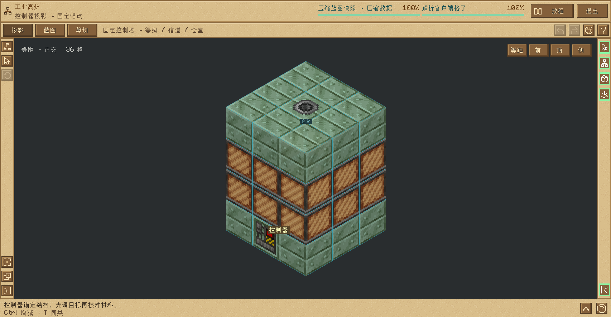</a></td>
    <td width="50%"><a href="README/screenshots/20261025/collapsible-tools.png">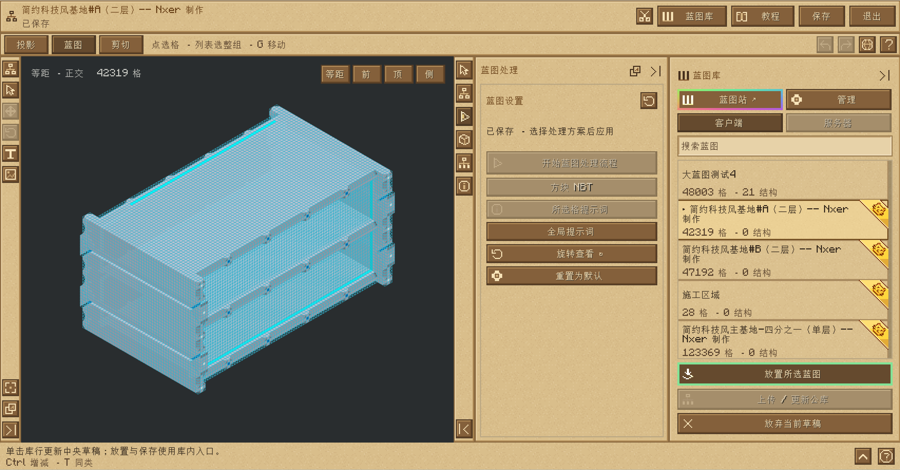</a></td>
  </tr>
  <tr><td align="center">围绕控制器规划结构。 <em>Plan around a controller.</em></td><td align="center">按需展开侧栏，为画布留出空间。 <em>Open panels when needed and keep room for the canvas.</em></td></tr>
</table>

工具栏默认以图标显示，可展开名称，悬停查看说明；属性、蓝图设置和蓝图库按需收纳。顶部显示文档状态与并行任务进度，底部指引随操作变化。**蓝图画布与蓝图等距镜头：中键拖动平移、右键拖动旋转、滚轮缩放。投影与剪切镜头：左拖旋转、右拖平移。**

*Tool rails expand to show names, panels collapse, and contextual hints follow the current operation. In Blueprint, middle-drag pans and right-drag rotates. Projection and Cut use left-drag to rotate and right-drag to pan; the wheel zooms.*

## 框选机器与建筑 / Capture a region

普通视角用左、右键设置两个角，完成后 **Shift+右键**提交。可组合多个选区、增加或减去区域，再导入蓝图或保存剪切。外表面显示斜线网格，当前两角用紫色框和左／右键标签标记；方向键平移，Alt+上下调整高度。

*Set two corners with left- and right-click in ordinary view, then submit with Shift+right-click. Combine or subtract regions before blueprint import or cutting. Surface hatching and purple corner labels show the volume; arrows move it and Alt+up/down changes its height.*

<table>
  <tr>
    <td width="50%"><a href="README/screenshots/20261025/selection-guidance.png">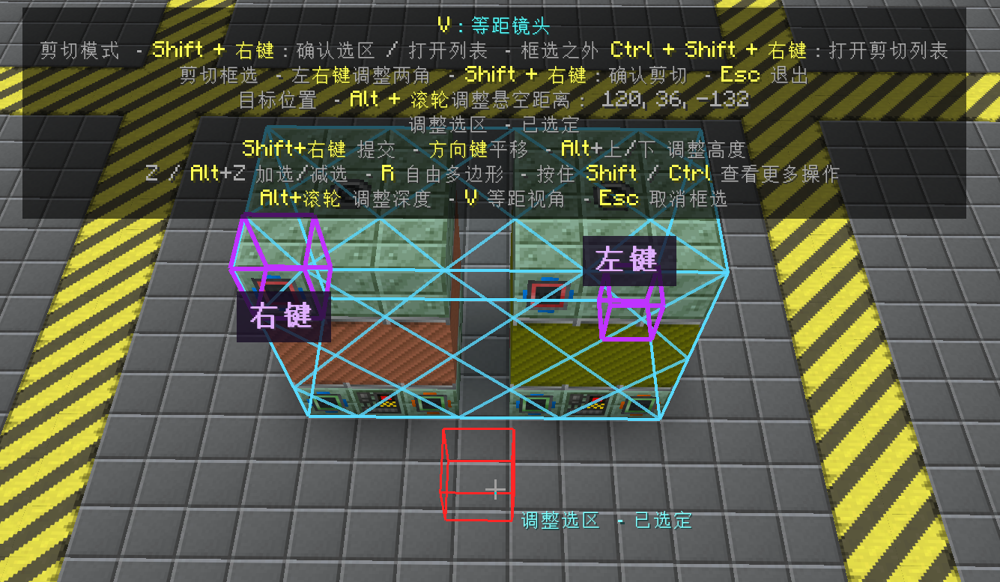</a></td>
    <td width="50%"><a href="README/screenshots/20261025/polygon-selection.png">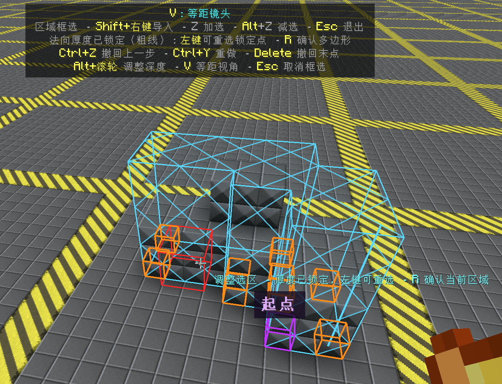</a></td>
  </tr>
  <tr><td align="center">角点、范围与当前操作同时可见。 <em>See corners, volume and the next action.</em></td><td align="center">按实际边界框选凹形轮廓。 <em>Capture concave outlines along their boundary.</em></td></tr>
</table>

**Z / Alt+Z** 为下一个框选择加选／减选，完成后恢复角点编辑；青色表示加选、红色表示减选。**Shift+Z** 合并并去重。默认 **B** 开始自由多边形，支持水平与两种轴对齐竖直平面；点击紫色首点闭合，再锁定法向厚度并确认。**Delete** 先撤回未完成输入，否则撤回最近一个完整选区；**Ctrl+Z / Ctrl+Y** 撤销／重做。取消非空选区会询问是否放弃。

*Z / Alt+Z adds or subtracts the next box; cyan means add and red means subtract. Shift+Z merges the result. B starts a polygon on a horizontal or axis-aligned vertical plane: close it at the purple starting point, lock its extrusion depth and confirm. Delete removes pending input or the latest complete selection; Ctrl+Z/Y undoes or redoes changes.*

**等距与透视：**框选或放置时默认 **V** 进入等距视角，V / Esc 返回。按住 **Ctrl+左键／右键**设置两角，松开 Ctrl 后 **Shift+左键**提交；多边形落点、闭合和厚度选择也需要 Ctrl，松开后操作镜头。**X** 开关 X 光，可拖动左侧高度条隐藏上方或下方，**Alt+滚轮**调整选点深度。

*V opens isometric view. Hold Ctrl and left/right-click to set corners, then release Ctrl and use Shift+left-click to submit. Polygon input also requires Ctrl; release it for camera navigation. X toggles X-ray slicing; Alt+wheel adjusts picking depth.*

<table>
  <tr>
    <td width="50%"><a href="README/screenshots/20261025/isometric-selection.png">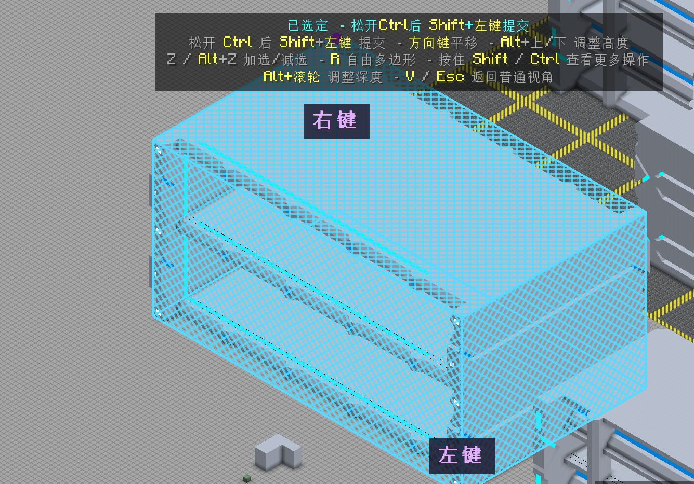</a></td>
    <td width="50%"><a href="README/screenshots/20261025/xray-slicing.png">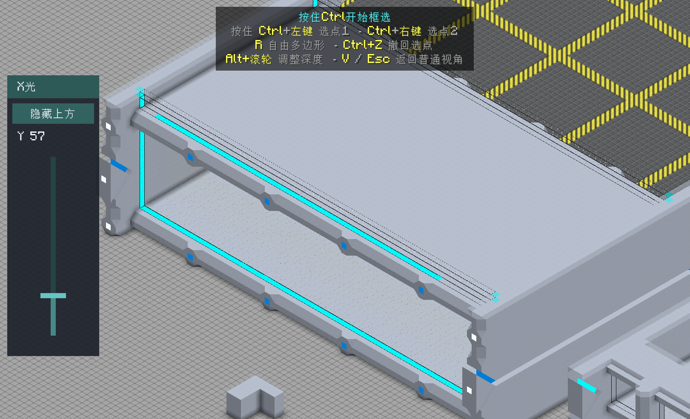</a></td>
  </tr>
  <tr><td align="center">等距检查大型选区。 <em>Inspect large selection volumes.</em></td><td align="center">切片查看内部与被遮挡位置。 <em>Slice through obstructing layers.</em></td></tr>
</table>

蓝图读取、区域采集与编辑最多支持 **999,999 个实际记录格**。导入、快照、传输与生成分阶段显示进度；长任务可在关闭工作台后继续，重新打开恢复原页面、选区与视角。相机视角不改变玩家位置或服务端施工权限。

*Reading, capture and editing support up to 999,999 recorded cells. Staged progress covers capture, snapshots, transfers and generation; long tasks can continue with the workspace closed. Camera navigation does not change player position or server permissions.*

## 在蓝图里编辑布局与图文 / Edit layouts & artwork

蓝图库单击条目即可载入中央画布。在「属性」调整受支持结构的主信号、等级、高度和仓室；点击单格、Ctrl 多选或 Shift 拖框，移动、复制和删除草稿内容。**G** 显示／隐藏位移手柄：彩色轴作单轴移动，XY / XZ / YZ 平面作双轴移动。等级相关外壳显示紫色关联提示，按 **T** 扩选同一结构的相关外壳。修改草稿不会直接改变世界。

*Click a library entry to load it. Edit supported structure channels and hatches, select cells or groups, then move, copy or delete draft content. G toggles axis and plane handles; T expands a related-casing selection within the same structure. Draft edits do not directly alter the world.*

文字与图片工具打开内部悬浮编辑窗，保留画布和视角。文字支持游戏／资源包字形、开放字体、材料与颜色、竖排、厚度、旋转、环形与弯曲；图片支持材料组合、比例与分辨率、抖动、滤镜和边缘背景抠除。源图放入客户端游戏目录的 **`MiaoBlueprintPicture/`**，支持 PNG、JPEG、BMP 和 GIF 首帧。

*Floating editors preserve the workspace and view. Text offers fonts, materials, color, vertical layout and 3D shaping. Pictures offer material palettes, resolution, dithering, filters and background removal. Place source images in the client game directory's MiaoBlueprintPicture/ folder; PNG, JPEG, BMP and the first GIF frame are supported.*

<table>
  <tr>
    <td width="50%"><a href="README/screenshots/20261025/text-editor.png">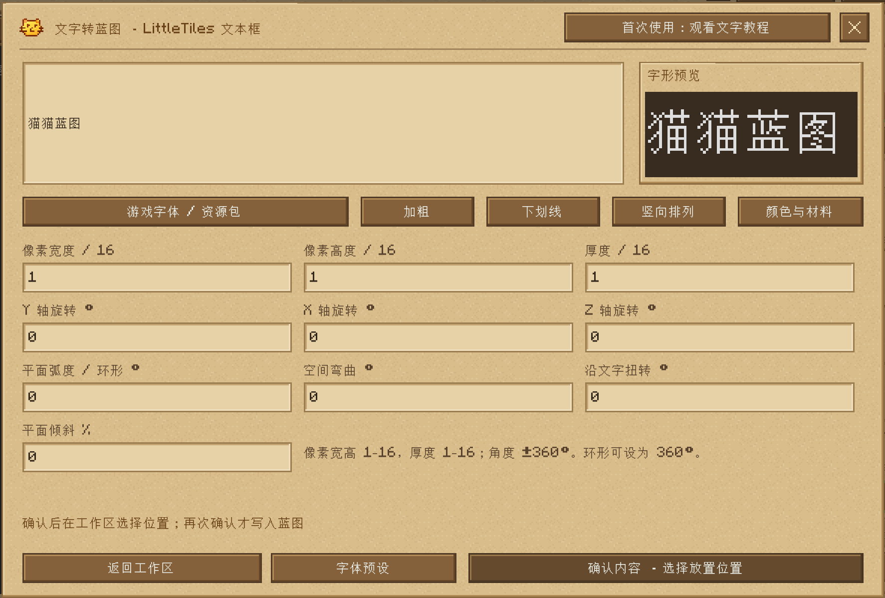</a></td>
    <td width="50%"><a href="README/screenshots/20261025/picture-editor.png">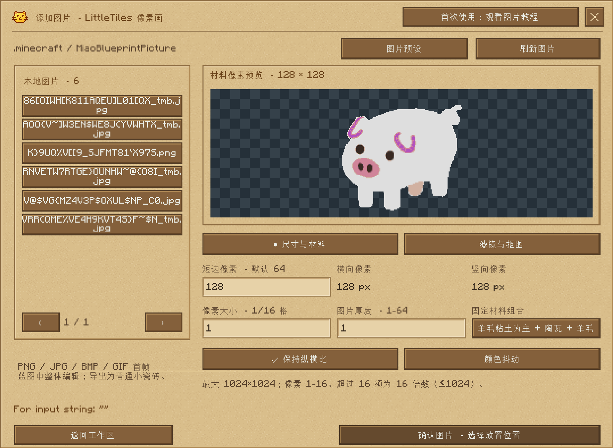</a></td>
  </tr>
  <tr><td align="center">字形、尺寸、材料与三维形态。 <em>Glyphs, dimensions, materials and 3D form.</em></td><td align="center">材料色预览、尺寸与转换参数。 <em>Palette preview, dimensions and conversion settings.</em></td></tr>
</table>

空工作区确认首个附加对象会创建新蓝图；已有内容时先选位，再用旋转、方向键、轴线或平面手柄整体调整，点击高亮确认后加入。附加对象随蓝图保存，点击即可整体选择并再次编辑；字体与图片预设各自支持套用、改名和删除。施工生成普通 LittleTiles 瓷砖或等价完整方块，重新框选世界不会恢复图文编辑身份。

*The first attachment creates a blueprint in an empty workspace. With existing content, choose a position, adjust the whole object and confirm. Saved attachments remain editable, and text/picture presets can be reused. Built artwork becomes ordinary LittleTiles or equivalent full blocks; recapturing it does not recover its attachment identity.*

图文生成需要 LittleTiles，材料按实际体积核算；尺寸、体积和数据预算同时生效。详细参数见 [文字转蓝图](README/text-blueprints.md)与[图片附加](README/picture-blueprints.md)。

*LittleTiles is required. Costs follow material volume, and resolution, volume and data limits all apply. See the text and picture guides for detailed parameters.*

## 内置教程，跟着界面学习 / Built-in tutorials

顶部「教程」提供投影、蓝图、结构、剪切列表、普通／等距框选与剪切，以及独立的文字附加和图片附加课程。高亮控件与分步动画演示载入、移动、复制、处理、材料核对和放置；可上一步、下一步、跳过或从头开始。教学使用隔离状态，结束后恢复原工作区。

*The tutorial menu covers Projection, Blueprint, structures, Cut storage, ordinary/isometric selection and cutting, plus text and picture lessons. Highlighted controls and animated steps demonstrate the workflow. Go back, advance, skip or restart; leaving restores the original workspace.*

<a href="README/screenshots/20261025/tutorial.png">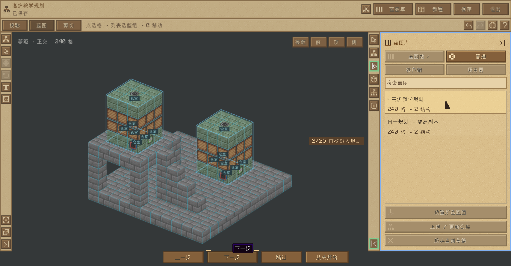</a>

## 按用途处理，再保存 / Review processing & save

「蓝图设置」中的开始／重新核对入口打开处理流程，按**倾向自用**或**倾向分享**核对去标识、量子网络、坐标、NBT 与提示词。自用默认建议去标识等级 **0**、量子网络保留；分享默认建议等级 **6**、量子网络重绑；两者坐标默认自动、提示词默认轻度。它们是建议方案，实际内容仍可能要求更严格处理，冲突须先解决。

*Private use recommends deidentification level 0 and preserving quantum networks; sharing recommends level 6 and rebinding. Both default to automatic coordinate handling and light annotations. These are recommendations; actual content can require stricter processing. Review identity, networks, coordinates, NBT and annotations before saving.*

服务端确认处理后，结果页提供保存、另存为和流程预设管理。**流程预设**保存可复用的处理选择，支持保存、更新和删除；它与自用／分享倾向不同，也不会替下一份蓝图确认具体坐标资源。可解析库存与 AE 编码样板可保留配置并计入对应材料；无法解析的数据会指出路径，处理后才能保存。木匠方块不保存原主人信息，保留形状、饰面和染色，新放置按原生规则归放置者。

*After server confirmation, save, save as or manage reusable processing presets. Presets are separate from the two recommendations and do not preapprove another blueprint's coordinate resources. Decodable inventories and AE patterns retain configuration with their physical costs; unreadable paths must be resolved. Carpenter shapes, skins and dyes remain, while old owner data is removed and ownership follows native placement rules.*

保留原量子网络的自用蓝图仅能在可核验的原存档、原网络与维度中使用；分享重绑时，按类群选择背包中已绑定自己真实网络的量子终端。复制设计不会复制原网络的访问权。

*Preserved quantum bindings require the verifiable original save, network and dimension. Shared designs bind each group through a terminal in your inventory that is already linked to your own real network; copying a design does not copy network access.*

**默认放置方向与 PNG 视角分别设置：**蓝图设置标题旁的旋转按钮每次将整图转 **90°**，保存后影响载入与默认放置方向。转动镜头只改变查看角度；正常保存或覆盖保存会从真实蓝图生成配对 PNG，采用发起保存时的画布视角。无编辑器视角上下文的导出使用默认角度。

*The rotation button turns the whole blueprint by 90°, changing saved geometry and its default placement orientation. Camera rotation changes only the view. Saving or overwriting renders the paired PNG using the view captured when saving began; exports without an editor view use the default angle.*

**Ctrl+S** 保存当前编辑的私人蓝图；公库蓝图另存为私人副本并保留原作者。顶栏保存入口可命名、设置选项和另存为。涉及新增敏感数据或策略变化时仍须复核；保存以最终成功提示为准。

*Ctrl+S saves the currently edited private blueprint; a server-library design becomes a private copy with its original author. Use the full Save entry for naming and options. Sensitive-content or policy changes still require review; wait for final confirmation.*

## 先定位，再核对材料施工 / Position, review & build

从蓝图库点「放置所选蓝图」进入世界预览。普通视角下 **R** 水平旋转、**Ctrl+R** 垂直旋转、**Alt+R** 打开姿态设置；右键锁定，再右键核对材料。等距视角会直接显示并更新预览，**Ctrl+左键**锁定，再 **Ctrl+左键**核对材料；**Ctrl+Shift+左键**可解锁调整。放置仍属于蓝图流程。

*Choose Place from the library. In ordinary view, R rotates horizontally, Ctrl+R vertically and Alt+R opens pose settings; right-click to lock, then review costs. In isometric view the preview appears and updates directly: Ctrl+left-click locks, then opens material review; Ctrl+Shift+left-click unlocks it.*

  <a href="README/screenshots/20261025/isometric-placement.png">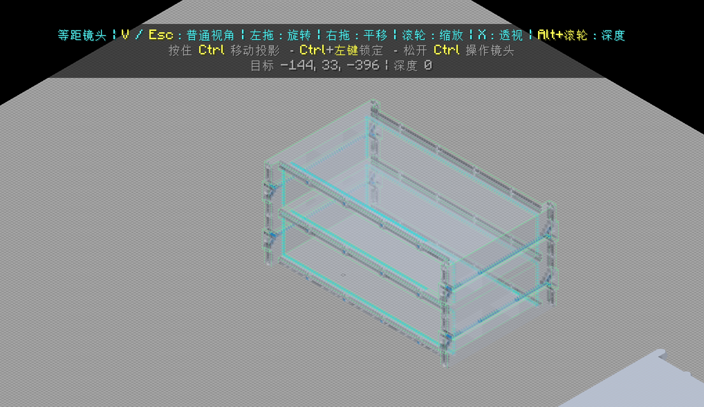</a> 
  施工前检查布局与落点；当前版本预览无需按 Ctrl，锁定与确认才需要。 <em>Inspect the layout and target. Current previews need no Ctrl; locking and confirmation do.</em>

材料预检列出施工范围、精确 NBT 条目、需求、已有、缺失、EU 与本次选项。选择背包或 ME 材料并完成所需量子网络绑定。受支持的装饰形状可优先用成品，缺少时按实际体积合计使用原材料；木匠坡面可用原生坡面壳，饰面、染料和其他组件分别计费。同一方案不重复确认，报价或条件变化后重新核对。

*Review scope, exact NBT items, quantities, shortages, energy and options. Supply inventory or ME materials and resolve network bindings. Supported decoration can use finished parts or raw material by volume; Carpenter slope shells, skins, dyes and components are charged separately. Changed quotes or conditions require another review.*

  <a href="README/screenshots/20261025/material-review.png">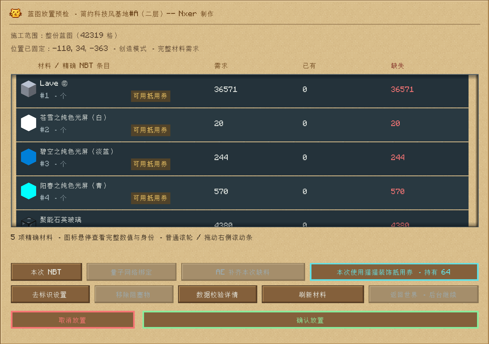</a> 
  材料需求与装饰抵用范围；图中为创造模式。 <em>Material requirements and voucher eligibility, shown in creative mode.</em>

**缺料补单：**可主动提交独立的真实 AE 合成订单，关闭窗口后继续，重新打开查看进度。产物进入 ME 后**刷新材料，再确认施工**。施工仍检查现场、权限、区块、材料与能量，部分完成与全部成功分别报告。

*Submit an independent AE crafting order for missing materials. It continues with the window closed; after delivery to ME, refresh materials and confirm construction. Site, permission, chunk, material and energy checks still apply; partial and complete outcomes are reported separately.*

**猫猫装饰抵用券：**无序合成 **2 个原生 StructureLib 全息投影仪 → 1 张券**。在材料审核中主动选用，一张主背包内的券抵扣本次允许的装饰材料，成功放置抵扣材料后消耗。GT、AE、工业设备、容器内物品、流体与能量继续实付。创造模式可查看范围且不消耗券。

*Craft one Decoration Voucher from two native StructureLib projectors. Select it for one job; a voucher in the main inventory is consumed after covered material is placed. Industrial equipment, stored items, fluids and energy retain their costs. Creative mode can inspect coverage without consuming a voucher.*

管理员可用 **`/gtmb voucher`** 搜索 Mod、方块与矿词，编辑允许／禁止规则并保存至服务器即时生效；黑名单优先。规则保存于 `config/gtmb-decoration-voucher.cfg`，已打开的材料方案会重新核算。

*Administrators can edit live rules with /gtmb voucher, searching mods, blocks and ore names. Blacklists take priority; saving updates the configuration and recalculates open quotes.*

## 连续剪切，排队搬家 / Queue cuts & move builds

剪切按原生快照保留方块、机器数据与库存，逐份放入**当前存档、当前玩家**的持久队列，与蓝图处理和分享独立。手持投影仪用 **Shift+右键**打开／切换模式，松开 Shift 进入；非框选时 **Ctrl+Shift+右键**可直达剪切列表。

*Cut preserves blocks, machine data and inventory through native snapshots in a persistent queue for the current player and save. Hold Shift and right-click to cycle modes, then release Shift to enter. Outside selection, Ctrl+Shift+right-click opens stored cuts.*

  <a href="README/screenshots/20261025/cut-workspace.png">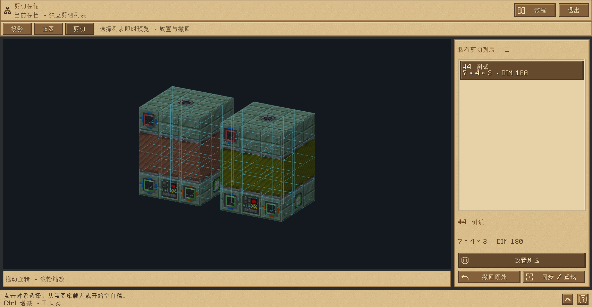</a> 
  逐项预览，放置所选或撤回原处。 <em>Preview each entry, place it or restore it to its source.</em>

框选并提交后命名暂存，可继续剪切下一份。列表中选条目即时预览，点「放置所选」进入世界；**Alt+A / D** 切换条目。普通视角右键锁定、再右键确认；等距视角用 **Ctrl+左键**锁定和确认。非框选时 **Alt+右键**可撤回。只有成功粘贴或撤回才消费条目，**Esc 退出剪切并保留全部暂存**。

*Store a cut and continue selecting. Choose an entry to preview and place it; Alt+A/D switches entries. Right-click locks and confirms in ordinary view; use Ctrl+left-click in isometric view. Alt+right-click outside selection restores a cut. Only successful placement or restoration consumes an entry; Esc exits while keeping the queue.*

## 保存成对文件，与别人分享 / Save pairs & share

到 [**蓝图站**](https://miaokatze.com/blueprints) 浏览、下载与分享设计，也可在游戏内蓝图库切换客户端／服务器上传下载。直接转交时，将**同名 JSON + PNG** 一起放入客户端游戏目录的 **`MiaoBlueprints/`**，保留作者与来源信息。

*Browse, download and share on the blueprint site, or transfer designs through the in-game client/server library. For manual transfer, copy the matching JSON + PNG pair into the recipient's game-directory MiaoBlueprints/ folder and retain author/source information.*

JSON 与 PNG 使用同一文件名主体，包含蓝图名与完整内容哈希；保存生成与 JSON 绑定的 PNG。配对校验或写入失败会保留原文件。「升级旧蓝图」可兼容压缩并整理旧配对，失败条目保留原件；读取不会静默升级，上传旧图到站点前请重新保存。

*JSON and PNG share a basename containing the blueprint name and full content hash. Saves bind the PNG to its JSON; validation or write failures preserve existing files. Upgrade Old Blueprints updates compatible storage and pairing while keeping failed entries intact. Reading alone does not upgrade a file; resave older designs before site upload.*

蓝图采用无损字典压缩，复用重复方块与 NBT 描述，保留材料、配置和来源信息。服务器蓝图库可按权限共享设计；剪切暂存始终留在原玩家、原存档中。

*Lossless dictionary compression reuses repeated block and NBT descriptions while retaining materials, configuration and provenance. The server library shares designs under its permissions; stored cuts remain with their original player and save.*

## 更多说明 / Further reading

- [完整使用指南 / Player guide](https://miaokatze.com/wiki?mod=gtmb)
- [文字转蓝图 / Text guide](README/text-blueprints.md) · [图片与像素画 / Picture guide](README/picture-blueprints.md)
- [客户端原生预览内存预算 / Native preview memory budget](README/preview-memory.md)
- [社区扩展接口 / Public API](API.md) · [默认关闭的开发测试区 / Optional developer test lab](TESTLAB.md)
- 管理员可用 **`/gtmb restart`** 重置运行任务、会话与传输；已放置方块、回收暂存和剪切记录保留。 / Administrators can reset runtime tasks, sessions and transfers with /gtmb restart; placed blocks, recovery storage and persistent cuts remain.

快捷键可在控制设置与编辑器 **F1** 中查看；截图中的个人绑定可能不同。配图由用户提供，点击可看原图；[素材来源与完整性清单](README/screenshots/20261025/manifest.json)。

*Check Controls and editor F1 for bindings; screenshots may use personal bindings. Images were supplied by the user and link to their original resolution. Credits and integrity details are in the manifest.*

## 许可与来源 / License & origins

[AGPL-3.0](LICENSE) · 源自 / Origin: **GT-Interesting-Thing** · 独立维护 / Independently maintained as **GTMB** · [开发记录 / Development notes](https://github.com/MIAOKATZE/GT-Miao-Blueprint-plan)
